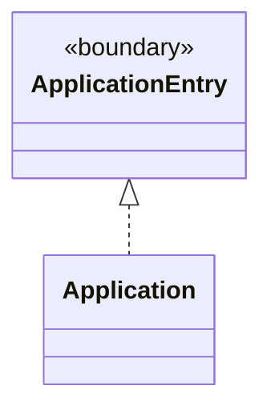

# 应用生命周期

## 设计意图

负责应用生命周期。

## 主要组成

| ?? | ?? |
| --- | --- |
| [Application](index.ts) | Application 持有资源仓库和运行时实例。 |

Application 装配并持有 DataArchitecture，使用同一个 ProjectList 验证项目身份；服务负责本机结构目录保存，不参与 Office 的数据库执行或工作流生命周期。

<!-- architecture:generated:start -->

## 架构关系

外部继承／实现边界：[ApplicationEntry](index.ts)。

[上层设计](../ARCHITECTURE.md)

<!-- architecture:generated:end -->

### Office 指令排队

Application 持有 OfficeQueue 并在关闭项目资源前取消和等待队列运行。队列生命周期独立于窗口与 Office 页面。

### 项目与对话导航

Application 持有 ProjectNavigation，将项目目录和 OfficeQueue 注入。导航元数据与执行队列分工明确，运行状态从队列读取，不由页面猜测。
