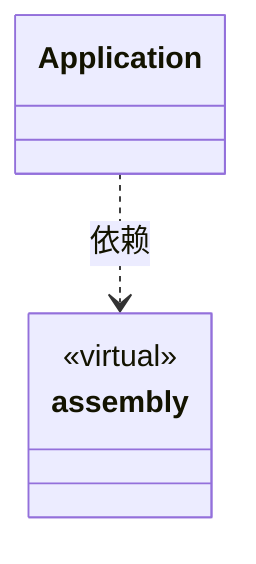

# src/logic/application 架构

## 设计意图

唯一应用生命周期：装配业务服务，按工作区实例打开、撤票、取消、排空与关闭；不导入 IPC 或 Electron。

## 主要组成

| 组成 | 定位 |
| --- | --- |
| [Application](application.ts) | 组织应用服务的生命周期与工作区装配；初始化内置 Schema，无需注入规范目录。 |

<!-- architecture:generated:start -->

## 架构关系

标注为 `virtual` 的节点是直接子模块的虚拟类封装；内部设计沿下方入口阅读。

## 子模块

| 虚拟封装 | 整体职责 |
| --- | --- |
| [assembly](assembly/ARCHITECTURE.md) | 把工作区、Agent、执行引擎和业务服务接成可运行的应用。装配函数认识具体实现并注入端口，运行观察器收集事实；应用状态与生命周期仍归上层 Application。 |

[上层设计](../ARCHITECTURE.md)

<!-- architecture:generated:end -->
