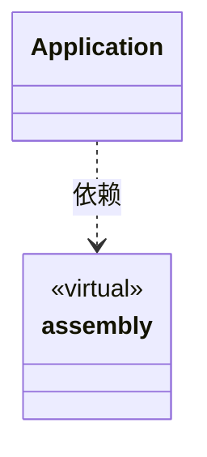

# src/logic/application 架构

## 设计意图

拥有应用级服务与工作区实例的唯一业务生命周期，统一处理初始化、打开、退役和排空。

`Application` 保存应用服务及各工作区服务集合，通过 `assembly` 连接领域协作。替换或停止工作区先阻止新活动并撤销准入，再关闭自动化、主/成员执行及文件服务，随后关闭派发、观察、历史和工作区资源；失败不能被解释为已经安全释放。Electron 与 IPC 通过外部端口接入。

## 主要组成

| 组成 | 定位 |
| --- | --- |
| [Application](application.ts) | 组织应用服务的生命周期与工作区装配；初始化内置 Schema，无需注入规范目录。 |

## 现状与目标边界

[application.ts](application.ts) 直接承担服务持有、工作区实例替换和关闭，`assembly` 子模块承接具体协作装配，当前尚非纯容器。目标是将生命周期实现与装配分别封装，父层只描述它们的组合。现有 Application 是真实权威所有者，后续路径调整不能建立第二个生命周期对象，也不能把先退役、后排空再释放的次序拆散。

<!-- architecture:generated:start -->

## 架构关系

标注为 `virtual` 的节点是直接子模块的虚拟类封装；内部设计沿下方入口阅读。

## 子模块

| 虚拟封装 | 整体职责 |
| --- | --- |
| [assembly](assembly/ARCHITECTURE.md) | 把独立业务服务与执行端口接成可运行的工作区，集中承担跨领域的具体装配责任。 |

[上层设计](../ARCHITECTURE.md)

<!-- architecture:generated:end -->
