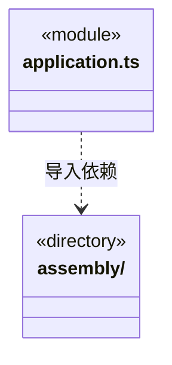
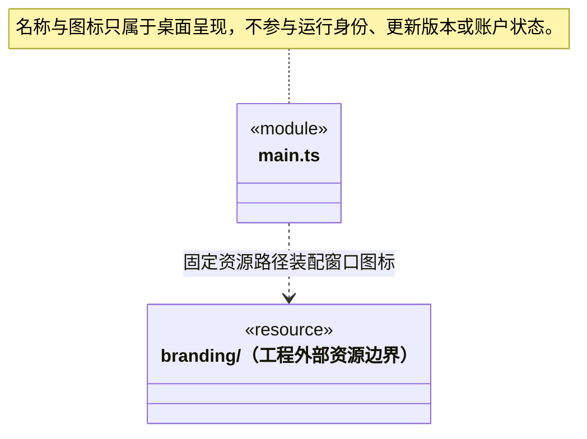
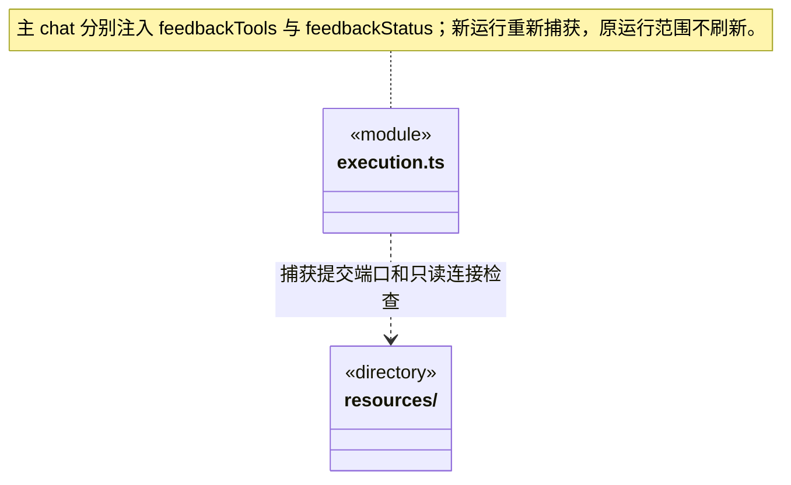

# src/logic/application 架构

## 目录定位

唯一应用生命周期：装配业务服务，按工作区实例打开、撤票、取消、排空与关闭；不导入 IPC 或 Electron。

本文描述当前实现。通过分析目录边界后维护的 [源码架构脚本](../../../scripts/source-architecture.mjs) 同步清单和声明；代码变更时仍须核对职责、关键成员与关系。

## 代码清单

| 文件 | 当前职责 |
| --- | --- |
| [application.ts](application.ts) | 单次运行授权、版本化队列增量和结构化问题按工作区路由；排队时冻结附件内容与模型身份。Application：登记及重命名工作区、装配模型供应商与服务，并统一派发主 Agent 对话、附件快照、工具审批和历史操作。 |

## 架构类图

各图中的同名节点表示同一目录边界；跨组及完整直接依赖如下（无边不代表继承）：

- `application.ts` → `assembly`：导入。

## 子目录导航

- [assembly/](assembly/ARCHITECTURE.md)：业务运行装配：注入准入、存储、工具端口和引擎解析；不处理 IPC 或持有第二套应用状态。

[返回上层](../ARCHITECTURE.md)。

每次修改本目录代码，同步维护文件头、关键契约说明及本图。未实现的治理、证据验收和自动编排能力不列入当前类图。

## 设计契约 v1 与落地范围

以下内容区分已接通能力与后续设计；以各节的实现状态为准，不将目标图当作现状图。维护源：[CONTRACT.md](CONTRACT.md)；生成类图时同步附加，勿直接修改本附录。

# 业务应用生命周期与宿主协作

Application 只持有业务服务与原生命周期。IPC 分发移至 bridge/server/application.ts，其适配器继承业务实例、只增加 dispatch，不覆盖状态方法；Electron、窗口、原生传输和关闭事件归 Bridge。以下协作约束同时说明业务与宿主的分工。

### 网页服务装配

Application 持有一份 WebSettings/WebService，启动恢复加密搜索配置；createExecutionManager 仅对桌面主会话绑定公开网页端口。缓存与每域限速为应用级，搜索每次读取当前配置；密钥不传入调度引擎。配置操作与网络执行分开。

网页方案位于独立 `core/platform/node/web`，不依赖本业务模块。WebService 组合其公开入口；Main 在 Electron ready 后通过平台参数注入 ElectronBrowserReader。Node/CLI 不加载 Electron；后台网页窗口使用独立匿名会话，运行取消负责释放，不共享主界面登录态。详见 [基础网页契约](../../core/platform/node/web/CONTRACT.md)。

关闭主窗口主动走现有 before-quit 取消与排空，不等待隐藏网页窗口自然完成才触发 window-all-closed；排空失败保留主窗口供用户重试。基础浏览器适配不自行决定应用退出。

# 主进程运行装配契约

## 资源入口与窗口优先启动

固定 bootstrap 验证签名 R 后调用 startDesktop(runtime)。Main 只持有应用/窗口生命周期，调用私有宿主端口取得更新服务与受管引擎；自身不改活动版本指针。R 的 preload、worker、renderer 都相对同一资源目录解析，koffi 和 EXE 品牌仍来自 C。

桌面使用 Application.init({restore:false}) 初始化目录/配置，窗口加载后再 background restore；CLI/其它消费者默认 init 仍等待恢复。停止标记阻止恢复继续打开下一工作区。启动确认需要页面加载成功与 React 的 list IPC 成功，不用单纯进程存活作为更新成功证据。

Paths 的 protectedRoots 包括整个安装/用户身份的程序缓存；主/成员受控读写、删除/移动及资源仓库配置都继承该边界。引擎下载与账号历史分开，createExecutionManager/createMemberServices 只注入固定 EngineRuntimeResolver。

## 后台预下载与用户确认安装

Main 为 `DesktopUpdates` 注入唯一的业务关闭回调，停止终端、等待 `Application.shutdown` 后才标记安装退出。后台检查自动预下载，固定 `desktop.updates.download` 只手动重试下载/校验，不接受地址或命令；`desktop.updates.install` 在包已就绪后明确确认重启或重试安装。预下载不调用业务关闭回调；installing 期间才拒绝普通业务 IPC 与拖入附件，状态查询仍可用来展示进度。

普通 before-quit 先 close 更新服务再排空，避免用户主动退出时迟到的下载或安装让出继续触发安装。安装器触发的退出已由成功排空设置 quitting，走原正常退出路径。安装失败没有升级成功保证，必须在新进程核实版本；不更改应用身份、用户目录或 NSIS 校验规则。

## 产品标识与原生窗口

`main.ts` 只装配窗口品牌资源：开发态从工程 `branding/cbim.png` 读取，打包态从固定 `resources/branding/cbim.png` 读取。Forge 的应用图标及独立安装器均使用同一矢量源生成的 ICO；运行时不生成或下载品牌资源。窗口标题为 CBIM，原应用 ID、可执行文件名称、卸载器探测与用户数据目录保持兼容。

## 反馈连接诊断与提交端口

`createExecutionManager` 只在桌面 chat 主运行注入反馈服务：`feedbackTools` 捕获固定连接，`feedbackStatus` 独立调用 `GitHubFeedbackAuth.checkConnection` 并检查工作区仍有效。未连接时只读诊断仍可用，运行中连接变化不替换原提交范围。认证状态及保存归 Logic feedback/service，Main 负责装配和关闭，工具命名／提示归调度层，更新程序不参与。

## 长期岗位登记的独立装配

`createMemberServices` 为 `WorkspaceMembers` 注入与派发共用的 FileDispatchStore、工作区代际及 `EngineModelProfiles.configuration` 公开配置端口。Application 按工作区保存该服务，关闭/重开先退役代际，原 store 排空后更换实例；岗位没有独立运行或重放生命周期。

岗位登记保存长期身份、名称/职责、项目适应、能力采纳及公开模型配置，不直接创建运行。新业务执行从真实模块责任解析该岗位，核来源、能力和配置后冻结到计划、任务与运行；active 单独不代表可执行。原回执查重早于新请求的实例和来源校验，重开仍可核实旧命令，不自动重新提交。

## 安全等待补充的附件准备

`createExecutionManager` 将 `ChatInputs.prepareContinuation` 注入主运行管理器。仅新的附件补充在创建工厂前准备一次正文、图片与清单；模型工厂使用 `ExecutionLaunchContext.preparedInputImages`，包括明确的空数组，不再读取附件 ID。图片不写入 `WorkspaceLoopOptions`，后续成员结果回注不会再次附加图片，原生历史仍保留先前真实用户图消息。

`Application.chatMaterials` 统一管理显式目录、链接、网页与已授权仓库资料导入，绑定原工作区实例及唯一 importId；停止工作区、重开和应用关闭先取消在途来源读取。仓库资料经当前授权闭包真实 HTTP 读取并复核；不执行资源，不为旧 connector 定义补造来源。续跑只读已经保存的 v1 文件或 v2 多来源快照，导入后的撤权不改写历史资料，也不触发重新联网。

同一真实模型配置在受理前核实视觉能力，明确不支持时返回 `GOAL_ATTACHMENT_VISION`，等待与原输入不消费。实际 Pi 初始化、网络或通信失败可能发生在受理后，不能据此宣称未执行；应保留原 commandId 并查询持久回执，不换 ID 自动重发。

## 模块知识保护与桌面治理

每个 `Workspace` 装配独立 `ModuleGovernanceService` 和用户数据账本；`Application.governance(id)` 只返回已就绪实例。桌面登记和人工决定由 IPC 注入本机明确操作标记，模型工具、普通知识参数和资源内容不能签发批准。正式实施另走显式 apply，仍由原 KnowledgeStore 串行事务写入；服务关闭随知识队列排空，不恢复未完成意图。

`createExecutionManager` 仅为已登记主对话实例提供 `ExecutionServices.governanceTools` 工厂；实际 createEngine 得到 runId 后才绑定四个窄端口。端口不缓存到共享 KnowledgeTools，执行成员及未装配 CLI 没有治理工具。主模型只读依据、保存观察/提案和查询原回执；作用域为当前 knowledge，但不授予知识写或业务执行权限。来源和稳定命令来自可信主绑定与工具调用 ID，输出有界，停止后的未知结果仍只查询原命令。

## 本机资源仓库连接生命周期

`Application.repositoryConnections` 是应用唯一的桌面连接服务，使用 `ResourceRepositories` 当前真实共享闭包和工作区知识事务端口；用户目录保存授权与命令回执，知识目录只保存可移植的链接器定义。初始化读取授权但不自动共享或联网，工作区关闭/重开先取消该工作区在途核验；应用退出先拒绝新连接操作、排空读写，再关闭共享服务。原回执查询不创建运行、调用模型或恢复旧工作区实例。

`createExecutionManager` 仅为 chat 主运行调用 `prepareTools`，把本轮固定的已授权只读端口注入 `ExecutionServices.repositoryTools`。能力捕获不访问 HTTP；实际模型调用才读取，执行成员、未装配的 CLI 和没有就绪连接的主轮不注册两项仓库工具。端口不从 ChatOptions 或模型参数取得授权，不改变原周期模式与本轮权限决定的业务工具能力。

## 正式成员的 Workflow 能力装配

`member-dispatch.prepare` 从与 Pi 实际注册相同的 `core/tools/native-tools` 清单，按本轮 permission 返回 availableTools；密钥和实际模型留在可信工厂。执行服务在 claim/run 之前预检冻结的模块约定。创建 Runtime 时注入全部 `preparedWorkflowContracts(run.prepared)`，普通主聊天不接正式成员 Workflow 门禁；Auto 的原生业务能力由周期模式与权限独立决定，不因注入成员契约而获得。

同一工厂通过 `availableValidators:['json-schema-v1','csv-table-v1','png-raster-v1']` 声明实际平台验证能力，不在无约定时冒称已注册验证工具。成员 Runtime 分别注入 `ArtifactFiles.validateFile/validateTable/validateImage`，路径与 Schema 来自冻结要求；目标审阅另注入 `normalizeValidationPath/checkValidationFiles`，成员结算复用已有 artifacts 端口。所有者代际与停止覆盖读取，判断使用当前字节，不通过报告服务重入派发事务或创建新运行。

## 本机显式人工决定

`member-dispatch` 为 `WorkspaceDispatchService.humanDecisions` 复用工作区固定的 canonical 日志、`ArtifactFiles` 与业务只读占用。没有选择基线时不读业务文件；明确选择的全部候选共用一次文件计量上限，不取得模型运行槽位。工作区退役、关闭或读取期间变化拒绝新的记录，回执查询不重新核实或启动执行。

人工决定只在可信桌面 IPC 路由注入本机 explicit_submit 标记，不从渲染参数或模型工具接受 actor/proof/文件哈希；该标记不代表已登录身份。单独保存 waiting 周期的记录，不调用执行管理器，也不消费等待、继续队列或更改权限。

## 文件基线采集与只读复核

`member-dispatch` 为每个成员运行注入 `ArtifactFiles`、固定知识版本及 `recheckDispatchExecutionContext` 实时复核闭包。普通主会话没有采集端口。平台路径仅从可信同轮工具来源解析，不接受前端或模型提交哈希；文件读取不返回正文。

历史报告复用同一平台限额，由 `MemberExecutionManager` 按明确运行交独立报告服务。只有显式指定 baselineId 才临时取得 `WorkspaceExecutionLease` 读占用，未指定仅列日志引用；报告不获取模型名额、不唤醒调度、不修复日志，也不将知识事务与文件系统观察宣称为跨存储原子快照。

## 应用级执行准入

成员检查点的私有 native 读取由 `NativeSessionFiles` 固定在本工作区 dispatch/runs/pi/sessions 内。结算在真实 close 之后记录指纹；续执行使用原 run 的固定配置，并通过 `assertMemberResume` 在领取后 Runtime/Pi 准备窗口再次复核全部冻结证明。该闭包不接客户端路径或模型声明，也不刷新原 proof 来掩盖知识、业务文件或 native 变化。关闭及启动恢复沿原安全规则封存 active 周期，不自动重放预约。

`Application` 持有唯一 `GlobalRunAdmission`，与只读 `GlobalRuntimeManager` 分开。`AdmissionSettings` 在恢复工作区之前安装已保存策略；默认额度 4，策略调整不停止已有运行。每次工作区装配产生本进程正整数 `ownerEpoch`，关闭、重开或初始化失败先退役旧代际并撤销等待票，实际运行名额仍由原释放函数归还。

`execution-admission.ts` 将全局资格与 `WorkspaceExecutionLease` 同步组合。请求键由主/成员来源加稳定命令 SHA-256 摘要组成，满足身份长度与字符约束；撤票只传 `AdmissionIdentity`，不夹带请求权限和来源字段。所有桌面主轮与成员轮使用同一服务，测试或独立装配未传服务时仍沿用已有工作区租约。

主普通聊天在 `LoopRuntime.acquireLease` 成功之后才调用 `beforeRun` 打开目标周期，额度不足不会创建 scope、运行日志或模型请求。主轮按实际权限领取租约：read 可共享，ask/execute 保守独占，防止 beforeRun 恢复 Auto 后超出已取得的占用。Team 与 Auto 均按本轮权限提供业务工具；知识写仍经过知识服务事务和用户权限。成员在派发存储事务内、领取信封和记录 run 之前取得全局及本地资格；准备、原生锁或持久化失败释放已取得资源。成员的未知终态仍保留原有占用规则，不能为了展示空闲而假释放。

成员准备知识、解析模型和最终重查基线后都重新核对批次及工作区代际。装配 `isCurrent` 在工作区退役时立即失效，手动成员启动同样受约束；不依赖稍后才执行的 manager.close。若停止发生在已经开始的持久提交期间，保留真实启动意图并结算取消，但不创建模型。代际同时发出 AbortSignal，成员启动信号贯穿尚未登记 active 的原生准备阶段；异常启动继续按 interrupted 留证，不伪装为未执行。

`CAPACITY_BUSY` 只表示直接请求在受理前被全局额度或公平顺序拒绝，不留下自动重试票。显式补充、只读核实和业务重规划在此门禁之后才保存受理意图；已保存命令仍优先查原回执。已受理协作的成员和结果回注使用 `CAPACITY_WAITING`，票据只含身份和权限，不含用户正文或凭据。回调由原 `AutoCollaboration` 批次持有，不由 IPC 或模型传入；释放只通知原协调器重新核实，不能直接重放运行。

本地租约释放通知全局资格变化；单纯读取监管或准入快照不触发执行。退出先撤票，再停止与排空主/成员运行及历史服务。等待票不持久化，重启继续沿用安全等待占位和历史中断处理，不依据旧票恢复模型。

## 原生附件选择上限

`chat.pick` 使用系统文件选择器，只导入用户明确选择的路径。超过12项时在读取和保存任何附件快照前明确拒绝，不能截取前12项后冒充完整选择；取消选择返回空列表。该限制同时适用于普通聊天和安全等待补充，后者另在受理前核实本工作区快照、总量和视觉能力。

安全等待选择器额外携带 importId，进入共享取消表。取消后即使系统对话框稍后返回，也不读取路径或保存资料；不能强制关闭系统对话框不等于导入仍有效。旧普通聊天不带 importId 的调用保持原行为。

## 目标周期消耗读取

`dispatch.scopeUsage` 接受明确 workspaceId/rootSessionId/scopeId，将请求交给 `WorkspaceDispatchService.usage`。服务复用工作区装配已有的主/成员 canonical 日志端口，文件路径由后端可信身份解析，不接受客户端路径或用量正文。返回白名单统计、来源身份和安全诊断，不暴露日志正文、原生路径或密钥。读取不会创建运行、领取名额、批准任务或更新知识；本步没有预算配置或计费扣款。
`Application.budgetSettings` 在恢复工作区前初始化，`budget.settings` / `budget.configure` 只读写未来周期的默认软限额。工作区给派发服务注入可靠设置读取闭包；新周期在创建事务中复制策略，当前和 waiting 周期保持原值。成员与主调度共享同一 ScopeBudgetService 和可信日志端口，不能从 IPC 参数、统计界面缓存或重建监管索引签发额度许可。

## 模块岗位负责人装配

`createMemberServices` 在同一 DispatchStore 上构造岗位及 `ModuleOwnerships`，Application 按工作区生命周期注册和移除服务。六个桌面入口与主工具复用同一责任事务，不创建第二份责任文件，不改知识或实际派发。主运行工厂在 Runtime.beforeRun 已登记周期后，经 AutoCollaboration 的实际主工具上下文取得 scope/run 与停止屏障，再构造四工具端口；成员、CLI 和缺少真实绑定的运行不注册这些工具。

桌面提交来源由 IPC 注入 local_desktop/explicit_submit；主提交来源由当前主实例、会话、周期和 toolCallId 生成。原命令优先只读恢复，未知结果不能自动换命令重做。已配置自定义岗位时，active 状态及责任关系仍需实际能力、来源和模型核验。未指定自定义岗位的新业务由主 Agent 在当前会话执行，不回退已退役的默认执行者。

## 岗位模型与正式领取

`createMemberServices` 注入同一个 `OwnerExecutionService`，按 Knowledge 串行快照→模型设置短锁→DispatchStore 事务核验计划、派发、领取、检查点预约及依赖闭包。多岗位规划一次取得公开模型快照，不解密；领取在原预算和租约通过后才同步解密已经捕获的岗位配置。全部短锁释放后才构造实际 Pi 引擎，不把密钥放入 binding、Prepared、日志或工具回包。

主会话选型仅供主模型。成员工厂使用冻结岗位 profile/model/hash；领取后配置修改不替换本段，后续恢复重新核原绑定。原生头的 TaskSpec 与 Prepared.memberContext 均保留同一绑定、岗位名/职责及适应内容；适应引用只是资料定位，不自动读取或授予权限。旧直接业务 loop 入口拒绝新启动，历史读取和已领取运行结算保留。

## 来源恢复与共享 Store 生命周期

Application 在 Workspace.open 前只构造一个带监控观察器的 DispatchStore；实际加载在工程锁及路径身份核实之后。知识来源、岗位、责任与派发服务复用它，不创建恢复专用第二 Store。停止/退出先停止运行，再由 Workspace.prepareClose 排空知识与来源结算，随后关闭派发持久服务，最后释放工程锁。来源恢复、明确采纳均不新建运行或调用模型。

可信 `beforeDispatchLoad` 阶段在路径归属及工程锁核实后初始化 Agent 历史索引，然后才读取 Store。`WorkspaceRuntimeMonitor.initializeHistory` 复用历史服务的幂等初始化，保证首次 loaded 与知识恢复期间 committed 均在索引装载之后各投递一次；不清空运行投影、不缓冲无界事务，也不放宽坏索引或重复持久记录检测。阶段失败沿工作区打开失败路径释放锁并阻止服务就绪。

## 检查点交接历史端口

成员服务装配为检查点放弃单独提供原运行 canonical 读取与路径规范化；不传当前文件、native 或模型配置读取端口，不创建或恢复执行。读取仍核工作区路径和原成员绑定，冻结证明由 Scheduler 历史核验及 Store CAS 共同裁决。原命令查询只读唯一 Store，不新增 IPC、模型查询工具或另一套任务登记；任何新执行继续使用原岗位/知识/模型短锁与准入协议。
### 原命令报告装配

原主命令核实仅复用已打开、初始化完成工作区的唯一 DispatchStore 与指定主 canonical 读取端口，不为查询 open/init/recover，不创建模型、执行器或业务名额。桌面与真实主工具共用同一 CommandVerificationService；当前模型配置、岗位或知识变化不代替原提交证明。停止/关闭使未完成查询不可交付，但不会改写原事务；原回执通过白名单投影后才跨 IPC。

影响观察装配唯一 Store、原主/成员 canonical、安全文件只读端口和短只读占用；不加载模型、不发 HTTP、不触碰 native。明确处置只来自桌面提交，后续核实/修复启动沿既有 Manager 意图和权限门禁；原命令重查优先于重新读取文件。Main 不把今天的文件哈希、控制面提交或用户处置当作原工具成功与业务验收。

## 受控单文件写入与显式补偿

受控文件能力仅由 Electron 桌面装配，独立 utilityProcess 在同一线程持有 Win32 独占句柄。普通 Node 宿主没有该能力。只允许现有 UTF-8 普通单文件；原 native write/edit 不因此获得自动撤销能力。

Runtime 在自己的 beforeTool 可靠保存 allowed 后签发一次性授权，短门闩排除其它工具/审批；模型与 emit 事件不能签发许可。Main 在 Store 外取得文件句柄和可靠 before/intended-after 私有备份，单条 prepared→executing→terminal 附录由唯一 Store 保存。只有可靠 applied 返回成功；进入 executing 后的 IO/截断/进程退出均可能部分写入，不自动回滚或重发。

停止先中断原进程，排空实际文件操作并确认 child 退出后才释放工作区占用。退出码不证明写成功。补偿是桌面明确提交的新命令，仅原 applied、原周期已关闭、当前同一文件仍等于原 after 才可恢复保存的 before。原日志、unknown 和原操作不改写；原命令查询先于今日配置，任何保存未知只查原记录。

member-dispatch 的影响端口另装配原知识事务只读适配，借已打开工作区的唯一知识队列，不向调度层暴露正文、恢复或提交方法。

## 原治理与责任保存核实（Step39）

成员服务装配为影响观察提供原治理/责任保存的只读端口，与原知识 journal 和安全文件观察各自独立。端口共用工作区已有存储与队列，停止检查仍作用整个观察；不解密模型、不创建另一个账本，不执行原调用。

## 受控文件统一影响观察（Step40）

影响观察的 `observeControlled` 复用同一已装配 ControlledFiles.report，读取前后核停止；原报告沿唯一 Store/canonical 验证，不产生 utility、租约、业务文件 IO 或补偿命令。原来源读取和实际写/补偿入口仍分离。

## 持久成员等待的只读装配

member-dispatch 将同一 canonical、ArtifactFiles 和 NativeFiles 只读指纹端口装配给 MemberPauseService，显式继续时取得工作区读占用；关闭/停止代次经 assertCurrent 检查。历史停泊只读原日志，当前核验不创建引擎或解密模型运行凭据，等待重启本身不调用这些端口。沿已有 goalContinue/goalContinuation IPC 受理与查询，不新增桌面自动恢复路径或独立存储。

成员工厂从已提交任务计算 `memberCheckpointLimit - checkpoints.length`，只经内部 ExecutionServices 注入 Runtime；公开模型或 IPC 不可设置。恢复验证闭包持有同一 Store 快照的全部原运行，避免在 Store 事务内反向读取。

## 逐请求预算（R06）

Application 每工作区装配一个请求预算服务，主工厂固定已解析模型，成员工厂固定原岗位模型；前者在等待受理前预检，后者领取前预检。引擎关闭和请求结算先于共享 Store 与工作区锁释放，重开不重发任何未决请求。

## R07-A 完整产物清单运行与复核

成员工厂复用固定工作区的 OutputManifestFiles，为真实运行注入知识复核及完整采集，为只读报告注入整范围复核和短读租约。报告不进入执行工厂、不调用模型、不改写任务或日志；主运行不装配完整采集。

## R07-B1 完整集合共同验收

固定工作区的同一OutputManifestFiles.check注入成员结算、目标服务及人工服务。人工选择/继续沿既有read租约和当前工作区校验，不调用模型、不改日志，也不复用旧native执行；真实执行仍由独立显式继续入口负责。

主轮业务占用与工具权限一致：Team 与 Auto 的 read 使用只读占用，ask／execute 使用独占，审批等待也不能与其他运行并发。人工接续 accept 与主运行目标审阅的文件核证通过 acquireMainRead 按已验证的 rootSessionId 派生读占用；原占用不存在时退回普通读申请。桌面预览、决定与接续预检仍走独立 acquireRead，不能复用正在运行的写占用。恢复及成员回注优先读取原周期冻结模式，历史缺省 Team，不用缺失的运行参数覆盖已保存的 Auto 策略；知识写仍由独立事务和权限保护。

## R07-B2 原删除与移动证明

成员实际工厂仅在 controlledTransport 支持 withExclusiveTransition 时装配删除/移动端口，沿原成员租约及工作区身份。普通 Node 缺省宿主不能执行，声明缺实际能力时启动失败。原阶段只追加到该成员 canonical；重开和只读报告不启动工人或重发操作。

CSV 能力由同一成员工厂的真实平台实现公开；知识声明、岗位准备与领取继续核对可用验证器，CSV 不复用 JSON 参数或绕过原工作区有效性与停止检查。

成员工厂公开png-raster-v1并注入ArtifactFiles.validateImage，准备/领取按真实可用验证器核要求。图片与JSON/CSV共用当前知识、工作区代际、停止和原文件证明；目标及人工出口不另开绕过复核的路径。

## 冻结范围成员执行

成员工厂只对已冻结executionScope装配ScopedExecutionFiles、受限ArtifactFiles/OutputManifestFiles；原文件受控写和删除移动逐次再次核范围。能力预检独立scopedTools；主会话不获得范围业务执行工具。历史桌面核实仍是独立可信只读流程，不借模型扩大范围。

## 原隔离执行核实与清理

Application按当前工作区装配唯一IsolatedExecutions，共享DispatchStore、inspectMember和WorkspaceExecutionLease。关闭先排空成员、再等待隔离清理账本、最后释放工作区锁；未知物理退出保持占用并允许再次原关闭。

### 多引擎装配

Application 发送时固定公开 engine，执行工厂核对它与所选供应商一致；配置被改到另一引擎时拒绝旧排队请求。成员使用自己采纳的模型及引擎，主选型不覆盖。member-dispatch 按真实引擎提供能力预检，并按受管目录把原生指纹读取交给对应格式适配。

业务重规划 accept 的原影响核证也按已核主身份调用 EffectObservationService.observeFromMain，派生本运行读占用，避免把自身占用冲突误记为文件不可观察而改变 basis。预览、preflight、公开 observe 和人工处置仍使用独立读占用；不改变原失败回执、证据指纹和权限。

## 角色历史的独立装配

`agent-history.ts:createAgentHistory` 接收最小工作区身份、project 路径定位和 assert，组合 AgentHistoryService、FileAgentHistoryStore 与 FileRunStorage。文件索引适配不再引用 Workspace 或实例化调度服务。构造不读盘；Application 继续在工作区持锁、Store 恢复后初始化历史，在释放工作区前关闭并排空历史写入。

canonical 读取仅按可信索引 source/task/run 定位；safeId、逐层符号链接拒绝、realpath 包含关系和工作区/root/task/run 身份校验保持原实现。既有事务、日志格式、锁和队列不拆分，索引不是正文或执行事实的替代来源。

## 全量 IPC 契约衔接

应用内部 dispatch 对已知操作推导响应，对原始动态字符串只返回 unknown；所有原始请求交给 IPC 契约解析。Electron 入口在 Schema 前核实主 Frame 与安装期间门禁，原生操作成功值按操作配对，未知输入不触发系统副作用。
## 主岗位控制面

execution 装配工作区已有 WorkspaceMembers 与真实 MainToolContext；新增主工具只复用本机岗位服务和同一 Store，不管理第二份登记。静态 Agent 的模型引用由用户预先配置，主工具无凭据端口、无批准或安装能力。

### 主 Agent 模型角色

聊天未显式选择模型时，从同一主 Agent revision 捕获 engine、primary 和 modelRoles；显式请求完整校验选型，不从新配置偷偷补其他角色。执行准备将角色交给 EngineModelProfiles，公开运行选项保留引用而不保存凭据。

Application 接收可选冷宿主 engineArtifacts 并持有唯一 EnginePackages；正式主/成员执行共用此解析器，源码运行继续使用原源工厂。初始化先校验本机安装清单，模型凭据与包管理状态独立。
