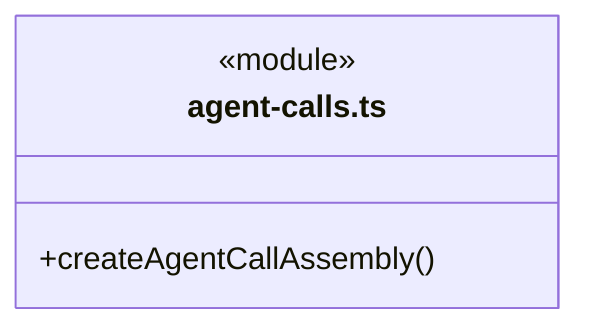
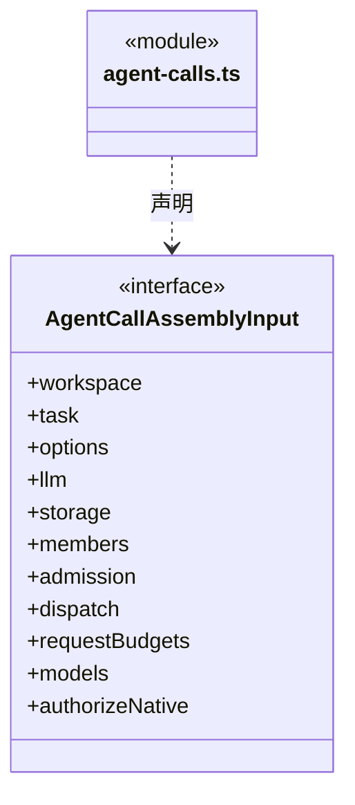
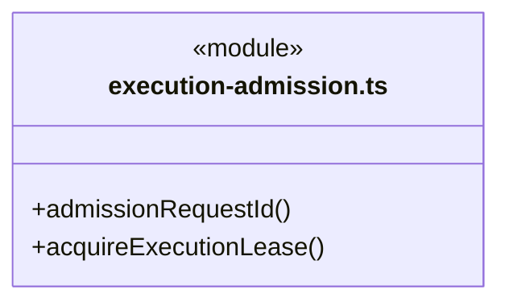
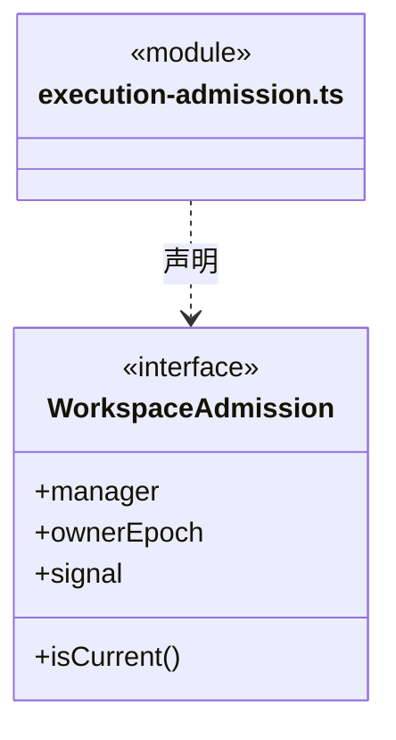
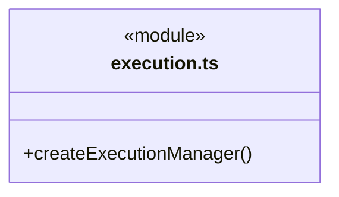
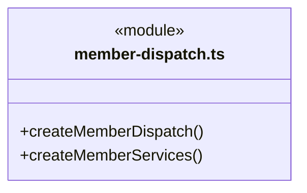
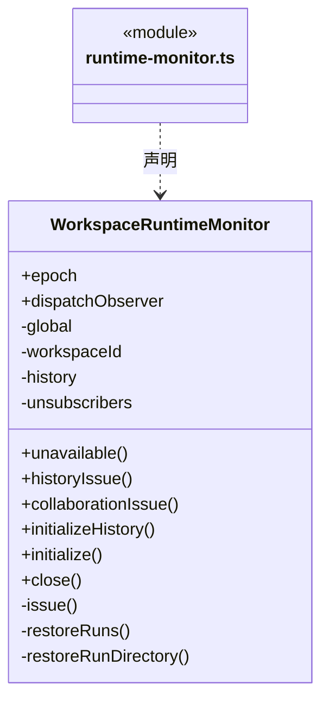
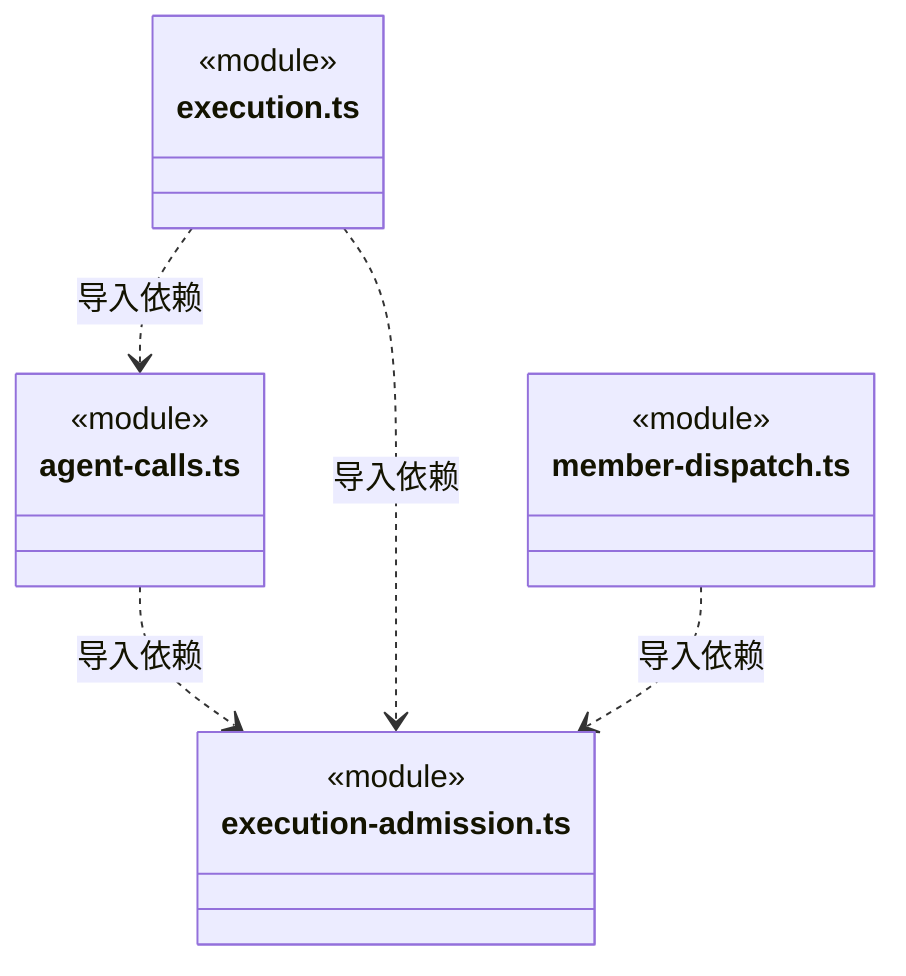

# src/logic/application/assembly 架构

## 目录定位

业务运行装配：注入准入、存储、工具端口和引擎解析；不处理 IPC 或持有第二套应用状态。

本文描述当前实现。通过分析目录边界后维护的 [源码架构脚本](../../../../scripts/source-architecture.mjs) 同步清单和声明；代码变更时仍须核对职责、关键成员与关系。

## 代码清单

| 文件 | 当前职责 |
| --- | --- |
| [agent-calls.ts](agent-calls.ts) | 把 Agent 对象与 execution 的调用协调器、LoopRuntime 装配到工作区真实引擎、准入和请求账本。 |
| [execution-admission.ts](execution-admission.ts) | 把应用级并发准入与本工作区文件/实例租约组合为主轮和成员轮共用的同步领取入口。 |
| [execution.ts](execution.ts) | 主进程执行装配，将工作区、已解析模型、原生锁与平台访问策略注入调度引擎。 |
| [member-dispatch.ts](member-dispatch.ts) | 为已运行工作区装配成员派发、大脑执行、目标审阅、岗位及模块负责人服务；复用工作区恢复前创建的唯一 DispatchStore，来源、责任、岗位与执行保持独立审计投影。 |
| [runtime-monitor.ts](runtime-monitor.ts) | 把工作区派发/周期事务、两套运行日志和对话队列接入全局监管，同时维护静态 Agent 的持久化历史归档。 |

## 架构类图

### agent-calls.ts

直接依赖：[../../agents/index.ts](../../agents/index.ts)、[../../execution/assembly/agent-call-scheduler.ts](../../execution/assembly/agent-call-scheduler.ts)、[../../agents/contracts.ts](../../agents/contracts.ts)、[../../../core/errors.ts](../../../core/errors.ts)、[../../execution/assembly/loop-engine.ts](../../execution/assembly/loop-engine.ts)、[../../workspace/service/workspace.ts](../../workspace/service/workspace.ts)、[../../team/service/workspace-members.ts](../../team/service/workspace-members.ts)、[../../team/rules/workspace-member-rules.ts](../../team/rules/workspace-member-rules.ts)、[../../team/rules/workspace-member.ts](../../team/rules/workspace-member.ts)、[../../engines/index.ts](../../engines/index.ts)、[../../engines/service/index.ts](../../engines/service/index.ts)、[../../execution/rules/types.ts](../../execution/rules/types.ts)、[../../execution/rules/storage.ts](../../execution/rules/storage.ts)、[execution-admission.ts](execution-admission.ts)、[../../dispatch/runtime/dispatch-service.ts](../../dispatch/runtime/dispatch-service.ts)、[../../budget/runtime/model-request-budget-service.ts](../../budget/runtime/model-request-budget-service.ts)、[../../budget/rules/request-budget.ts](../../budget/rules/request-budget.ts)。

### execution-admission.ts

直接依赖：[../../../core/errors.ts](../../../core/errors.ts)、[../../../core/platform/node/serialization.ts](../../../core/platform/node/serialization.ts)、[../../runtime/rules/admission.ts](../../runtime/rules/admission.ts)、[../../execution/admission/run-admission.ts](../../execution/admission/run-admission.ts)、[../../execution/admission/workspace-lease.ts](../../execution/admission/workspace-lease.ts)、[../../execution/admission/admission-wait.ts](../../execution/admission/admission-wait.ts)。

### execution.ts

直接依赖：[../../web/index.ts](../../web/index.ts)、[../../execution/storage/run-storage.ts](../../execution/storage/run-storage.ts)、[../../materials/service/chat-inputs.ts](../../materials/service/chat-inputs.ts)、[../../engines/service/index.ts](../../engines/service/index.ts)、[../../workspace/service/workspace.ts](../../workspace/service/workspace.ts)、[../../../core/platform/node/locking.ts](../../../core/platform/node/locking.ts)、[../../execution/platform/tool-guard.ts](../../execution/platform/tool-guard.ts)、[../../../core/platform/node/serialization.ts](../../../core/platform/node/serialization.ts)、[../../../core/errors.ts](../../../core/errors.ts)、[../../conversation/runtime/execution-manager.ts](../../conversation/runtime/execution-manager.ts)、[../../execution/assembly/loop-engine.ts](../../execution/assembly/loop-engine.ts)、[../../execution/rules/engine-runtime.ts](../../execution/rules/engine-runtime.ts)、[../../execution/admission/workspace-lease.ts](../../execution/admission/workspace-lease.ts)、[../../dispatch/runtime/auto-collaboration.ts](../../dispatch/runtime/auto-collaboration.ts)、[../../dispatch/runtime/dispatch-service.ts](../../dispatch/runtime/dispatch-service.ts)、[execution-admission.ts](execution-admission.ts)、[../../feedback/service/index.ts](../../feedback/service/index.ts)、[../../connectors/service/repository-connections.ts](../../connectors/service/repository-connections.ts)、[../../governance/service/main-governance-tools.ts](../../governance/service/main-governance-tools.ts)、[../../team/service/main-workspace-member-tools.ts](../../team/service/main-workspace-member-tools.ts)、[../../workspace/service/main-module-ownership-tools.ts](../../workspace/service/main-module-ownership-tools.ts)、[../../workspace/service/module-ownerships.ts](../../workspace/service/module-ownerships.ts)、[../../team/service/workspace-members.ts](../../team/service/workspace-members.ts)、[../../budget/runtime/model-request-budget-service.ts](../../budget/runtime/model-request-budget-service.ts)、[agent-calls.ts](agent-calls.ts)。

### member-dispatch.ts

直接依赖：[../../workspace/service/workspace.ts](../../workspace/service/workspace.ts)、[../../dispatch/runtime/dispatch-service.ts](../../dispatch/runtime/dispatch-service.ts)、[../../dispatch/rules/dispatch-storage.ts](../../dispatch/rules/dispatch-storage.ts)、[../../engines/service/index.ts](../../engines/service/index.ts)、[../../execution/admission/workspace-lease.ts](../../execution/admission/workspace-lease.ts)、[../../team/runtime/member-execution.ts](../../team/runtime/member-execution.ts)、[../../execution/assembly/loop-engine.ts](../../execution/assembly/loop-engine.ts)、[../../execution/rules/engine-runtime.ts](../../execution/rules/engine-runtime.ts)、[../../execution/context/execution-context.ts](../../execution/context/execution-context.ts)、[../../tasks/rules/member-topic-context-rules.ts](../../tasks/rules/member-topic-context-rules.ts)、[../../file-operations/platform/files/artifact-files.ts](../../file-operations/platform/files/artifact-files.ts)、[../../file-operations/platform/files/code-check-runner.ts](../../file-operations/platform/files/code-check-runner.ts)、[../../file-operations/platform/files/output-manifest-files.ts](../../file-operations/platform/files/output-manifest-files.ts)、[../../execution/platform/native-session-files.ts](../../execution/platform/native-session-files.ts)、[../../tasks/rules/member-checkpoint.ts](../../tasks/rules/member-checkpoint.ts)、[../../team/runtime/member-checkpoint-verifier.ts](../../team/runtime/member-checkpoint-verifier.ts)、[../../execution/storage/run-storage.ts](../../execution/storage/run-storage.ts)、[../../execution/platform/tool-guard.ts](../../execution/platform/tool-guard.ts)、[../../file-operations/platform/files/scoped-execution-files.ts](../../file-operations/platform/files/scoped-execution-files.ts)、[../../workspace/rules/execution-scope.ts](../../workspace/rules/execution-scope.ts)、[../../workspace/rules/artifact-scope.ts](../../workspace/rules/artifact-scope.ts)、[../../execution/ports/identity.ts](../../execution/ports/identity.ts)、[../../../core/errors.ts](../../../core/errors.ts)、[execution-admission.ts](execution-admission.ts)、[../../budget/rules/scope-budget.ts](../../budget/rules/scope-budget.ts)、[../../tasks/rules/execution-context.ts](../../tasks/rules/execution-context.ts)、[../../tools/rules/native-tools.ts](../../tools/rules/native-tools.ts)、[../../team/service/workspace-members.ts](../../team/service/workspace-members.ts)、[../../workspace/service/module-ownerships.ts](../../workspace/service/module-ownerships.ts)、[../../engines/index.ts](../../engines/index.ts)、[../../tasks/rules/member-commands.ts](../../tasks/rules/member-commands.ts)、[../../team/rules/workspace-member-rules.ts](../../team/rules/workspace-member-rules.ts)、[../../file-operations/service/controlled-files.ts](../../file-operations/service/controlled-files.ts)、[../../file-operations/service/isolated-executions.ts](../../file-operations/service/isolated-executions.ts)、[../../file-operations/service/artifact-transitions.ts](../../file-operations/service/artifact-transitions.ts)、[../../file-operations/platform/files/controlled-file-protocol.ts](../../file-operations/platform/files/controlled-file-protocol.ts)、[../../evidence/service/knowledge-effect-reader.ts](../../evidence/service/knowledge-effect-reader.ts)、[../../evidence/service/persistent-effect-reader.ts](../../evidence/service/persistent-effect-reader.ts)、[../../budget/runtime/model-request-budget-service.ts](../../budget/runtime/model-request-budget-service.ts)、[../../dispatch/storage/request-budget-store.ts](../../dispatch/storage/request-budget-store.ts)、[../../tasks/rules/dispatch-execution.ts](../../tasks/rules/dispatch-execution.ts)。

### runtime-monitor.ts

直接依赖：[../../workspace/service/workspace.ts](../../workspace/service/workspace.ts)、[../../execution/storage/run-storage.ts](../../execution/storage/run-storage.ts)、[../../execution/ports/identity.ts](../../execution/ports/identity.ts)、[../../dispatch/rules/dispatch-storage.ts](../../dispatch/rules/dispatch-storage.ts)、[../../dispatch/runtime/dispatch-service.ts](../../dispatch/runtime/dispatch-service.ts)、[../../conversation/runtime/execution-manager.ts](../../conversation/runtime/execution-manager.ts)、[../../team/runtime/member-execution.ts](../../team/runtime/member-execution.ts)、[../../runtime/monitoring/global-runtime.ts](../../runtime/monitoring/global-runtime.ts)、[../../history/runtime/agent-history.ts](../../history/runtime/agent-history.ts)。

### 本目录调用边界

## 子目录导航

无子目录。

[返回上层](../ARCHITECTURE.md)。

每次修改本目录代码，同步维护文件头、关键契约说明及本图。未实现的治理、证据验收和自动编排能力不列入当前类图。

## 设计契约 v1 与落地范围

以下内容区分已接通能力与后续设计；以各节的实现状态为准，不将目标图当作现状图。维护源：[CONTRACT.md](CONTRACT.md)；生成类图时同步附加，勿直接修改本附录。

# 运行装配的上下文边界

## 统一 Agent 工具执行

可信 `ExecutionLaunchContext.executionModel` 选择新调用模型，公开运行选项不能自行改协议。`agent-calls.ts` 组合 Agent 对象、execution 的 AgentCallScheduler 与 LoopRuntime；主与子直接使用同一 Runtime 生命周期，prepare 只通过现有 GlobalRunAdmission 领取真实许可。新主运行只建立无 goal 的预算作用域、持有真实主运行并在终态关闭；不由旧 AutoCollaboration 同时推进。

根工作区租约在子调用中保留，子独立领取 GlobalRunAdmission 名额。Runtime 先核实父工具批次独占并阻止父并发工具，后代排空才释放根。子 Agent 使用冻结岗位指令与自己的引擎、模型、凭据和价格端口；账本作用域仍归根，agentRun 只标记实际子请求来源。捕获配置时再次核实哈希，不继承根 process 覆盖。未确认配置、旧非逐请求预算和缺少真实准入均明确拒绝，不降权限或绕过计量。子问题端口经 Runtime 独占核验，只交给调度器中的直接调用方；回复续跑同一 child runtime。详见 [Agent 契约](../../agents/CONTRACT.md)。

## 旧派发读取与恢复

`member-dispatch` 在成员领取提交后读取唯一 DispatchStore，按该轮冻结 `topicContext` 引用解析当前办公室、话题和角色的有界资料，再交给共用 `memberExecutionPrompt`。版本或引用变化拒绝启动，不回退到最近话题；上下文引用不另存一份聊天正文。Pi、Claude Code、Codex 共用这条装配链，仍沿原任务的原生身份和检查点证明执行。

其他装配入口继续由 Application 持有唯一生命周期；本模块不成为第二份调度状态源，不把界面选择或角色名称当作授权。

### 多角色装配

主运行解析 options.modelRoles；成员运行消费领取事务冻结的 ResolvedEngineModel，不二次查询选型。主模型及附加角色凭据都只存在可信准备结果，公开任务快照只保存无密钥配置。

### 逐角色预算工厂传播

主/成员装配把统一适配器请求的 role 传给同一工作区 ModelRequestBudgetService.forRun；省略 role 沿 primary。角色身份、配置与价格只能从原冻结模型快照取得，不从工具请求读取。

递归模型捕获使用 EngineModelProfiles，包括岗位冻结的 modelRoles；根与子预算均按 role 缓存独立计价端口，继续共享根账本。子发送门禁作为 forRun 第四参，与第三参角色选型分离。
