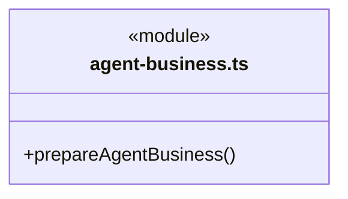
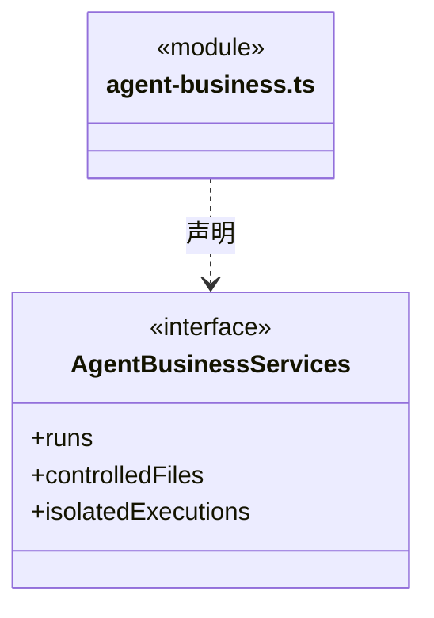
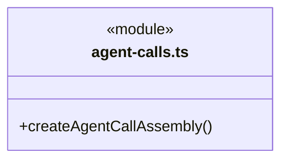
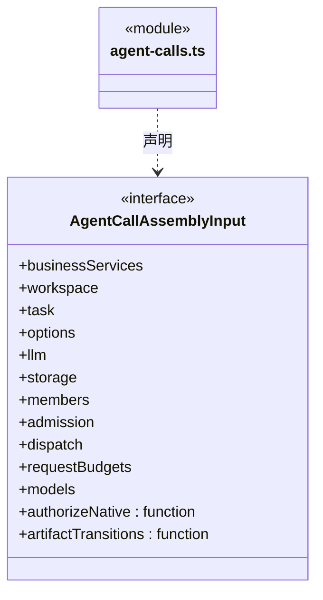
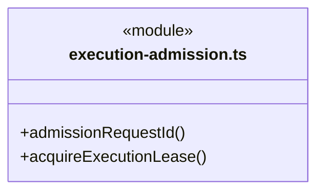
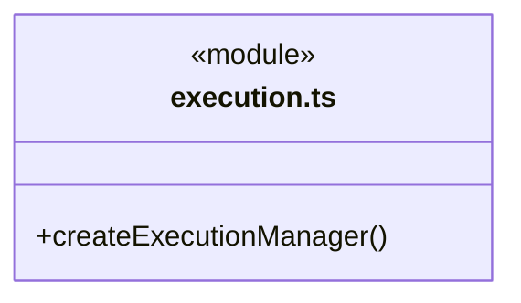
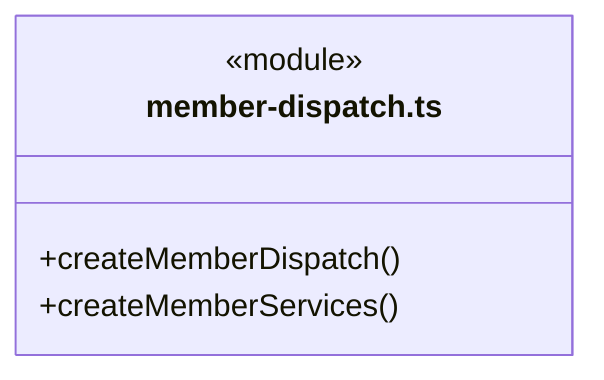
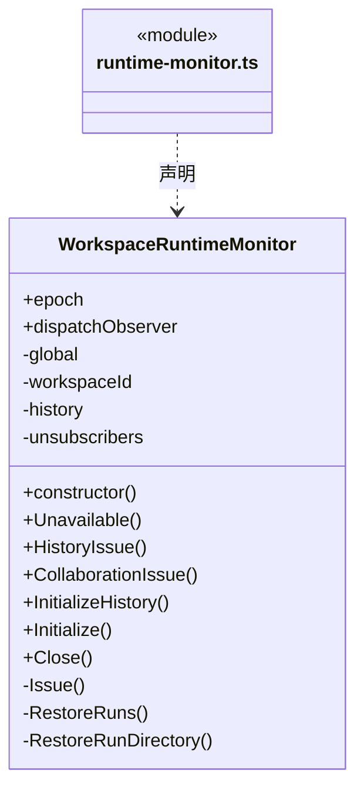
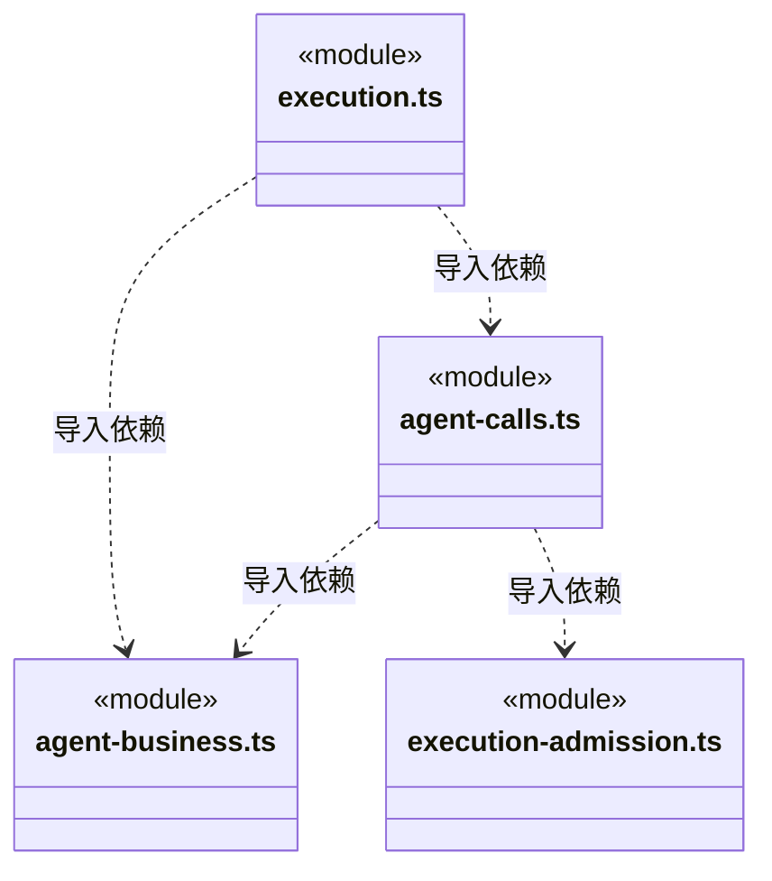
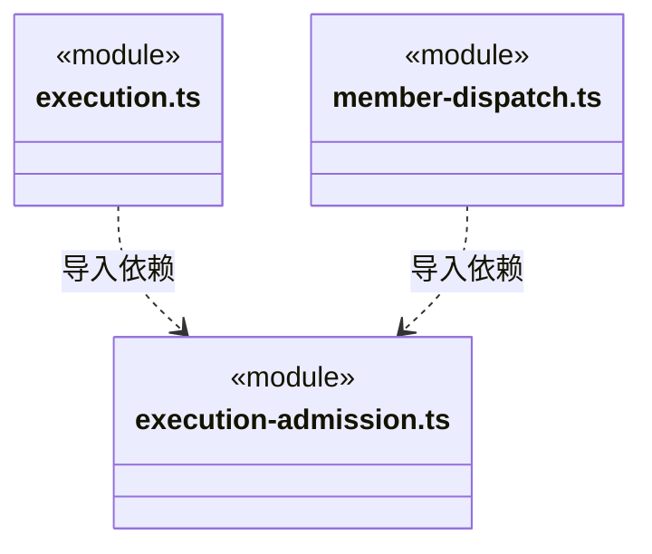

# src/logic/application/assembly 架构

本目录只维护这一份说明。设计与契约直接编辑本文；文件清单、类图和导航由 [架构脚本](../../../../scripts/source-architecture.mjs) 更新，生成区域之外的人工说明会保留。

## 封装意图

业务运行装配：注入准入、存储、工具端口和引擎解析；不处理 IPC 或持有第二套应用状态。

## 类与模块的设计意图

下表依据源码声明及文件头说明定位封装。字段表示该实例持有的状态或协作引用，不表示它拥有被引用服务的生命周期；实际资源责任和调用限制见下文契约及源码注释。

| 类／模块 | 实现形式与实例字段 | 封装依据 |
| --- | --- | --- |
| [agent-business.ts](agent-business.ts) | 函数／契约模块 | 普通指令不隐式授予业务范围；复用现有执行契约，不创建旧派发图、队列或 Team 会话。 |
| [agent-calls.ts](agent-calls.ts) | 函数／契约模块 | 复用 execution 的运行生命周期和全局准入，避免重复循环和本根并发账本；根运行持工作区租约，后代只在独占工具交接中执行。 |
| [execution-admission.ts](execution-admission.ts) | 函数／契约模块 | 等待不占任何租约；工作区装配代际与可信批次回调隔离迟到唤醒，准入错误区分未受理与可继续等待。 |
| [execution.ts](execution.ts) | 函数／契约模块 | 主会话与图根共享实例，在创建 run 前取得全局名额；主会话在两种模式下均按真实权限占用；ask/execute 独占工作区，知识治理仍由独立事务和用户权限保护。 |
| [member-dispatch.ts](member-dispatch.ts) | 函数／契约模块 | 知识→模型设置→Store 锁序固定岗位配置，预算和租约通过后才解密；成员不继承主模型。Workflow 能力按实际端口预检，密钥只留工厂闭包，锁释放后创建引擎；历史报告不启动成员。 |
| [WorkspaceRuntimeMonitor](runtime-monitor.ts) | 实例类；持有 `epoch`、`dispatchObserver`、`unsubscribers`、`global`、`workspaceId`、`history` | 一次工作区打开对应一个观察器；装配方先排空业务服务再关闭观察器，保证最后的运行事实仍被计入。 |

## 接口设计契约

### 运行装配的上下文边界

#### 统一 Agent 工具执行

可信 `ExecutionLaunchContext.executionModel` 选择新调用模型，公开运行选项不能自行改协议。`agent-calls.ts` 组合 Agent 对象、execution 的 AgentCallScheduler 与 LoopRuntime；主与子直接使用同一 Runtime 生命周期，prepare 只通过现有 GlobalRunAdmission 领取真实许可。新主运行按本轮输入建立目标及预算作用域、持有真实主运行并在终态关闭；不由旧 AutoCollaboration 同时推进。

根工作区租约在子调用中保留，子独立领取 GlobalRunAdmission 名额。Runtime 先核实父工具批次独占并阻止父并发工具，后代排空才释放根。子 Agent 使用冻结岗位指令与自己的引擎、模型、凭据和价格端口；账本作用域仍归根，agentRun 只标记实际子请求来源。捕获配置时再次核实哈希，不继承根 process 覆盖。未确认配置、旧非逐请求预算和缺少真实准入均明确拒绝，不降权限或绕过计量。子问题端口经 Runtime 独占核验，只交给调度器中的直接调用方；回复续跑同一 child runtime。详见 [Agent 契约](../../agents/ARCHITECTURE.md#contract)。

#### 旧派发读取与恢复

`member-dispatch` 在成员领取提交后读取唯一 DispatchStore，按该轮冻结 `topicContext` 引用解析当前办公室、话题和角色的有界资料，再交给共用 `memberExecutionPrompt`。版本或引用变化拒绝启动，不回退到最近话题；上下文引用不另存一份聊天正文。Pi、Claude Code、Codex 共用这条装配链，仍沿原任务的原生身份和检查点证明执行。

其他装配入口继续由 Application 持有唯一生命周期；本模块不成为第二份调度状态源，不把界面选择或角色名称当作授权。

##### 多角色装配

主运行解析 options.modelRoles；成员运行消费领取事务冻结的 ResolvedEngineModel，不二次查询选型。主模型及附加角色凭据都只存在可信准备结果，公开任务快照只保存无密钥配置。

##### 逐角色预算工厂传播

主/成员装配把统一适配器请求的 role 传给同一工作区 ModelRequestBudgetService.ForRun；省略 role 沿 primary。角色身份、配置与价格只能从原冻结模型快照取得，不从工具请求读取。

递归模型捕获使用 EngineModelProfiles，包括岗位冻结的 modelRoles；根与子预算均按 role 缓存独立计价端口，继续共享根账本。子发送门禁作为 forRun 第四参，与第三参角色选型分离。

#### Agent 业务验证迁移

`cbim_agent_call.business` 显式给出模块、验收项及可选 Workflow。agent-business 在原岗位、来源和模型快照下冻结知识，再注入既有采集、JSON/CSV/PNG、清单和代码检查端口。普通调用保持 chat；业务调用使用 LoopRuntime.StartMember 的可信身份入口，保留 agent-tools-v1 与父工具引用，不创建派发图任务、消息队列或 Team UI。

TaskNode/DispatchRun 在本装配中仅是既有知识冻结及 canonical 验证器所需的私有输入投影，不写入 DispatchStore，不代表旧派发已发生。真实副作用与结算事实来自 LoopRuntime 的原始日志。再次核验读取同一 taskId/runId 的 canonical 和当前文件；不重启模型、不修改旧证据、不声明人工验收。原知识变化拒绝核验。冻结的 executionScope 通过既有 ScopedExecutionFiles 装配读取、写入范围和隔离生命周期；缺少可信平台服务时明确拒绝启动，不降级到普通命令。

模型配置捕获使用 workspaceMemberEngine 的原缺省值；实际执行可默认 Pi，但不得把 engine 字段补进既有采纳快照而改变其哈希。业务递归不能省略业务上下文或扩大父模块范围。旧人工目标决策与持久检查点流程仍属历史协议，未在本次九项文件验证迁移中改写。

##### 主 Agent 人工评审

agent-calls 仅把本根对话已捕获的 requestQuestion 注入 requestReview；这是原用户问题队列，不创建另一个消息或协作服务。子工具目录不公开直接评审，子求助仍面向直接调用方。人工决定由调度工具写入原运行日志，既有 AgentCallAssembly 生命周期负责关闭，不恢复旧人工目标服务。

#### 根运行插入回执

根运行按本轮输入打开目标周期，队列启动保留 queueId 与 followupOf。插入消息复用 ScopeActiveInputService.Send，收尾等待在途插入；完成核证返回 GOAL_* 错误时保留阻塞原因并以 failed 封存，错误仍返回对话，不把模型退出认定为业务成功。

##### 统一主会话归档

根装配单独提供 OfficeHistoryTools，身份固定为当前 workspace/rootSession；执行 Agent 不继承此归档入口。读取历史不恢复旧周期、不产生新授权。

##### 递归业务删除与移动

Application 将可信 ControlledFileTransport 传入执行装配；每个显式业务子调用通过既有 createArtifactTransitionPort 捕获工作区实例和准入生命周期。agent-business 只传递端口，不生成新文件执行器或旧派发记录。Runtime 继续负责冻结 Workflow、权限、原清单、操作阶段和 canonical 证明，平台工人退出后才返回。无专用传输保持不可用，不回退原生命令；隔离调用仍核对冻结范围。当前结果复核读取原子调用日志及文件，重启不自动重放。

#### 递归业务运行身份与平台服务

Application 只装配一份 AgentBusinessRuns、ControlledFiles 和 IsolatedExecutions。agent-business 在父工具发布实际子运行引用后、LoopRuntime 开始前将冻结身份登记进原 DispatchStore；不创建旧派工图任务。最小 BusinessRunSource 让原文件服务读到同一权限、知识和绑定，protocol 决定 canonical 位于 loop-engine/tasks，旧记录仍读取 dispatch/runs/tasks。

Runtime.close 成功后才能关闭登记，关闭提交成功后才释放 GlobalRunAdmission 许可。保存未知时保留占用、错误和原句柄，后续只重试排空／关闭，不重发模型或文件操作。隔离范围同时约束读取、受控写入和产物迁移；复用平台隔离记录及显式清理，不引入第二个执行循环。

#### 主 Agent 岗位与责任工具

新 AgentCallAssembly 在 beforeRun 成功后提供 MainToolContext，实际身份来自本轮 scope/run。岗位与模块责任工具复用原服务、命令 ID、审批和独立回执，使用此上下文替代 Auto 批次；只为主调用装配，子 Agent 没有管理入口。根收尾立即撤销新控制面操作，等待已登记提交和输入回执后再关闭周期及释放预算。读取或保存未知不自动重放。旧运行继续由 Auto 的原实现提供同一窄契约。

#### 递归用量日志入口

member-dispatch 为 ScopeUsageService 提供独立 inspectAgent：固定 loop-engine/tasks 路径并核对工作区、项目、task/run。父调用关系及业务登记由统计服务核验；主 Agent 的 inspectMain 仍拒绝成员日志，旧成员路径不变。

#### 递归业务历史回补

WorkspaceRuntimeMonitor 的两目录扫描区分旧成员和新递归业务：后者只从 loop-engine 恢复，并核对首条 agent-tools-v1/agentCall 当前子身份。业务 memberBinding 不再一概要求旧 dispatch/runs 路径。全局统计和历史索引使用同一原日志，重开不重新执行。

#### 递归产物报告日志端口

member-dispatch 将现有 inspectMember 同时注入产物/完整清单报告的 inspectAgent。BusinessRunSource.protocol 固定新日志位于 loop-engine/tasks，旧派工继续用 dispatch/runs/tasks；报告服务自行核对持久身份、父调用与原生绑定。只读报告不启动引擎，不读取最新模型配置，也不生成兼容派工图。

#### 递归执行记录核实

member-dispatch 同时为执行记录报告装配 inspectAgent，复用已有 BusinessRunSource 的明确协议路径；新增来源与产物报告一致，不重复保存日志或派发状态。

#### 递归人工审阅的普通文件证明
[agent-business](agent-business.ts) 的 verify 在既有 Workflow 核验后调用 AgentArtifactVerification，复核普通采集文件。原 JSON/CSV/PNG 或完整集合验证保持原规则；两类已核实文件按路径合并，避免同一文件重复出现在人工意见对象中。首次交付、result_check、人工接受与接受后继续均使用同一原日志核验闭包，当前字节变化返回 ARTIFACT_BASELINE_STALE，不能把旧读取回执当作当前文件相同的证明。

显式业务 Agent 的 verify 即使没有附加 Workflow，也要求完整无未决工具的 canonical，并调用既有证据规则核实原目标计划、步骤与成功交付。纯模型完成、放弃交付或返回说明文字不能变为 verified；普通非业务 Agent 调用语义不受影响。

##### 递归工具迁移收口

Agent 业务装配将原 message/acceptance 冻结到实际登记。新修复调用继续通过既有岗位、冻结知识、权限、文件和 Workflow 装配；不恢复旧 Team 派工状态。

## 开闭边界

本目录的职责及允许协作由[封装意图](#封装意图)限定，输入输出、状态与失败语义以[接口设计契约](#接口设计契约)为准。扩展从已有公开入口及实际装配位置进入；没有明确可替换契约的部分按真实影响修改和验证，不预建未使用的基类或插件入口。

<!-- architecture:generated:start -->

## 文件清单

| 文件 | 形式 | 当前职责 |
| --- | --- | --- |
| [ARCHITECTURE.md](ARCHITECTURE.md) | 说明文档 | 本目录的文件清单、真实声明、依赖与子封装导航。 |
| [agent-business.ts](agent-business.ts) | 源码模块 | 把递归 Agent 的显式业务范围接入既有冻结知识、文件验证及 canonical 交付核验。 |
| [agent-calls.ts](agent-calls.ts) | 源码模块 | 把 Agent 对象与 execution 的调用协调器、LoopRuntime 装配到工作区真实引擎、准入和请求账本。 |
| [execution-admission.ts](execution-admission.ts) | 源码模块 | 把应用级并发准入与本工作区文件/实例租约组合为主轮和成员轮共用的同步领取入口。 |
| [execution.ts](execution.ts) | 源码模块 | 主进程执行装配，将工作区、已解析模型、原生锁与平台访问策略注入调度引擎。 |
| [member-dispatch.ts](member-dispatch.ts) | 源码模块 | 为已运行工作区装配成员派发、大脑执行、目标审阅、岗位及模块负责人服务；复用工作区恢复前创建的唯一 DispatchStore，来源、责任、岗位与执行保持独立审计投影。 |
| [runtime-monitor.ts](runtime-monitor.ts) | 源码模块 | 把工作区派发/周期事务、两套运行日志和对话队列接入全局监管，同时维护静态 Agent 的持久化历史归档。 |

## 架构类图

成员标记：`+` 公开、`-` 私有、`#` 受保护、`$` 静态；`function` 为函数值成员，`get`／`set` 为访问器。调用／构造／索引签名按匿名签名列出，不虚构方法名；`global.` 表示全局声明补充，非运行时嵌套类。构造函数单独列出，运行时私有字段保留 `#`。文档和资源仅在文件清单中导航，不作为代码节点。

### agent-business.ts

[查看源码](agent-business.ts)。

直接依赖：[../../../core/errors.ts](../../../core/errors.ts)、[../../agents/contracts.ts](../../agents/contracts.ts)、[../../dispatch/runtime/dispatch-service.ts](../../dispatch/runtime/dispatch-service.ts)、[../../engines/index.ts](../../engines/index.ts)、[../../evidence/rules/workflow-evidence.ts](../../evidence/rules/workflow-evidence.ts)、[../../evidence/runtime/agent-artifact-verification.ts](../../evidence/runtime/agent-artifact-verification.ts)、[../../execution/assembly/loop-engine.ts](../../execution/assembly/loop-engine.ts)、[../../execution/context/dispatch-context.ts](../../execution/context/dispatch-context.ts)、[../../execution/context/execution-context.ts](../../execution/context/execution-context.ts)、[../../execution/rules/business-run.ts](../../execution/rules/business-run.ts)、[../../execution/rules/member-run.ts](../../execution/rules/member-run.ts)、[../../execution/rules/storage.ts](../../execution/rules/storage.ts)、[../../execution/rules/types.ts](../../execution/rules/types.ts)、[../../execution/storage/business-runs.ts](../../execution/storage/business-runs.ts)、[../../file-operations/platform/files/artifact-files.ts](../../file-operations/platform/files/artifact-files.ts)、[../../file-operations/platform/files/code-check-runner.ts](../../file-operations/platform/files/code-check-runner.ts)、[../../file-operations/platform/files/output-manifest-files.ts](../../file-operations/platform/files/output-manifest-files.ts)、[../../file-operations/platform/files/scoped-execution-files.ts](../../file-operations/platform/files/scoped-execution-files.ts)、[../../file-operations/service/controlled-files.ts](../../file-operations/service/controlled-files.ts)、[../../file-operations/service/isolated-executions.ts](../../file-operations/service/isolated-executions.ts)、[../../runtime/monitoring/member-events.ts](../../runtime/monitoring/member-events.ts)、[../../tasks/rules/dispatch-execution.ts](../../tasks/rules/dispatch-execution.ts)、[../../tasks/rules/execution-context.ts](../../tasks/rules/execution-context.ts)、[../../tasks/rules/graph-types.ts](../../tasks/rules/graph-types.ts)、[../../team/rules/workspace-member.ts](../../team/rules/workspace-member.ts)、[../../team/runtime/member-workflow.ts](../../team/runtime/member-workflow.ts)、[../../workspace/rules/artifact-scope.ts](../../workspace/rules/artifact-scope.ts)、[../../workspace/rules/execution-scope.ts](../../workspace/rules/execution-scope.ts)、[../../workspace/service/workspace.ts](../../workspace/service/workspace.ts)。

### agent-calls.ts

[查看源码](agent-calls.ts)。

直接依赖：[../../../core/errors.ts](../../../core/errors.ts)、[../../agents/contracts.ts](../../agents/contracts.ts)、[../../agents/index.ts](../../agents/index.ts)、[agent-business.ts](agent-business.ts)、[execution-admission.ts](execution-admission.ts)、[../../budget/rules/request-budget.ts](../../budget/rules/request-budget.ts)、[../../budget/runtime/model-request-budget-service.ts](../../budget/runtime/model-request-budget-service.ts)、[../../dispatch/runtime/dispatch-service.ts](../../dispatch/runtime/dispatch-service.ts)、[../../engines/index.ts](../../engines/index.ts)、[../../engines/service/index.ts](../../engines/service/index.ts)、[../../execution/assembly/agent-call-scheduler.ts](../../execution/assembly/agent-call-scheduler.ts)、[../../execution/assembly/loop-engine.ts](../../execution/assembly/loop-engine.ts)、[../../execution/rules/conversation-binding.ts](../../execution/rules/conversation-binding.ts)、[../../execution/rules/storage.ts](../../execution/rules/storage.ts)、[../../execution/rules/types.ts](../../execution/rules/types.ts)、[../../team/rules/workspace-member-rules.ts](../../team/rules/workspace-member-rules.ts)、[../../team/rules/workspace-member.ts](../../team/rules/workspace-member.ts)、[../../team/service/workspace-members.ts](../../team/service/workspace-members.ts)、[../../tools/runtime/office-history-tools.ts](../../tools/runtime/office-history-tools.ts)、[../../workspace/service/workspace.ts](../../workspace/service/workspace.ts)。

### execution-admission.ts

[查看源码](execution-admission.ts)。

直接依赖：[../../../core/errors.ts](../../../core/errors.ts)、[../../../core/platform/node/serialization.ts](../../../core/platform/node/serialization.ts)、[../../execution/admission/admission-wait.ts](../../execution/admission/admission-wait.ts)、[../../execution/admission/run-admission.ts](../../execution/admission/run-admission.ts)、[../../execution/admission/workspace-lease.ts](../../execution/admission/workspace-lease.ts)、[../../runtime/rules/admission.ts](../../runtime/rules/admission.ts)。

### execution.ts

[查看源码](execution.ts)。

直接依赖：[../../../core/errors.ts](../../../core/errors.ts)、[../../../core/platform/node/locking.ts](../../../core/platform/node/locking.ts)、[../../../core/platform/node/serialization.ts](../../../core/platform/node/serialization.ts)、[agent-business.ts](agent-business.ts)、[agent-calls.ts](agent-calls.ts)、[execution-admission.ts](execution-admission.ts)、[../../budget/runtime/model-request-budget-service.ts](../../budget/runtime/model-request-budget-service.ts)、[../../connectors/service/repository-connections.ts](../../connectors/service/repository-connections.ts)、[../../conversation/runtime/execution-manager.ts](../../conversation/runtime/execution-manager.ts)、[../../dispatch/runtime/auto-collaboration.ts](../../dispatch/runtime/auto-collaboration.ts)、[../../dispatch/runtime/dispatch-service.ts](../../dispatch/runtime/dispatch-service.ts)、[../../engines/service/index.ts](../../engines/service/index.ts)、[../../execution/admission/workspace-lease.ts](../../execution/admission/workspace-lease.ts)、[../../execution/assembly/loop-engine.ts](../../execution/assembly/loop-engine.ts)、[../../execution/platform/tool-guard.ts](../../execution/platform/tool-guard.ts)、[../../execution/rules/engine-runtime.ts](../../execution/rules/engine-runtime.ts)、[../../execution/storage/run-storage.ts](../../execution/storage/run-storage.ts)、[../../feedback/service/index.ts](../../feedback/service/index.ts)、[../../file-operations/platform/files/controlled-file-protocol.ts](../../file-operations/platform/files/controlled-file-protocol.ts)、[../../file-operations/service/artifact-transitions.ts](../../file-operations/service/artifact-transitions.ts)、[../../governance/service/main-governance-tools.ts](../../governance/service/main-governance-tools.ts)、[../../materials/service/chat-inputs.ts](../../materials/service/chat-inputs.ts)、[../../team/service/main-workspace-member-tools.ts](../../team/service/main-workspace-member-tools.ts)、[../../team/service/workspace-members.ts](../../team/service/workspace-members.ts)、[../../web/index.ts](../../web/index.ts)、[../../workspace/service/main-module-ownership-tools.ts](../../workspace/service/main-module-ownership-tools.ts)、[../../workspace/service/module-ownerships.ts](../../workspace/service/module-ownerships.ts)、[../../workspace/service/workspace.ts](../../workspace/service/workspace.ts)。

### member-dispatch.ts

[查看源码](member-dispatch.ts)。

直接依赖：[../../../core/errors.ts](../../../core/errors.ts)、[execution-admission.ts](execution-admission.ts)、[../../budget/rules/scope-budget.ts](../../budget/rules/scope-budget.ts)、[../../budget/runtime/model-request-budget-service.ts](../../budget/runtime/model-request-budget-service.ts)、[../../dispatch/rules/dispatch-storage.ts](../../dispatch/rules/dispatch-storage.ts)、[../../dispatch/runtime/dispatch-service.ts](../../dispatch/runtime/dispatch-service.ts)、[../../dispatch/storage/request-budget-store.ts](../../dispatch/storage/request-budget-store.ts)、[../../engines/index.ts](../../engines/index.ts)、[../../engines/service/index.ts](../../engines/service/index.ts)、[../../evidence/service/knowledge-effect-reader.ts](../../evidence/service/knowledge-effect-reader.ts)、[../../evidence/service/persistent-effect-reader.ts](../../evidence/service/persistent-effect-reader.ts)、[../../execution/admission/workspace-lease.ts](../../execution/admission/workspace-lease.ts)、[../../execution/assembly/loop-engine.ts](../../execution/assembly/loop-engine.ts)、[../../execution/context/execution-context.ts](../../execution/context/execution-context.ts)、[../../execution/platform/native-session-files.ts](../../execution/platform/native-session-files.ts)、[../../execution/platform/tool-guard.ts](../../execution/platform/tool-guard.ts)、[../../execution/ports/identity.ts](../../execution/ports/identity.ts)、[../../execution/rules/business-run.ts](../../execution/rules/business-run.ts)、[../../execution/rules/engine-runtime.ts](../../execution/rules/engine-runtime.ts)、[../../execution/storage/business-runs.ts](../../execution/storage/business-runs.ts)、[../../execution/storage/run-storage.ts](../../execution/storage/run-storage.ts)、[../../file-operations/platform/files/artifact-files.ts](../../file-operations/platform/files/artifact-files.ts)、[../../file-operations/platform/files/code-check-runner.ts](../../file-operations/platform/files/code-check-runner.ts)、[../../file-operations/platform/files/controlled-file-protocol.ts](../../file-operations/platform/files/controlled-file-protocol.ts)、[../../file-operations/platform/files/output-manifest-files.ts](../../file-operations/platform/files/output-manifest-files.ts)、[../../file-operations/platform/files/scoped-execution-files.ts](../../file-operations/platform/files/scoped-execution-files.ts)、[../../file-operations/service/artifact-transitions.ts](../../file-operations/service/artifact-transitions.ts)、[../../file-operations/service/controlled-files.ts](../../file-operations/service/controlled-files.ts)、[../../file-operations/service/isolated-executions.ts](../../file-operations/service/isolated-executions.ts)、[../../tasks/rules/execution-context.ts](../../tasks/rules/execution-context.ts)、[../../tasks/rules/member-checkpoint.ts](../../tasks/rules/member-checkpoint.ts)、[../../tasks/rules/member-commands.ts](../../tasks/rules/member-commands.ts)、[../../tasks/rules/member-topic-context-rules.ts](../../tasks/rules/member-topic-context-rules.ts)、[../../team/rules/workspace-member-rules.ts](../../team/rules/workspace-member-rules.ts)、[../../team/runtime/member-checkpoint-verifier.ts](../../team/runtime/member-checkpoint-verifier.ts)、[../../team/runtime/member-execution.ts](../../team/runtime/member-execution.ts)、[../../team/service/workspace-members.ts](../../team/service/workspace-members.ts)、[../../tools/rules/native-tools.ts](../../tools/rules/native-tools.ts)、[../../workspace/rules/artifact-scope.ts](../../workspace/rules/artifact-scope.ts)、[../../workspace/rules/execution-scope.ts](../../workspace/rules/execution-scope.ts)、[../../workspace/service/module-ownerships.ts](../../workspace/service/module-ownerships.ts)、[../../workspace/service/workspace.ts](../../workspace/service/workspace.ts)。

### runtime-monitor.ts

[查看源码](runtime-monitor.ts)。

直接依赖：[../../agents/contracts.ts](../../agents/contracts.ts)、[../../conversation/runtime/execution-manager.ts](../../conversation/runtime/execution-manager.ts)、[../../dispatch/rules/dispatch-storage.ts](../../dispatch/rules/dispatch-storage.ts)、[../../dispatch/runtime/dispatch-service.ts](../../dispatch/runtime/dispatch-service.ts)、[../../execution/ports/identity.ts](../../execution/ports/identity.ts)、[../../execution/storage/run-storage.ts](../../execution/storage/run-storage.ts)、[../../history/runtime/agent-history.ts](../../history/runtime/agent-history.ts)、[../../runtime/monitoring/global-runtime.ts](../../runtime/monitoring/global-runtime.ts)、[../../team/runtime/member-execution.ts](../../team/runtime/member-execution.ts)、[../../workspace/service/workspace.ts](../../workspace/service/workspace.ts)。

### 本目录调用边界

## 子目录导航

无子目录。

[返回上层](../ARCHITECTURE.md)。

每次修改本目录代码，同步维护文件头、关键契约说明及本图。未实现的治理、证据验收和自动编排能力不列入当前类图。

<!-- architecture:generated:end -->
