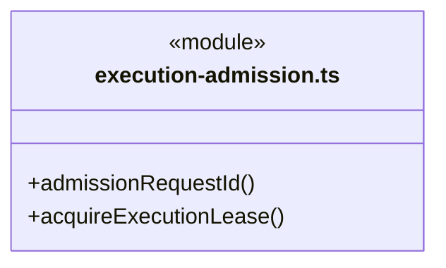
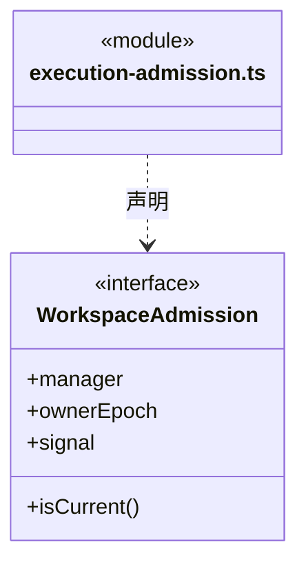
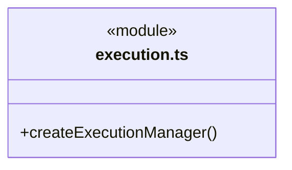
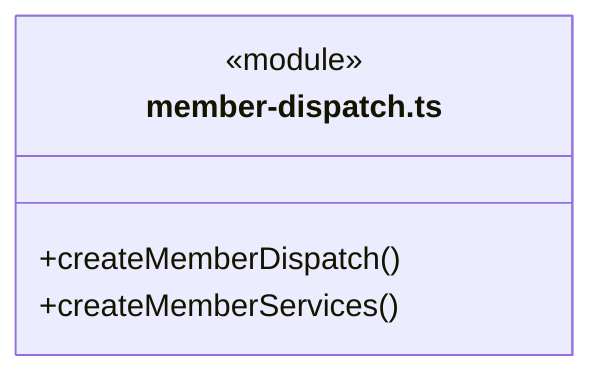
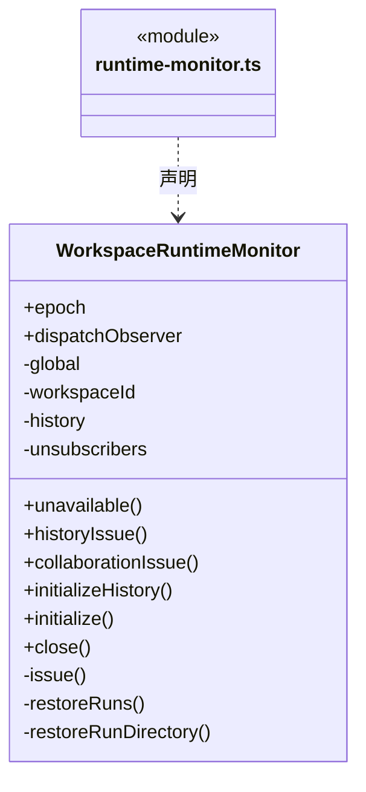
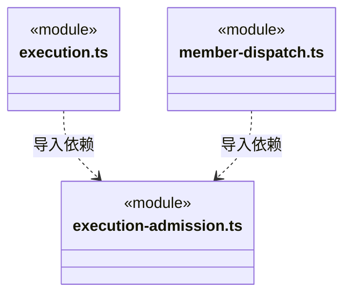

# src/logic/application/assembly 架构

## 目录定位

业务运行装配：注入准入、存储、工具端口和引擎解析；不处理 IPC 或持有第二套应用状态。

本文描述当前实现。通过分析目录边界后维护的 [源码架构脚本](../../../../scripts/source-architecture.mjs) 同步清单和声明；代码变更时仍须核对职责、关键成员与关系。

## 代码清单

| 文件 | 当前职责 |
| --- | --- |
| [execution-admission.ts](execution-admission.ts) | 把应用级并发准入与本工作区文件/实例租约组合为主轮和成员轮共用的同步领取入口。 |
| [execution.ts](execution.ts) | 主进程执行装配，将工作区、已解析模型、原生锁与平台访问策略注入调度引擎。 |
| [member-dispatch.ts](member-dispatch.ts) | 为已运行工作区装配成员派发、大脑执行、目标审阅、岗位及模块负责人服务；复用工作区恢复前创建的唯一 DispatchStore，来源、责任、岗位与执行保持独立审计投影。 |
| [runtime-monitor.ts](runtime-monitor.ts) | 把工作区派发/周期事务、两套运行日志和对话队列接入全局监管，同时维护静态 Agent 的持久化历史归档。 |

## 架构类图

### execution-admission.ts

直接依赖：[../../../core/errors.ts](../../../core/errors.ts)、[../../../core/platform/node/serialization.ts](../../../core/platform/node/serialization.ts)、[../../runtime/rules/admission.ts](../../runtime/rules/admission.ts)、[../../execution/admission/run-admission.ts](../../execution/admission/run-admission.ts)、[../../execution/admission/workspace-lease.ts](../../execution/admission/workspace-lease.ts)、[../../execution/admission/admission-wait.ts](../../execution/admission/admission-wait.ts)。

### execution.ts

直接依赖：[../../web/index.ts](../../web/index.ts)、[../../execution/storage/run-storage.ts](../../execution/storage/run-storage.ts)、[../../materials/service/chat-inputs.ts](../../materials/service/chat-inputs.ts)、[../../models/service/index.ts](../../models/service/index.ts)、[../../workspace/service/workspace.ts](../../workspace/service/workspace.ts)、[../../../core/platform/node/locking.ts](../../../core/platform/node/locking.ts)、[../../execution/platform/tool-guard.ts](../../execution/platform/tool-guard.ts)、[../../../core/platform/node/serialization.ts](../../../core/platform/node/serialization.ts)、[../../../core/errors.ts](../../../core/errors.ts)、[../../conversation/runtime/execution-manager.ts](../../conversation/runtime/execution-manager.ts)、[../../execution/assembly/loop-engine.ts](../../execution/assembly/loop-engine.ts)、[../../execution/rules/engine-runtime.ts](../../execution/rules/engine-runtime.ts)、[../../execution/admission/workspace-lease.ts](../../execution/admission/workspace-lease.ts)、[../../dispatch/runtime/auto-collaboration.ts](../../dispatch/runtime/auto-collaboration.ts)、[../../dispatch/runtime/dispatch-service.ts](../../dispatch/runtime/dispatch-service.ts)、[execution-admission.ts](execution-admission.ts)、[../../feedback/service/index.ts](../../feedback/service/index.ts)、[../../connectors/service/repository-connections.ts](../../connectors/service/repository-connections.ts)、[../../governance/service/main-governance-tools.ts](../../governance/service/main-governance-tools.ts)、[../../team/service/main-workspace-member-tools.ts](../../team/service/main-workspace-member-tools.ts)、[../../workspace/service/main-module-ownership-tools.ts](../../workspace/service/main-module-ownership-tools.ts)、[../../workspace/service/module-ownerships.ts](../../workspace/service/module-ownerships.ts)、[../../team/service/workspace-members.ts](../../team/service/workspace-members.ts)、[../../budget/runtime/model-request-budget-service.ts](../../budget/runtime/model-request-budget-service.ts)。

### member-dispatch.ts

直接依赖：[../../workspace/service/workspace.ts](../../workspace/service/workspace.ts)、[../../dispatch/runtime/dispatch-service.ts](../../dispatch/runtime/dispatch-service.ts)、[../../dispatch/rules/dispatch-storage.ts](../../dispatch/rules/dispatch-storage.ts)、[../../models/service/index.ts](../../models/service/index.ts)、[../../execution/admission/workspace-lease.ts](../../execution/admission/workspace-lease.ts)、[../../team/runtime/member-execution.ts](../../team/runtime/member-execution.ts)、[../../execution/assembly/loop-engine.ts](../../execution/assembly/loop-engine.ts)、[../../execution/rules/engine-runtime.ts](../../execution/rules/engine-runtime.ts)、[../../execution/context/execution-context.ts](../../execution/context/execution-context.ts)、[../../file-operations/platform/files/artifact-files.ts](../../file-operations/platform/files/artifact-files.ts)、[../../file-operations/platform/files/code-check-runner.ts](../../file-operations/platform/files/code-check-runner.ts)、[../../file-operations/platform/files/output-manifest-files.ts](../../file-operations/platform/files/output-manifest-files.ts)、[../../execution/platform/native-session-files.ts](../../execution/platform/native-session-files.ts)、[../../tasks/rules/member-checkpoint.ts](../../tasks/rules/member-checkpoint.ts)、[../../team/runtime/member-checkpoint-verifier.ts](../../team/runtime/member-checkpoint-verifier.ts)、[../../execution/storage/run-storage.ts](../../execution/storage/run-storage.ts)、[../../execution/platform/tool-guard.ts](../../execution/platform/tool-guard.ts)、[../../file-operations/platform/files/scoped-execution-files.ts](../../file-operations/platform/files/scoped-execution-files.ts)、[../../workspace/rules/execution-scope.ts](../../workspace/rules/execution-scope.ts)、[../../workspace/rules/artifact-scope.ts](../../workspace/rules/artifact-scope.ts)、[../../execution/ports/identity.ts](../../execution/ports/identity.ts)、[../../../core/errors.ts](../../../core/errors.ts)、[execution-admission.ts](execution-admission.ts)、[../../budget/rules/scope-budget.ts](../../budget/rules/scope-budget.ts)、[../../tasks/rules/execution-context.ts](../../tasks/rules/execution-context.ts)、[../../tools/rules/native-tools.ts](../../tools/rules/native-tools.ts)、[../../team/service/workspace-members.ts](../../team/service/workspace-members.ts)、[../../workspace/service/module-ownerships.ts](../../workspace/service/module-ownerships.ts)、[../../models/index.ts](../../models/index.ts)、[../../tasks/rules/member-commands.ts](../../tasks/rules/member-commands.ts)、[../../team/rules/workspace-member-rules.ts](../../team/rules/workspace-member-rules.ts)、[../../file-operations/service/controlled-files.ts](../../file-operations/service/controlled-files.ts)、[../../file-operations/service/isolated-executions.ts](../../file-operations/service/isolated-executions.ts)、[../../file-operations/service/artifact-transitions.ts](../../file-operations/service/artifact-transitions.ts)、[../../file-operations/platform/files/controlled-file-protocol.ts](../../file-operations/platform/files/controlled-file-protocol.ts)、[../../evidence/service/knowledge-effect-reader.ts](../../evidence/service/knowledge-effect-reader.ts)、[../../evidence/service/persistent-effect-reader.ts](../../evidence/service/persistent-effect-reader.ts)、[../../budget/runtime/model-request-budget-service.ts](../../budget/runtime/model-request-budget-service.ts)、[../../dispatch/storage/request-budget-store.ts](../../dispatch/storage/request-budget-store.ts)、[../../tasks/rules/dispatch-execution.ts](../../tasks/rules/dispatch-execution.ts)。

### runtime-monitor.ts

直接依赖：[../../workspace/service/workspace.ts](../../workspace/service/workspace.ts)、[../../execution/storage/run-storage.ts](../../execution/storage/run-storage.ts)、[../../execution/ports/identity.ts](../../execution/ports/identity.ts)、[../../dispatch/rules/dispatch-storage.ts](../../dispatch/rules/dispatch-storage.ts)、[../../dispatch/runtime/dispatch-service.ts](../../dispatch/runtime/dispatch-service.ts)、[../../conversation/runtime/execution-manager.ts](../../conversation/runtime/execution-manager.ts)、[../../team/runtime/member-execution.ts](../../team/runtime/member-execution.ts)、[../../runtime/monitoring/global-runtime.ts](../../runtime/monitoring/global-runtime.ts)、[../../history/runtime/agent-history.ts](../../history/runtime/agent-history.ts)。

### 本目录调用边界

## 子目录导航

无子目录。

[返回上层](../ARCHITECTURE.md)。

每次修改本目录代码，同步维护文件头、关键契约说明及本图。未实现的治理、证据验收和自动编排能力不列入当前类图。
