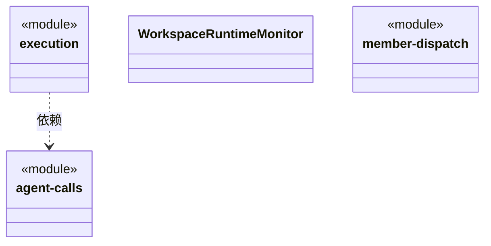

# src/logic/application/assembly 架构

## 设计意图

把工作区、Agent、执行引擎和业务服务接成可运行的应用。装配函数认识具体实现并注入端口，运行观察器收集事实；应用状态与生命周期仍归上层 Application。

## 主要组成

| 组成 | 定位 |
| --- | --- |
| [WorkspaceRuntimeMonitor](runtime-monitor.ts) | 把工作区派发/周期事务、两套运行日志和对话队列接入全局监管，同时维护静态 Agent 的持久化历史归档。 |
| [agent-calls](agent-calls.ts) | 把 Agent 对象与 execution 的调用协调器、LoopRuntime 装配到工作区真实引擎、准入和请求账本。 |
| [execution](execution.ts) | 主进程执行装配，将工作区、已解析模型、原生锁与平台访问策略注入调度引擎。 |
| [member-dispatch](member-dispatch.ts) | 为已运行工作区装配成员派发、大脑执行、目标审阅、岗位及模块负责人服务；复用工作区恢复前创建的唯一 DispatchStore，来源、责任、岗位与执行保持独立审计投影。 |

<!-- architecture:generated:start -->

## 架构关系

[上层设计](../ARCHITECTURE.md)

<!-- architecture:generated:end -->
