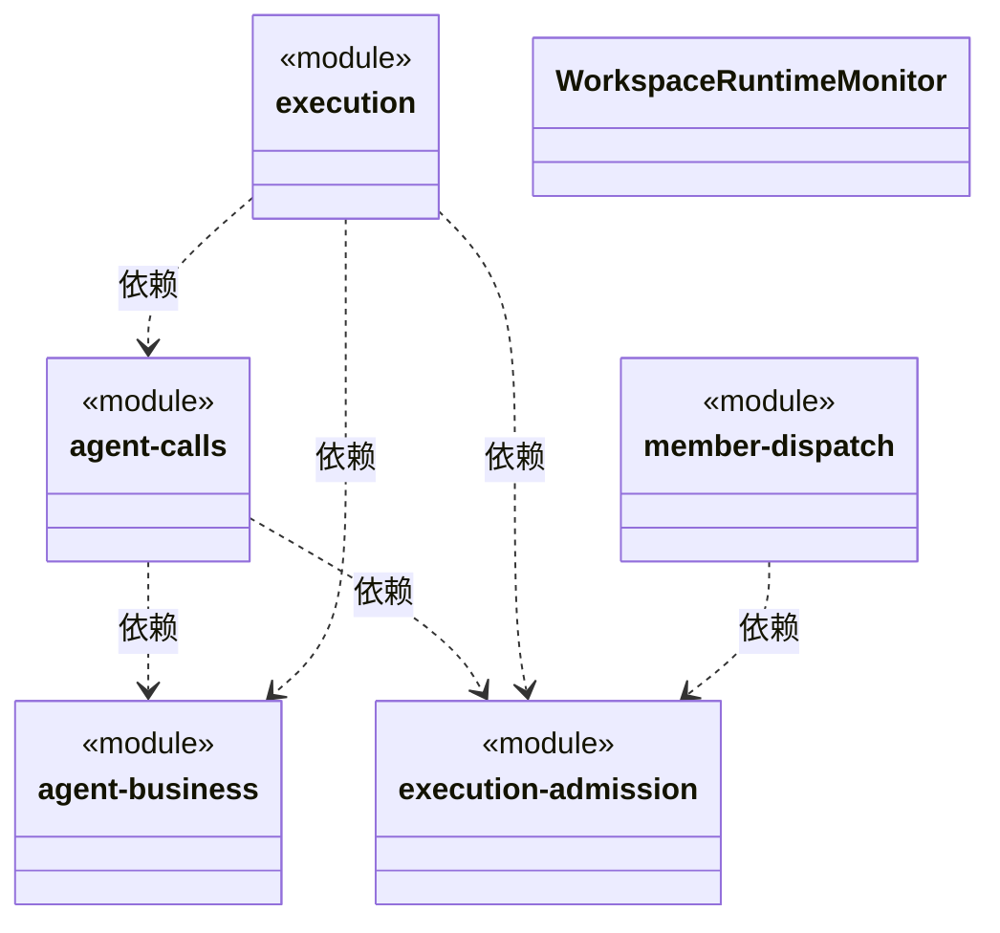

# src/logic/application/assembly 架构

## 设计意图

把独立业务服务与执行端口接成可运行的工作区，集中承担跨领域的具体装配责任。

装配函数建立 Agent 调用、主执行与成员派发关系，并注入模型、准入、预算及文件端口；`WorkspaceRuntimeMonitor` 把已提交派发和运行事实接到监管与履历。唯一工作区存储由 Application 在恢复阶段创建，装配复用该实例，服务生命周期仍交回 Application 管理。

## 主要组成

| 组成 | 定位 |
| --- | --- |
| [WorkspaceRuntimeMonitor](runtime-monitor.ts) | 把工作区派发/周期事务、两套运行日志和对话队列接入全局监管，同时维护静态 Agent 的持久化历史归档。 |
| [agent-calls](agent-calls.ts) | 把 Agent 对象与 execution 的调用协调器、LoopRuntime 装配到工作区真实引擎、准入和请求账本。 |
| [execution](execution.ts) | 把工作区、冻结模型、原生锁及平台策略注入主执行管理器。 |
| [member-dispatch](member-dispatch.ts) | 为已运行工作区装配成员派发、大脑执行、目标审阅、岗位及模块负责人服务；复用工作区恢复前创建的唯一 DispatchStore，来源、责任、岗位与执行保持独立审计投影。 |
| [agent-business](agent-business.ts) | 为递归业务调用连接知识、文件、验证和可信登记端口。 |
| [execution-admission](execution-admission.ts) | 把应用级准入和工作区占用绑定到具体执行入口。 |

<!-- architecture:generated:start -->

## 架构关系

[上层设计](../ARCHITECTURE.md)

<!-- architecture:generated:end -->
