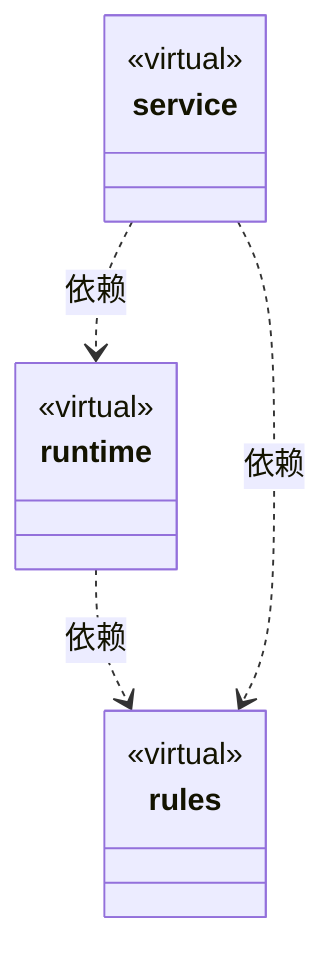

# src/logic/automation 架构

## 设计意图

封装自动化计划从定义到定时执行的业务流程。规则描述计划和触发时间，运行层裁决调度，服务层连接工作区与持久化。

## 主要组成

本层由下列子模块组合，每个子模块作为独立的虚拟类封装参与本层协作。

<!-- architecture:generated:start -->

## 架构关系

标注为 `virtual` 的节点是直接子模块的虚拟类封装；内部设计沿下方入口阅读。

## 子模块

| 虚拟封装 | 整体职责 |
| --- | --- |
| [rules](rules/ARCHITECTURE.md) | 自动化定义、运行与执行/存储端口及纯时区日程计算，不依赖调度和桌面实现。 |
| [runtime](runtime/ARCHITECTURE.md) | 串行版本配置、持久启动意图与定时调度；同项不重叠，重开跳过过期，不重放未知运行。 |
| [service](service/ARCHITECTURE.md) | 自动化应用服务及文件存储：计划、执行请求与持久化属于同一应用职责，领域调度契约归 logic/automation/rules。 |

[上层设计](../ARCHITECTURE.md)

<!-- architecture:generated:end -->
