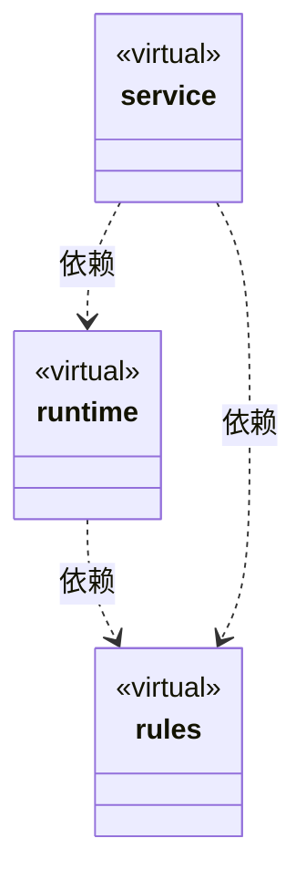

# src/logic/automation 架构

## 设计意图

组织工作区自动化的定义、触发与运行记录，把日程规则和真实执行分开。

`rules` 定义计划与时间计算，`runtime` 决定何时调度并维护启动状态，`service` 接入工作区目录和文件持久化。计划修改影响后续触发；已保存启动意图、正在执行和未知结果不能互相替代。

## 主要组成

本层没有直接产品实现，由下方子模块组成；每个直接子模块作为一个虚拟封装，只在本层呈现整体职责与协作。

<!-- architecture:generated:start -->

## 架构关系

标注为 `virtual` 的节点是直接子模块的虚拟类封装；内部设计沿下方入口阅读。

## 子模块

| 虚拟封装 | 整体职责 |
| --- | --- |
| [rules](rules/ARCHITECTURE.md) | 描述自动化计划、触发时间和所需执行／存储能力，不依赖桌面或真实调度器。 |
| [runtime](runtime/ARCHITECTURE.md) | 把自动化定义转换为有持久记录的定时启动，避免同一计划重叠执行或重放未知结果。 |
| [service](service/ARCHITECTURE.md) | 将自动化调度接入当前工作区的真实能力目录和持久存储，提供应用侧配置与查询入口。 |

[上层设计](../ARCHITECTURE.md)

<!-- architecture:generated:end -->
