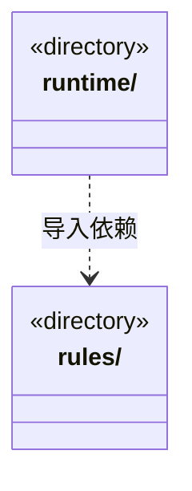

# src/logic/automation 架构

## 目录定位

自动化计划、触发条件及计划契约；服务与规则分开归属，实际依赖通过明确入口验证。

本文描述当前实现。通过分析目录边界后维护的 [源码架构脚本](../../../scripts/source-architecture.mjs) 同步清单和声明；代码变更时仍须核对职责、关键成员与关系。

## 代码清单

本层无直接代码文件。

## 架构类图

各图中的同名节点表示同一目录边界；跨组及完整直接依赖如下（无边不代表继承）：

- `runtime` → `rules`：导入。

## 子目录导航

- [rules/](rules/ARCHITECTURE.md)：自动化定义、运行与执行/存储端口及纯时区日程计算，不依赖调度和桌面实现。
- [runtime/](runtime/ARCHITECTURE.md)：串行版本配置、持久启动意图与定时调度；同项不重叠，重开跳过过期，不重放未知运行。

[返回上层](../ARCHITECTURE.md)。

每次修改本目录代码，同步维护文件头、关键契约说明及本图。未实现的治理、证据验收和自动编排能力不列入当前类图。
