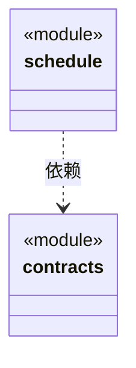

# src/logic/automation/rules 架构

## 设计意图

描述自动化计划、触发时间和所需执行／存储能力，不依赖桌面或真实调度器。

`contracts` 定义版本化配置与运行事实，`schedule` 在给定时间和时区条件下计算下一次触发。规则不读取时钟、不执行任务，错过日程如何处理及何时保存意图由运行层决定。

## 主要组成

| 组成 | 定位 |
| --- | --- |
| [contracts](contracts.ts) | 工作区自动化的定义、计划、持久启动记录及端口契约。 |
| [schedule](schedule.ts) | 计算下一个自动化触发时刻，不触发执行或读写时钟。 |

<!-- architecture:generated:start -->

## 架构关系

[上层设计](../ARCHITECTURE.md)

<!-- architecture:generated:end -->
