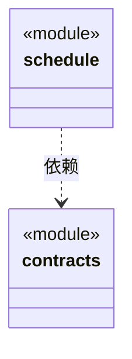

# src/logic/automation/rules 架构

## 设计意图

自动化定义、运行与执行/存储端口及纯时区日程计算，不依赖调度和桌面实现。

## 主要组成

| 组成 | 定位 |
| --- | --- |
| [contracts](contracts.ts) | 工作区自动化的定义、计划、持久启动记录及端口契约。 |
| [schedule](schedule.ts) | 计算下一个自动化触发时刻，不触发执行或读写时钟。 |

<!-- architecture:generated:start -->

## 架构关系

[上层设计](../ARCHITECTURE.md)

<!-- architecture:generated:end -->
