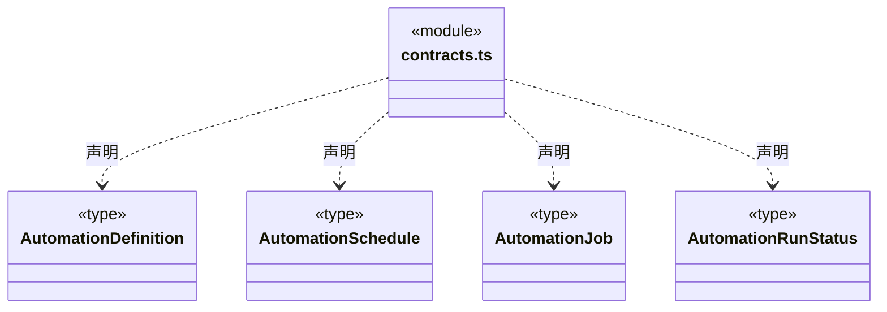
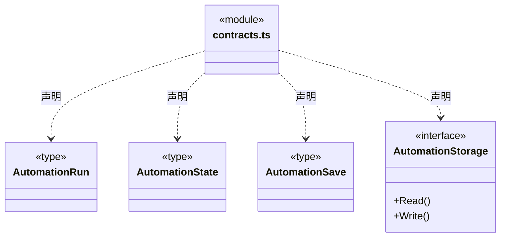
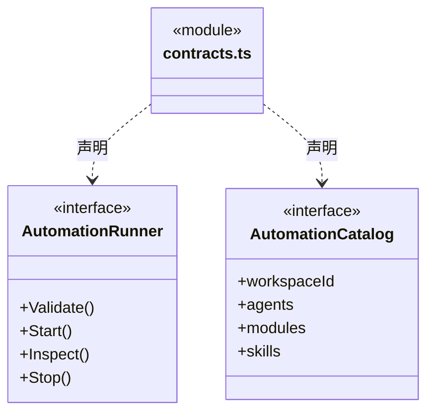
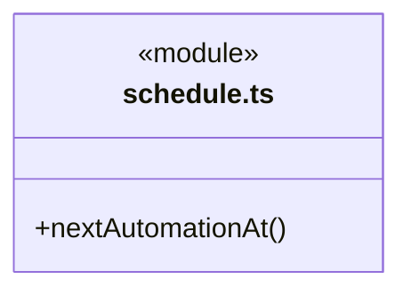
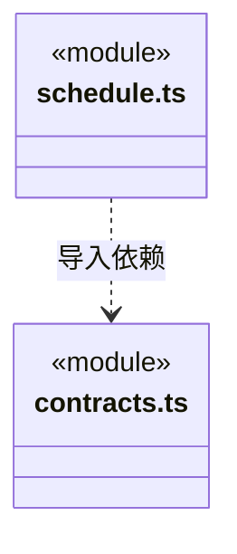

# src/logic/automation/rules 架构

本目录只维护这一份说明。设计与契约直接编辑本文；文件清单、类图和导航由 [架构脚本](../../../../scripts/source-architecture.mjs) 更新，生成区域之外的人工说明会保留。

## 封装意图

自动化定义、运行与执行/存储端口及纯时区日程计算，不依赖调度和桌面实现。

## 类与模块的设计意图

下表依据源码声明及文件头说明定位封装。字段表示该实例持有的状态或协作引用，不表示它拥有被引用服务的生命周期；实际资源责任和调用限制见下文契约及源码注释。

| 类／模块 | 实现形式与实例字段 | 封装依据 |
| --- | --- | --- |
| [contracts.ts](contracts.ts) | 函数／契约模块 | 计划与一次执行分开保存；调度只依赖存储/执行端口，不认识桌面、模型供应商或具体文件。执行结束不代表业务验收。 |
| [schedule.ts](schedule.ts) | 函数／契约模块 | 间隔从指定基点计算，每日按保存的 IANA 时区处理夏令时；过期一次任务不补跑。所有传输时刻是 UTC ISO 字符串。 |

## 接口设计契约

### 工作区自动化契约

定义归工作区，运行冻结定义版本，不随配置编辑改写。固定计划为手动、间隔、按 IANA 时区每天及未来一次；不存在自选工作目录。默认 Agent 是主 Agent，成员选择是当前已采纳岗位 ID，不是新建运行实例。

AutomationStorage 只读写有界完整状态，AutomationRunner 提供校验、真实启动、状态观察和停止。启动必须先经 bind 保存实际主 taskId/runId，再执行模型。Unknown 保留原身份并阻止重叠；结果状态不表示业务验收。新日程变化在 schedule.ts，业务派发变化在 Main 适配，不反向改变契约层。

## 开闭边界

本目录的职责及允许协作由[封装意图](#封装意图)限定，输入输出、状态与失败语义以[接口设计契约](#接口设计契约)为准。扩展从已有公开入口及实际装配位置进入；没有明确可替换契约的部分按真实影响修改和验证，不预建未使用的基类或插件入口。

<!-- architecture:generated:start -->

## 文件清单

| 文件 | 形式 | 当前职责 |
| --- | --- | --- |
| [ARCHITECTURE.md](ARCHITECTURE.md) | 说明文档 | 本目录的文件清单、真实声明、依赖与子封装导航。 |
| [contracts.ts](contracts.ts) | 源码模块 | 工作区自动化的定义、计划、持久启动记录及端口契约。 |
| [schedule.ts](schedule.ts) | 源码模块 | 计算下一个自动化触发时刻，不触发执行或读写时钟。 |

## 架构类图

成员标记：`+` 公开、`-` 私有、`#` 受保护、`$` 静态；构造函数单独列出。文档和资源仅在文件清单中导航，不作为代码节点。

### contracts.ts

### schedule.ts

直接依赖：[contracts.ts](contracts.ts)。

### 本目录调用边界

## 子目录导航

无子目录。

[返回上层](../ARCHITECTURE.md)。

每次修改本目录代码，同步维护文件头、关键契约说明及本图。未实现的治理、证据验收和自动编排能力不列入当前类图。

<!-- architecture:generated:end -->
