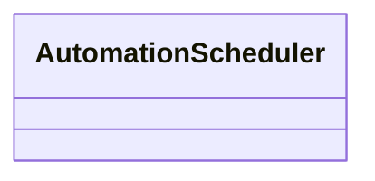

# src/logic/automation/runtime 架构

## 设计意图

把自动化定义转换为有持久记录的定时启动，避免同一计划重叠执行或重放未知结果。

`AutomationScheduler` 持有实例内调度和串行修改状态，通过注入端口保存定义、记录启动意图并发起执行。重开时跳过过期触发，不把遗留运行认作可重试；关闭停止后续调度并收束在途工作。

## 主要组成

| 组成 | 定位 |
| --- | --- |
| [AutomationScheduler](scheduler.ts) | 工作区自动化的串行定义修改、定时触发和执行状态维护。 |

<!-- architecture:generated:start -->

## 架构关系

[上层设计](../ARCHITECTURE.md)

<!-- architecture:generated:end -->
