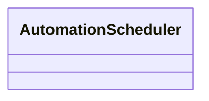

# src/logic/automation/runtime 架构

## 设计意图

串行版本配置、持久启动意图与定时调度；同项不重叠，重开跳过过期，不重放未知运行。

## 主要组成

| 组成 | 定位 |
| --- | --- |
| [AutomationScheduler](scheduler.ts) | 工作区自动化的串行定义修改、定时触发和执行状态维护。 |

<!-- architecture:generated:start -->

## 架构关系

[上层设计](../ARCHITECTURE.md)

<!-- architecture:generated:end -->
