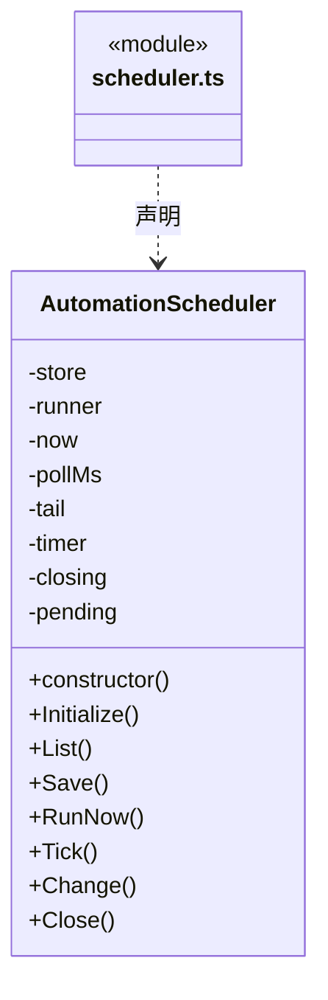
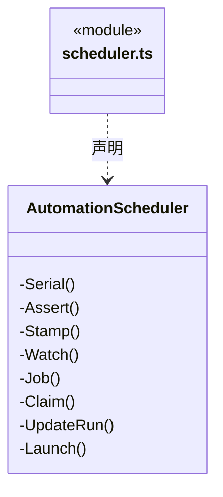

# src/logic/automation/runtime 架构

本目录只维护这一份说明。设计与契约直接编辑本文；文件清单、类图和导航由 [架构脚本](../../../../scripts/source-architecture.mjs) 更新，生成区域之外的人工说明会保留。

## 封装意图

串行版本配置、持久启动意图与定时调度；同项不重叠，重开跳过过期，不重放未知运行。

## 类与模块的设计意图

下表依据源码声明及文件头说明定位封装。字段表示该实例持有的状态或协作引用，不表示它拥有被引用服务的生命周期；实际资源责任和调用限制见下文契约及源码注释。

| 类／模块 | 实现形式与实例字段 | 封装依据 |
| --- | --- | --- |
| [AutomationScheduler](scheduler.ts) | 实例类；持有 `tail`、`timer`、`closing`、`pending`、`store`、`runner`、`now`、`pollMs` | 先保存 starting 意图，再通过窄执行端口启动；异步启动不占串行锁，bind 能保存原任务且暂停可取消。每项最多一个未结执行；重启跳过错过的时刻，不重放启动。 |

## 接口设计契约

### 自动化调度

唯一 AutomationScheduler 串行修改定义与运行历史，定义 CAS 拒绝旧版本。先原子保存 starting，再异步启动；启动不占串行锁，避免 bind 保存身份自锁。每个定义最多一个 starting/running/waiting/unknown 记录，错过时刻跳至未来，不排积压任务。

关闭取消启动准备并排空；工作区随后停止主/成员进程。重开无真实身份的启动标中断，有身份只观察原周期，绝不恢复模型。暂停/删除先停未来计划和准备，再停止真实原任务；停止失败不伪造取消成功。删除保留历史，编辑仅影响未来执行。最多 100 个定义、500 条运行；只清理已终结历史，不删除未结记录。

调度器不依赖工作区、UI、引擎或派发实现；Main 通过存储/执行端口装配。已有运行启动错误说明不会被后续无说明的只读状态覆盖。

## 开闭边界

本目录的职责及允许协作由[封装意图](#封装意图)限定，输入输出、状态与失败语义以[接口设计契约](#接口设计契约)为准。扩展从已有公开入口及实际装配位置进入；没有明确可替换契约的部分按真实影响修改和验证，不预建未使用的基类或插件入口。

<!-- architecture:generated:start -->

## 文件清单

| 文件 | 形式 | 当前职责 |
| --- | --- | --- |
| [ARCHITECTURE.md](ARCHITECTURE.md) | 说明文档 | 本目录的文件清单、真实声明、依赖与子封装导航。 |
| [scheduler.ts](scheduler.ts) | 源码模块 | 工作区自动化的串行定义修改、定时触发和执行状态维护。 |

## 架构类图

成员标记：`+` 公开、`-` 私有、`#` 受保护、`$` 静态；构造函数单独列出。文档和资源仅在文件清单中导航，不作为代码节点。

### scheduler.ts

成员 1/2（同名节点为同一声明，跨图合并阅读）。

成员 2/2（同名节点为同一声明，跨图合并阅读）。

直接依赖：[../../../core/errors.ts](../../../core/errors.ts)、[../rules/contracts.ts](../rules/contracts.ts)、[../rules/schedule.ts](../rules/schedule.ts)。

## 子目录导航

无子目录。

[返回上层](../ARCHITECTURE.md)。

每次修改本目录代码，同步维护文件头、关键契约说明及本图。未实现的治理、证据验收和自动编排能力不列入当前类图。

<!-- architecture:generated:end -->
