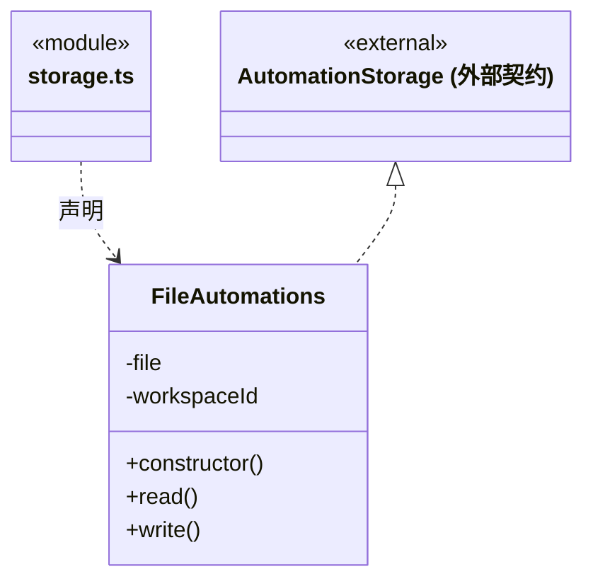
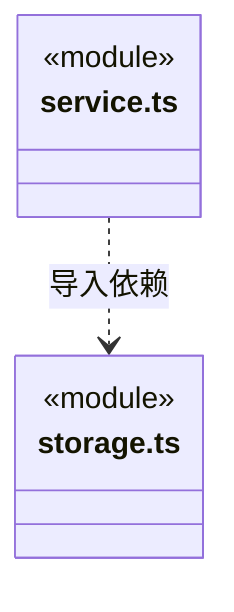

# src/logic/automation/service 架构

## 目录定位

自动化应用服务及文件存储：计划、执行请求与持久化属于同一应用职责，领域调度契约归 logic/automation/rules。

本文描述当前实现。通过分析目录边界后维护的 [源码架构脚本](../../../../scripts/source-architecture.mjs) 同步清单和声明；代码变更时仍须核对职责、关键成员与关系。

## 文件清单

| 文件 | 形式 | 当前职责 |
| --- | --- | --- |
| [ARCHITECTURE.md](ARCHITECTURE.md) | 说明文档 | 本目录的文件清单、真实声明、依赖与子封装导航。 |
| [CONTRACT.md](CONTRACT.md) | 说明文档 | 人工维护的职责、接口契约、状态所有权与扩展边界；在本文末尾同步附加。 |
| [service.ts](service.ts) | 源码模块 | 将工作区知识、已采纳岗位和真实协作接入自动化端口，提供桌面目录与实例校验。 |
| [storage.ts](storage.ts) | 源码模块 | 在工作区私有用户目录保存自动化定义与有界运行历史。 |

## 架构类图

成员标记：`+` 公开、`-` 私有、`#` 受保护、`$` 静态；构造函数单独列出。文档和资源仅在文件清单中导航，不作为代码节点。

### service.ts

直接依赖：[../../workspace/service/workspace.ts](../../workspace/service/workspace.ts)、[../../conversation/runtime/execution-manager.ts](../../conversation/runtime/execution-manager.ts)、[../../dispatch/runtime/auto-collaboration.ts](../../dispatch/runtime/auto-collaboration.ts)、[../../dispatch/runtime/dispatch-service.ts](../../dispatch/runtime/dispatch-service.ts)、[../runtime/scheduler.ts](../runtime/scheduler.ts)、[storage.ts](storage.ts)、[../rules/contracts.ts](../rules/contracts.ts)、[../../knowledge/rules/read-models/index.ts](../../knowledge/rules/read-models/index.ts)、[../../knowledge/rules/builtins.ts](../../knowledge/rules/builtins.ts)、[../../../core/errors.ts](../../../core/errors.ts)、[../../team/rules/member-execution-binding.ts](../../team/rules/member-execution-binding.ts)。

### storage.ts

直接依赖：[../../../core/platform/node/files/index.ts](../../../core/platform/node/files/index.ts)、[../../../core/errors.ts](../../../core/errors.ts)、[../rules/contracts.ts](../rules/contracts.ts)。

### 本目录调用边界

## 子目录导航

无子目录。

[返回上层](../ARCHITECTURE.md)。

每次修改本目录代码，同步维护文件头、关键契约说明及本图。未实现的治理、证据验收和自动编排能力不列入当前类图。

## 设计契约 v1 与落地范围

以下内容区分已接通能力与后续设计；以各节的实现状态为准，不将目标图当作现状图。维护源：[CONTRACT.md](CONTRACT.md)；生成类图时同步附加，勿直接修改本附录。

## 内置运行资源边界

WorkspaceAutomations 通过 rules.assetsRoot 构造 Builtins，与工作区执行上下文使用同一运行资产。
