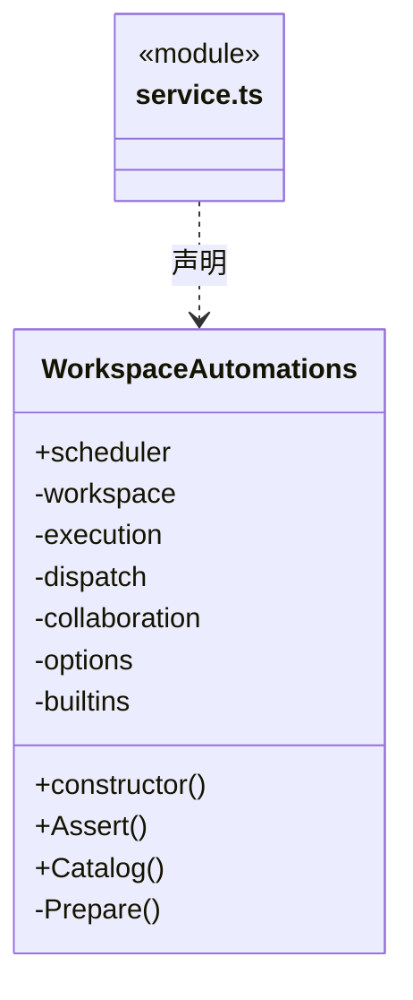
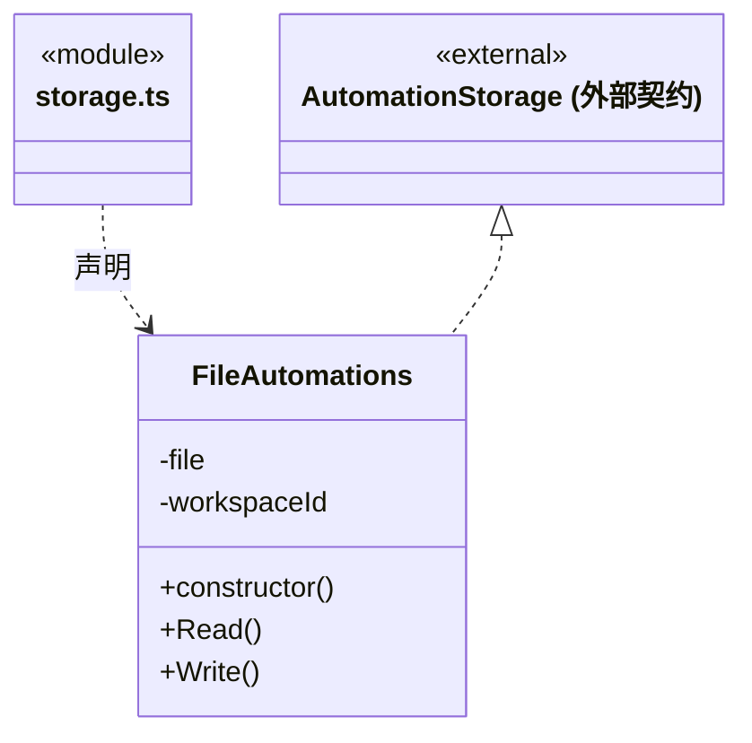
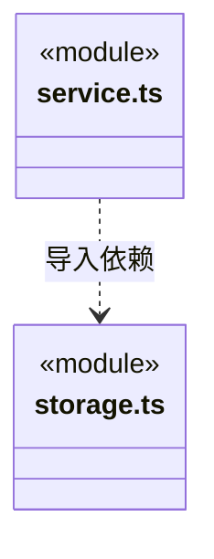

# src/logic/automation/service 架构

本目录只维护这一份说明。设计与契约直接编辑本文；文件清单、类图和导航由 [架构脚本](../../../../scripts/source-architecture.mjs) 更新，生成区域之外的人工说明会保留。

## 封装意图

自动化应用服务及文件存储：计划、执行请求与持久化属于同一应用职责，领域调度契约归 logic/automation/rules。

## 类与模块的设计意图

下表依据源码声明及文件头说明定位封装。字段表示该实例持有的状态或协作引用，不表示它拥有被引用服务的生命周期；实际资源责任和调用限制见下文契约及源码注释。

| 类／模块 | 实现形式与实例字段 | 封装依据 |
| --- | --- | --- |
| [WorkspaceAutomations](service.ts) | 实例类；持有 `scheduler`、`builtins`、`workspace`、`execution`、`dispatch`、`collaboration`、`options` | Main 内部持有，公开 IPC 只能取得经实例校验的服务；所有动作仍由串行调度器裁决。 |
| [FileAutomations](storage.ts) | 实例类；持有 `file`、`workspaceId` | 调度状态不属于 .cbim 知识；依赖工作区独占锁和唯一调度器串行写入，原子替换失败时保留原文件，损坏数据不得当成空清单覆盖。 |

## 接口设计契约

#### 内置运行资源边界

WorkspaceAutomations 通过 rules.assetsRoot 构造 Builtins，与工作区执行上下文使用同一运行资产。

## 开闭边界

本目录的职责及允许协作由[封装意图](#封装意图)限定，输入输出、状态与失败语义以[接口设计契约](#接口设计契约)为准。扩展从已有公开入口及实际装配位置进入；没有明确可替换契约的部分按真实影响修改和验证，不预建未使用的基类或插件入口。

<!-- architecture:generated:start -->

## 文件清单

| 文件 | 形式 | 当前职责 |
| --- | --- | --- |
| [ARCHITECTURE.md](ARCHITECTURE.md) | 说明文档 | 本目录的文件清单、真实声明、依赖与子封装导航。 |
| [service.ts](service.ts) | 源码模块 | 将工作区知识、已采纳岗位和真实协作接入自动化端口，提供桌面目录与实例校验。 |
| [storage.ts](storage.ts) | 源码模块 | 在工作区私有用户目录保存自动化定义与有界运行历史。 |

## 架构类图

成员标记：`+` 公开、`-` 私有、`#` 受保护、`$` 静态；构造函数单独列出。文档和资源仅在文件清单中导航，不作为代码节点。

### service.ts

直接依赖：[../../workspace/service/workspace.ts](../../workspace/service/workspace.ts)、[../../conversation/runtime/execution-manager.ts](../../conversation/runtime/execution-manager.ts)、[../../dispatch/runtime/auto-collaboration.ts](../../dispatch/runtime/auto-collaboration.ts)、[../../dispatch/runtime/dispatch-service.ts](../../dispatch/runtime/dispatch-service.ts)、[../runtime/scheduler.ts](../runtime/scheduler.ts)、[storage.ts](storage.ts)、[../rules/contracts.ts](../rules/contracts.ts)、[../../knowledge/rules/read-models/index.ts](../../knowledge/rules/read-models/index.ts)、[../../knowledge/rules/builtins.ts](../../knowledge/rules/builtins.ts)、[../../../core/errors.ts](../../../core/errors.ts)、[../../team/rules/member-execution-binding.ts](../../team/rules/member-execution-binding.ts)。

### storage.ts

直接依赖：[../../../core/platform/node/files/index.ts](../../../core/platform/node/files/index.ts)、[../../../core/errors.ts](../../../core/errors.ts)、[../rules/contracts.ts](../rules/contracts.ts)。

### 本目录调用边界

## 子目录导航

无子目录。

[返回上层](../ARCHITECTURE.md)。

每次修改本目录代码，同步维护文件头、关键契约说明及本图。未实现的治理、证据验收和自动编排能力不列入当前类图。

<!-- architecture:generated:end -->
