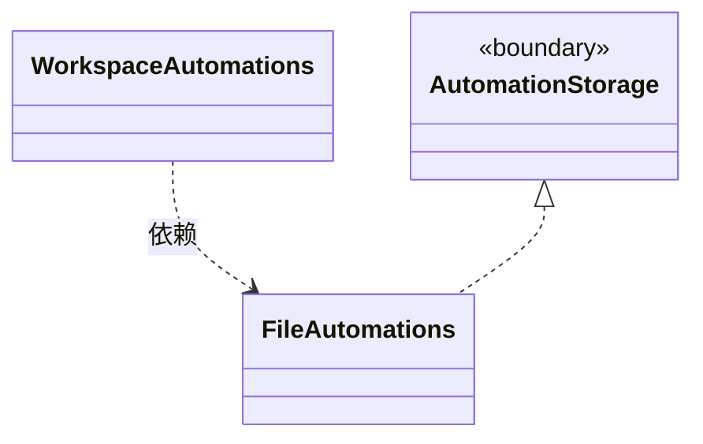

# src/logic/automation/service 架构

## 设计意图

将自动化调度接入当前工作区的真实能力目录和持久存储，提供应用侧配置与查询入口。

`WorkspaceAutomations` 核实工作区、岗位及知识选择后连接调度器，`FileAutomations` 在私有目录保存定义和有界运行历史。服务组合既有协作流程，不建立新的执行引擎或第二套任务事实。

## 主要组成

| 组成 | 定位 |
| --- | --- |
| [WorkspaceAutomations](service.ts) | 将工作区知识、已采纳岗位和真实协作接入自动化端口，提供桌面目录与实例校验；内置流程通过同一代码常量目录读取。 |
| [FileAutomations](storage.ts) | 在工作区私有用户目录保存自动化定义与有界运行历史。 |

<!-- architecture:generated:start -->

## 架构关系

外部继承／实现边界：[AutomationStorage](../rules/contracts.ts)。

[上层设计](../ARCHITECTURE.md)

<!-- architecture:generated:end -->
