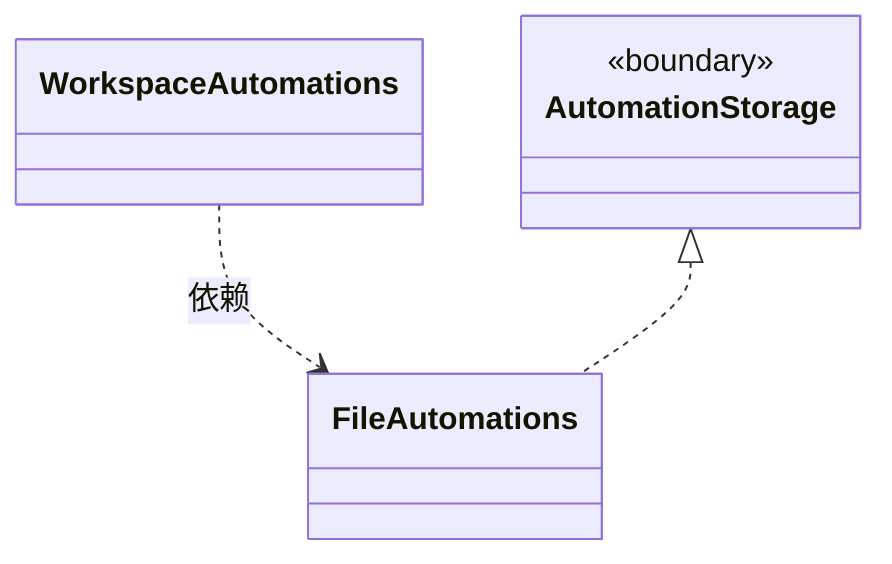

# src/logic/automation/service 架构

## 设计意图

自动化应用服务及文件存储：计划、执行请求与持久化属于同一应用职责，领域调度契约归 logic/automation/rules。

## 主要组成

| 组成 | 定位 |
| --- | --- |
| [WorkspaceAutomations](service.ts) | 将工作区知识、已采纳岗位和真实协作接入自动化端口，提供桌面目录与实例校验；内置流程通过同一代码常量目录读取。 |
| [FileAutomations](storage.ts) | 在工作区私有用户目录保存自动化定义与有界运行历史。 |

<!-- architecture:generated:start -->

## 架构关系

外部继承／实现边界：[AutomationStorage](../rules/contracts.ts)。

[上层设计](../ARCHITECTURE.md)

<!-- architecture:generated:end -->
