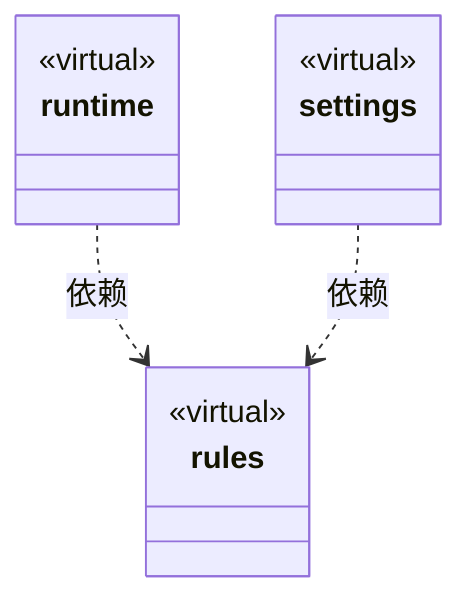

# src/logic/budget 架构

## 设计意图

分别管理目标周期额度与逐模型请求的用量约束，保留预占、已报告消耗和未知成本的区别。

`rules` 定义计量事实与端口，`runtime` 在可信身份下预占和结算，`settings` 保存新周期的默认策略。运行中冻结的预算不随配置编辑追改；用量展示本身不签发执行许可。

## 主要组成

本层没有直接产品实现，由下方子模块组成；每个直接子模块作为一个虚拟封装，只在本层呈现整体职责与协作。

<!-- architecture:generated:start -->

## 架构关系

标注为 `virtual` 的节点是直接子模块的虚拟类封装；内部设计沿下方入口阅读。

## 子模块

| 虚拟封装 | 整体职责 |
| --- | --- |
| [rules](rules/ARCHITECTURE.md) | 定义周期预算、请求账本和可信计量规则，让准入与持久重放使用同一组不变量。 |
| [runtime](runtime/ARCHITECTURE.md) | 协调周期准入、逐请求预留与结算，并提供有真实日志依据的消耗查询。 |
| [settings](settings/ARCHITECTURE.md) | 保存创建新目标时使用的额度和计量模式，隔离默认配置与活动周期的冻结策略。 |

[上层设计](../ARCHITECTURE.md)

<!-- architecture:generated:end -->
