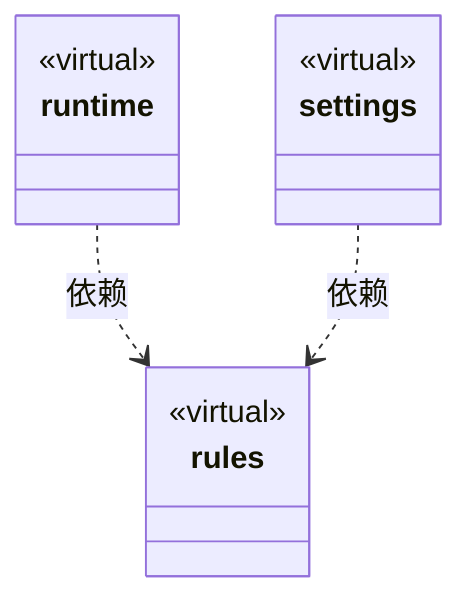

# src/logic/budget 架构

## 设计意图

封装目标周期与模型请求的预算管理。规则定义额度和计量事实，运行服务协调预占与结算，设置服务维护后续周期的默认策略。

## 主要组成

本层由下列子模块组合，每个子模块作为独立的虚拟类封装参与本层协作。

<!-- architecture:generated:start -->

## 架构关系

标注为 `virtual` 的节点是直接子模块的虚拟类封装；内部设计沿下方入口阅读。

## 子模块

| 虚拟封装 | 整体职责 |
| --- | --- |
| [rules](rules/ARCHITECTURE.md) | 预算领域：Scope 使用量、预占/结算、模型请求规则和存储端口。规则不访问应用文件与具体传输，业务编排在 logic/budget/runtime。 |
| [runtime](runtime/ARCHITECTURE.md) | 预算应用服务：协调请求和目标预算预占/结算，通过明确存储端口保存结果；不直接访问共享派发 Store。 |
| [settings](settings/ARCHITECTURE.md) | 保存作用域预算默认值；运行周期在创建时冻结，设置变化不追改活动周期。 |

[上层设计](../ARCHITECTURE.md)

<!-- architecture:generated:end -->
