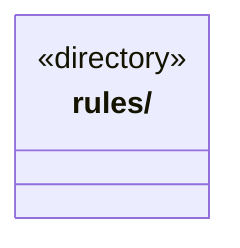

# src/logic/budget 架构

## 目录定位

模型请求额度与作用域预算规则；服务与规则分开归属，实际依赖通过明确入口验证。

本文描述当前实现。通过分析目录边界后维护的 [源码架构脚本](../../../scripts/source-architecture.mjs) 同步清单和声明；代码变更时仍须核对职责、关键成员与关系。

## 代码清单

本层无直接代码文件。

## 架构类图

各图中的同名节点表示同一目录边界；跨组及完整直接依赖如下（无边不代表继承）：

本层无目录间直接导入关系。

## 子目录导航

- [rules/](rules/ARCHITECTURE.md)：预算领域：Scope 使用量、预占/结算、模型请求规则和存储端口。规则不访问应用文件与具体传输，业务服务在 scheduler-engine/budget。

[返回上层](../ARCHITECTURE.md)。

每次修改本目录代码，同步维护文件头、关键契约说明及本图。未实现的治理、证据验收和自动编排能力不列入当前类图。
