# src/logic/budget/rules 架构

本目录只维护这一份说明。设计与契约直接编辑本文；文件清单、类图和导航由 [架构脚本](../../../../scripts/source-architecture.mjs) 更新，生成区域之外的人工说明会保留。

## 封装意图

预算领域：Scope 使用量、预占/结算、模型请求规则和存储端口。规则不访问应用文件与具体传输，业务编排在 logic/budget/runtime。

## 类与模块的设计意图

下表依据源码声明及文件头说明定位封装。字段表示该实例持有的状态或协作引用，不表示它拥有被引用服务的生命周期；实际资源责任和调用限制见下文契约及源码注释。

| 类／模块 | 实现形式与实例字段 | 封装依据 |
| --- | --- | --- |
| [model-request-budget-invariants.ts](model-request-budget-invariants.ts) | 函数／契约模块 | 网络 IO 必须在持久事务外；只有精确预留能进入发送意图，额外角色核对完整执行绑定及逐字段计价，终态记录允许停止后结算，但不能改写原预算或夹带业务变化。 |
| [model-request-budget-rules.ts](model-request-budget-rules.ts) | 函数／契约模块 | 所有在途预留共同占额度，跨实例遗留视为未知；按协议报告结算，不能根据模型文字或错误状态猜测免费。 |
| [model-request-budget-storage.ts](model-request-budget-storage.ts) | 函数／契约模块 | 请求预留只需要冻结周期预算和原请求记录，不应获得岗位、任务图、邮箱或其它领域的写权限；实现仍在原串行事务内投影视图和提交。 |
| [model-request-budget.ts](model-request-budget.ts) | 函数／契约模块 | 请求与运行不是同一计量单位；重试和摘要各有独立请求，缺用量或恢复遗留不能按零释放。 |
| [model-request-configuration.ts](model-request-configuration.ts) | 函数／契约模块 | 角色价格不能由引擎请求给出；附加角色指纹还绑定整个执行配置，防止把另一运行的同型号混入本次执行。 |
| [request-budget.ts](request-budget.ts) | 函数／契约模块 | 引擎只负责实际 IO 和协议用量；请求身份、冻结价格和可靠事务由装配方持有，不向模型暴露修改入口。 |
| [scope-budget-invariants.ts](scope-budget-invariants.ts) | 函数／契约模块 | 单独保存“允许”会被后续运行误用；证明必须和唯一新增主运行或成员领取一起提交，拒绝只能记录原因，不能消费等待或改变目标。 |
| [scope-budget.ts](scope-budget.ts) | 函数／契约模块 | 缺省保留旧运行间软限额，不能迁移旧周期的保证；在途、未知和达到额度分开表达，不把展示零值当许可。 |
| [scope-usage.ts](scope-usage.ts) | 函数／契约模块 | 完整运行归属、可读日志、已报告用量和已知价格是不同事实；未知记录不能计作免费，也不能据统计签发预算或执行许可。 |

## 接口设计契约

### 请求与作用域预算规则

本目录拥有模型请求预算的数据、状态约束、存储端口及作用域预算与用量协议。model-request-budget.ts、model-request-budget-rules.ts 和 model-request-budget-invariants.ts 定义请求账本及合法演进，model-request-budget-storage.ts 声明存储边界；scope-budget.ts、scope-budget-invariants.ts、scope-usage.ts 定义目标周期预算和公开用量。

request-budget.ts 提供 RequestBudgetPort、RequestBudgetTicket 与未知原因契约，依赖本域请求账本类型。reserve/issue 分别保存申请与发送意图，实际发送前同步 assertSend；报告、明确未发送与未知分别保留事实。规则不执行网络请求，也不拥有模型凭据或运行服务。

实际请求传输位于 [execution/engines/transport](../../execution/engines/transport/ARCHITECTURE.md)，预算编排在 [budget/runtime](../runtime/ARCHITECTURE.md)，持久化由 [dispatch/storage](../../dispatch/storage/ARCHITECTURE.md#contract) 承担。模型目录和配置服务分别见 [models](../../models/ARCHITECTURE.md#contract) 与 [models/service](../../models/service/ARCHITECTURE.md#contract)。迁移保留账本、结算与工具授权顺序。

#### 递归模型的计费归属

main 请求绑定可携带 agentRun 记录实际子 taskId/runId；预算授权仍由原 rootSessionId/taskId/runId/scopeId 决定，不以 agentRun 授权或新开额度。每个子模型使用自身冻结价格申请与结算，共享根账本的已用及预留上限。

##### V2 逐角色预算

model-request-configuration.ts 从原执行快照投影预算模型；primary 保留旧字段及指纹，附加角色保存 slot、角色配置指纹和完整执行 bindingHash。成员预留/发送审计逐字段核对原 run.model 中的角色，不能仅复制 hash 后更换价格。

生成预算继续使用 contextWindow/maxTokens/完整价格分量；向量使用 inputTokens、dimensions、inputPrice，maxOutputTokens 必须为 0，不假造生成容量。向量只接受非缓存输入用量，未知价格仍为未知，金额为本地估算。两类请求在同一个周期账本汇总，未知、超额、重启遗留阻止后续准入。旧生成记录不补 role；旧阶段、命令指纹和终态规则保持不变。

#### 共享算法调用边界

本目录通过 Core 公开入口调用 `JsonUtils.OrderJsonValue`。静态类只承载原算法；本目录继续决定字段、比较器、错误映射及资源生命周期。函数改为静态方法不改变原持久化字节或失败语义。

## 开闭边界

本目录的职责及允许协作由[封装意图](#封装意图)限定，输入输出、状态与失败语义以[接口设计契约](#接口设计契约)为准。扩展从已有公开入口及实际装配位置进入；没有明确可替换契约的部分按真实影响修改和验证，不预建未使用的基类或插件入口。

<!-- architecture:generated:start -->

## 文件清单

| 文件 | 形式 | 当前职责 |
| --- | --- | --- |
| [ARCHITECTURE.md](ARCHITECTURE.md) | 说明文档 | 本目录的文件清单、真实声明、依赖与子封装导航。 |
| [model-request-budget-invariants.ts](model-request-budget-invariants.ts) | 源码模块 | 在唯一工作区 Store 提交与重放时核实请求身份、预算预留和不可改写的阶段链。 |
| [model-request-budget-rules.ts](model-request-budget-rules.ts) | 源码模块 | 从不可变请求阶段计算预留、真实用量和后续请求的准入，供服务及 Store 独立核对。 |
| [model-request-budget-storage.ts](model-request-budget-storage.ts) | 源码模块 | 模型请求账本独有的读视图、提交单元与准入端口。 |
| [model-request-budget.ts](model-request-budget.ts) | 源码模块 | 定义逐模型请求预留、发送意图和结算的不可变事实，以及只读预算摘要。 |
| [model-request-configuration.ts](model-request-configuration.ts) | 源码模块 | 从已冻结的执行快照派生单角色的请求计量参数，供预算服务与审计共同核对。 |
| [request-budget.ts](request-budget.ts) | 源码模块 | 定义各引擎共用传输与工作区请求账本之间的可信窄端口。 |
| [scope-budget-invariants.ts](scope-budget-invariants.ts) | 源码模块 | 在派发事务提交与重放时保护冻结额度、真实运行准入证明和不可改写的预算拒绝事实。 |
| [scope-budget.ts](scope-budget.ts) | 源码模块 | 定义周期冻结额度、可信计量观察和启动证明；显式 request 模式另由请求账本控制每次发送。 |
| [scope-usage.ts](scope-usage.ts) | 源码模块 | 定义指定调度周期的只读运行计量报告，供调度服务、Bridge 和任务视图共用。 |

## 架构类图

成员标记：`+` 公开、`-` 私有、`#` 受保护、`$` 静态；构造函数单独列出。文档和资源仅在文件清单中导航，不作为代码节点。

### model-request-budget-invariants.ts

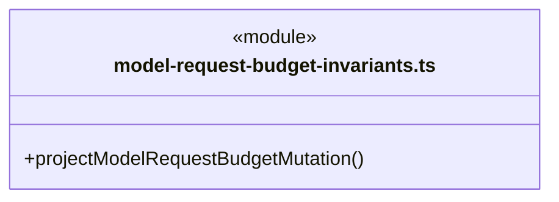

直接依赖：[../../../core/errors.ts](../../../core/errors.ts)、[model-request-budget-rules.ts](model-request-budget-rules.ts)、[model-request-budget.ts](model-request-budget.ts)、[model-request-configuration.ts](model-request-configuration.ts)、[../../dispatch/rules/dispatch-storage.ts](../../dispatch/rules/dispatch-storage.ts)、[../../team/rules/workspace-member-rules.ts](../../team/rules/workspace-member-rules.ts)。

### model-request-budget-rules.ts

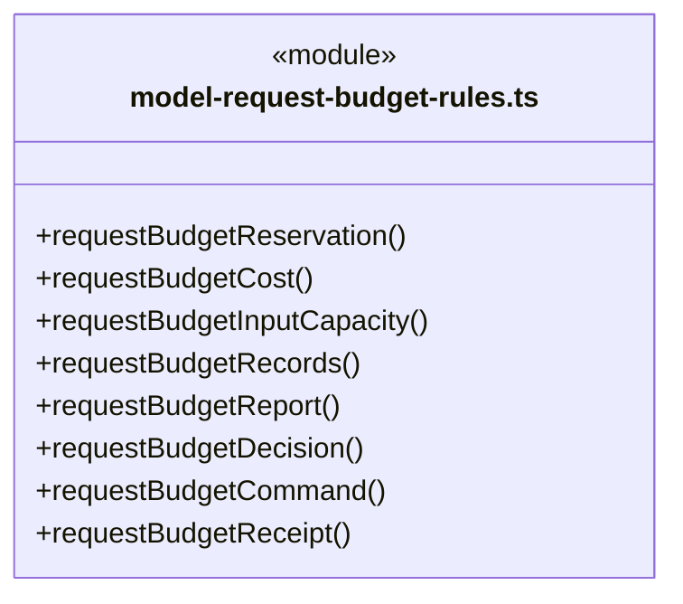

直接依赖：[../../../core/platform/node/serialization.ts](../../../core/platform/node/serialization.ts)、[model-request-budget.ts](model-request-budget.ts)、[scope-budget.ts](scope-budget.ts)。

### model-request-budget-storage.ts

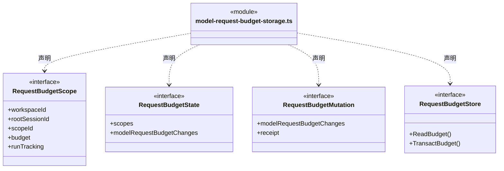

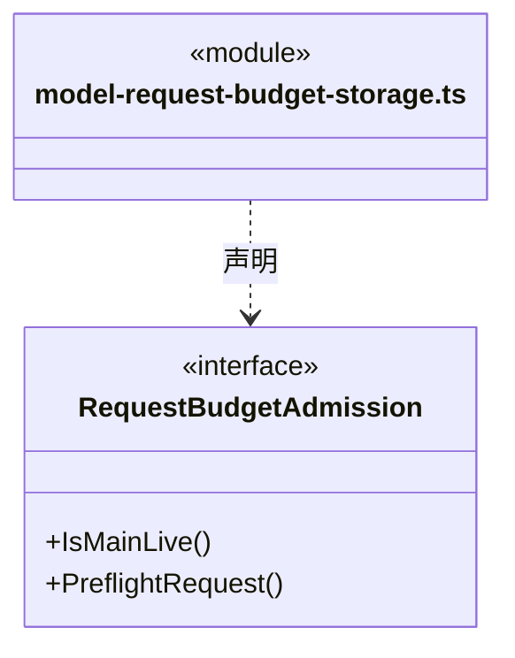

直接依赖：[model-request-budget.ts](model-request-budget.ts)、[scope-budget.ts](scope-budget.ts)。

### model-request-budget.ts

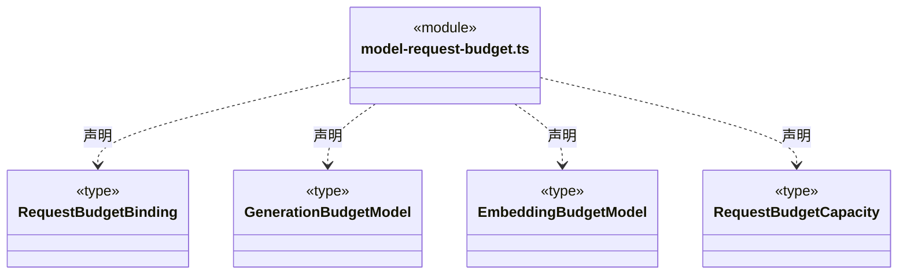

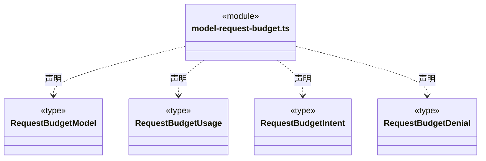

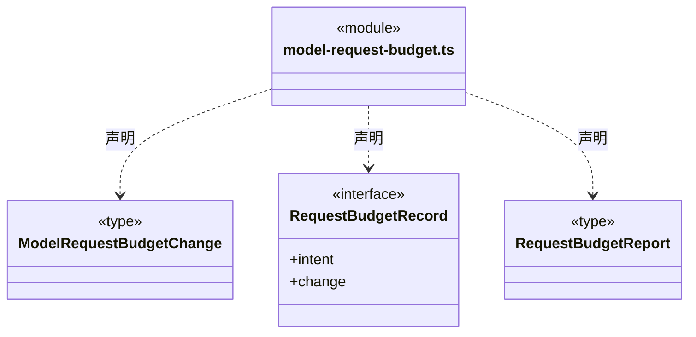

### model-request-configuration.ts

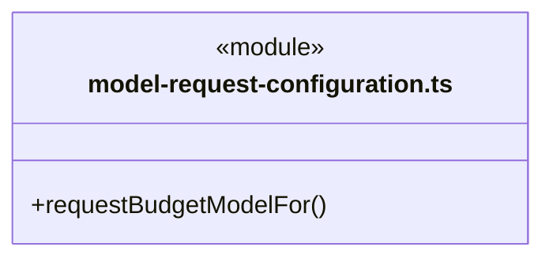

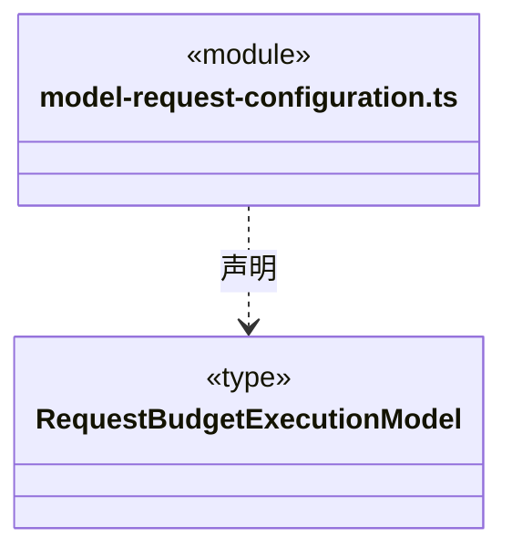

直接依赖：[../../../core/platform/node/serialization.ts](../../../core/platform/node/serialization.ts)、[model-request-budget.ts](model-request-budget.ts)、[../../engines/index.ts](../../engines/index.ts)、[../../team/rules/workspace-member-rules.ts](../../team/rules/workspace-member-rules.ts)。

### request-budget.ts

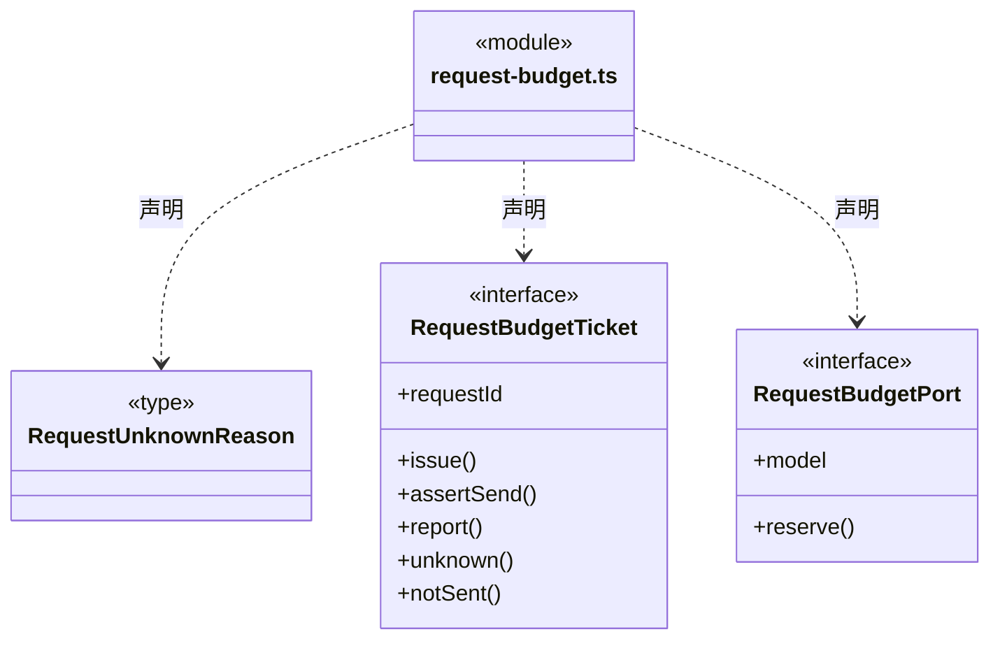

直接依赖：[model-request-budget.ts](model-request-budget.ts)。

### scope-budget-invariants.ts

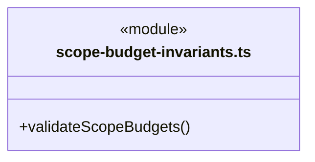

直接依赖：[../../../core/errors.ts](../../../core/errors.ts)、[../../../core/utility/index.ts](../../../core/utility/index.ts)、[scope-budget.ts](scope-budget.ts)、[../../dispatch/rules/dispatch-storage.ts](../../dispatch/rules/dispatch-storage.ts)、[../../tasks/rules/dispatch-scope.ts](../../tasks/rules/dispatch-scope.ts)。

### scope-budget.ts

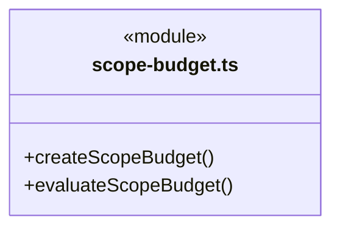

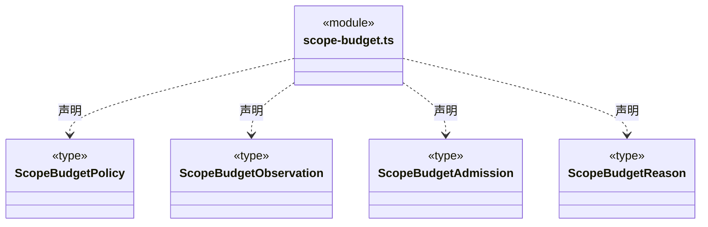

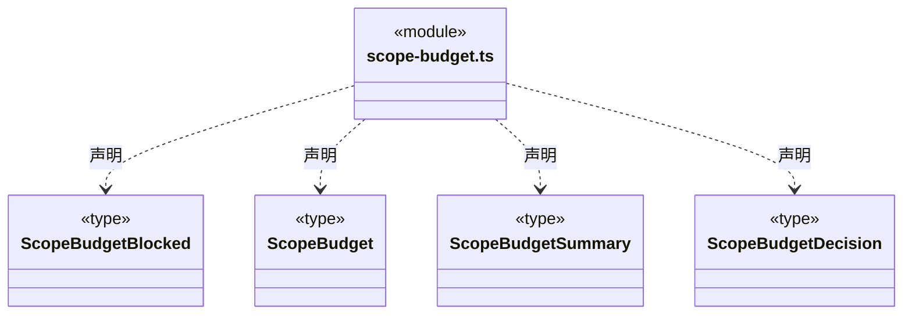

### scope-usage.ts

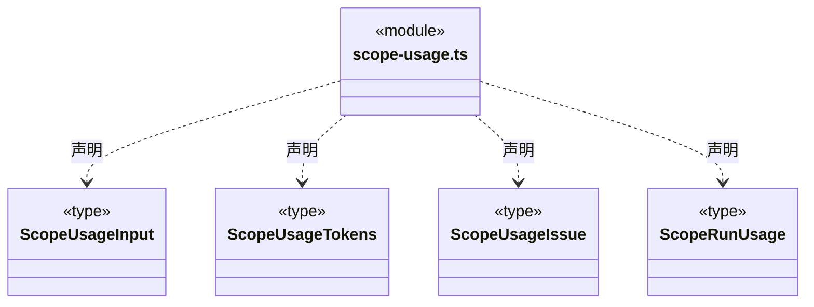

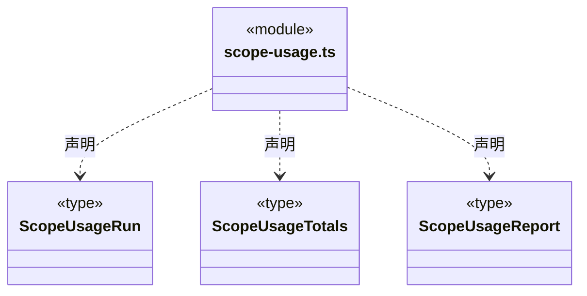

### 本目录调用边界

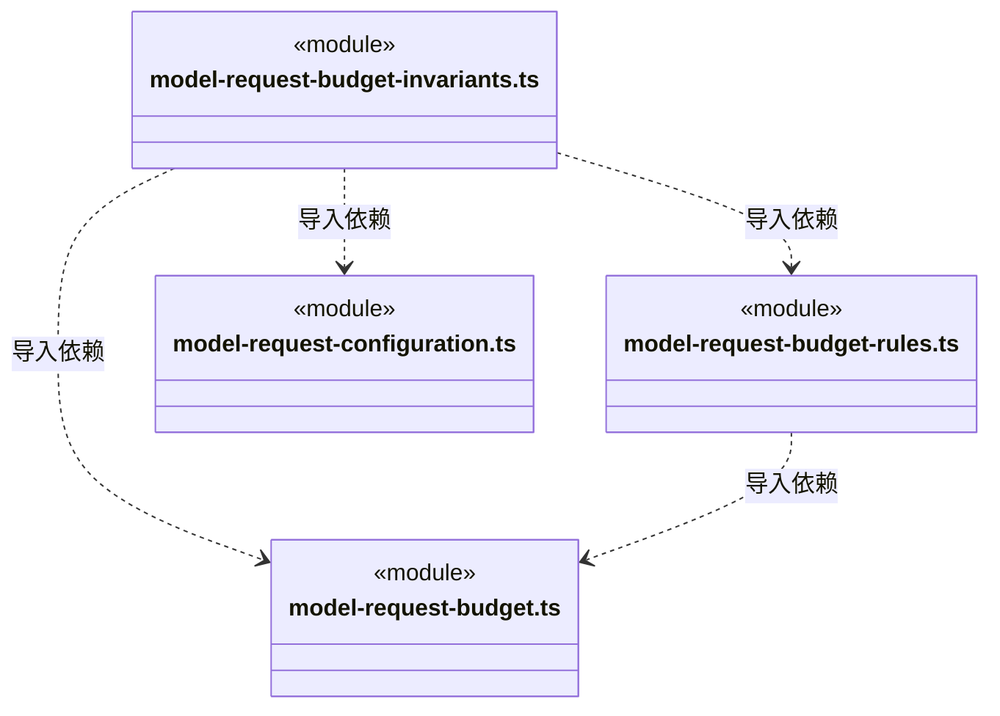

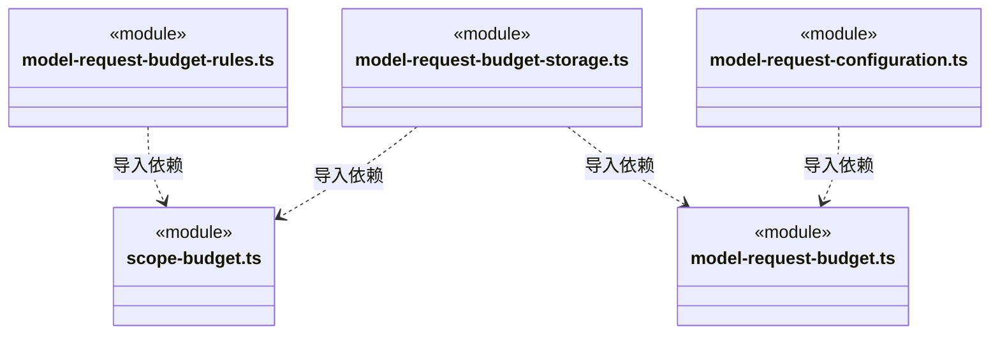

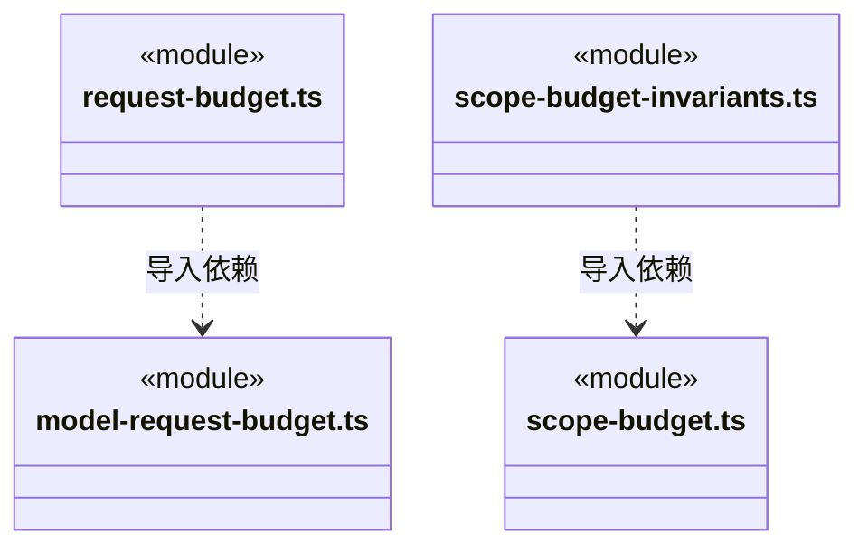

## 子目录导航

无子目录。

[返回上层](../ARCHITECTURE.md)。

每次修改本目录代码，同步维护文件头、关键契约说明及本图。未实现的治理、证据验收和自动编排能力不列入当前类图。

<!-- architecture:generated:end -->
