# src/logic/budget/rules 架构

## 目录定位

预算领域：Scope 使用量、预占/结算、模型请求规则和存储端口。规则不访问应用文件与具体传输，业务编排在 logic/budget/runtime。

本文描述当前实现。通过分析目录边界后维护的 [源码架构脚本](../../../../scripts/source-architecture.mjs) 同步清单和声明；代码变更时仍须核对职责、关键成员与关系。

## 代码清单

| 文件 | 当前职责 |
| --- | --- |
| [model-request-budget-invariants.ts](model-request-budget-invariants.ts) | 在唯一工作区 Store 提交与重放时核实请求身份、预算预留和不可改写的阶段链。 |
| [model-request-budget-rules.ts](model-request-budget-rules.ts) | 从不可变请求阶段计算预留、真实用量和后续请求的准入，供服务及 Store 独立核对。 |
| [model-request-budget-storage.ts](model-request-budget-storage.ts) | 模型请求账本独有的读视图、提交单元与准入端口。 |
| [model-request-budget.ts](model-request-budget.ts) | 定义逐模型请求预留、发送意图和结算的不可变事实，以及只读预算摘要。 |
| [request-budget.ts](request-budget.ts) | 定义各引擎共用传输与工作区请求账本之间的可信窄端口。 |
| [scope-budget-invariants.ts](scope-budget-invariants.ts) | 在派发事务提交与重放时保护冻结额度、真实运行准入证明和不可改写的预算拒绝事实。 |
| [scope-budget.ts](scope-budget.ts) | 定义周期冻结额度、可信计量观察和启动证明；显式 request 模式另由请求账本控制每次发送。 |
| [scope-usage.ts](scope-usage.ts) | 定义指定调度周期的只读运行计量报告，供调度服务、Bridge 和任务视图共用。 |

## 架构类图

### model-request-budget-invariants.ts

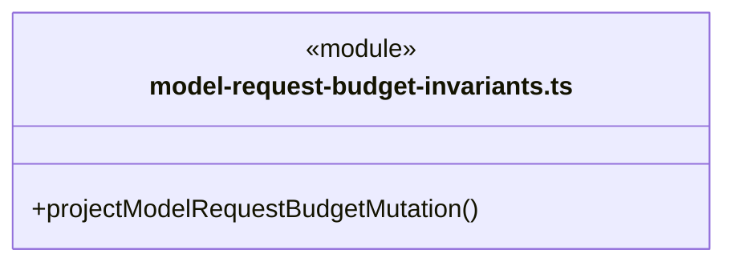

直接依赖：[../../../core/errors.ts](../../../core/errors.ts)、[../../team/rules/workspace-member-rules.ts](../../team/rules/workspace-member-rules.ts)、[../../dispatch/rules/dispatch-storage.ts](../../dispatch/rules/dispatch-storage.ts)、[model-request-budget.ts](model-request-budget.ts)、[model-request-budget-rules.ts](model-request-budget-rules.ts)。

### model-request-budget-rules.ts

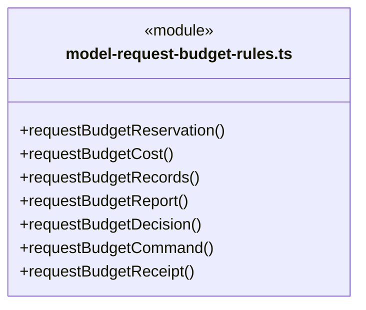

直接依赖：[../../../core/platform/node/serialization.ts](../../../core/platform/node/serialization.ts)、[scope-budget.ts](scope-budget.ts)、[model-request-budget.ts](model-request-budget.ts)。

### model-request-budget-storage.ts

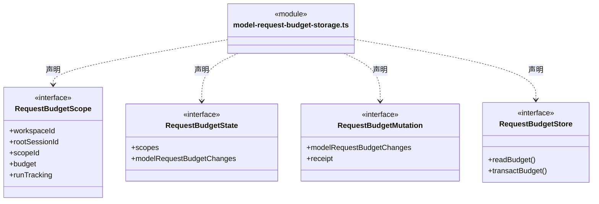

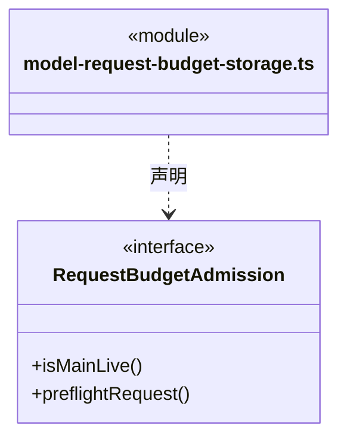

直接依赖：[scope-budget.ts](scope-budget.ts)、[model-request-budget.ts](model-request-budget.ts)。

### model-request-budget.ts

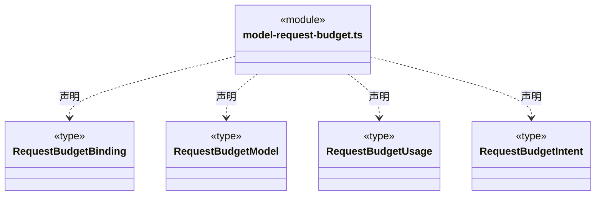

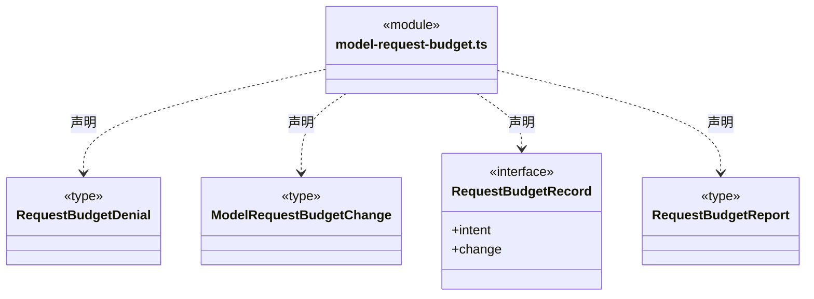

### request-budget.ts

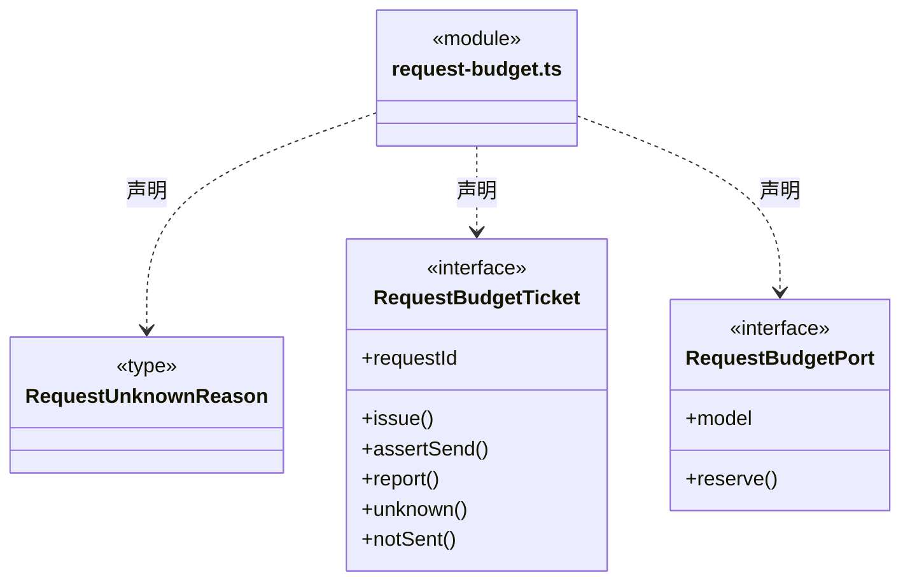

直接依赖：[model-request-budget.ts](model-request-budget.ts)。

### scope-budget-invariants.ts

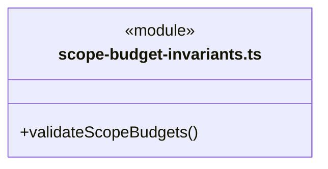

直接依赖：[../../../core/utility/index.ts](../../../core/utility/index.ts)、[../../../core/errors.ts](../../../core/errors.ts)、[../../dispatch/rules/dispatch-storage.ts](../../dispatch/rules/dispatch-storage.ts)、[../../tasks/rules/dispatch-scope.ts](../../tasks/rules/dispatch-scope.ts)、[scope-budget.ts](scope-budget.ts)。

### scope-budget.ts

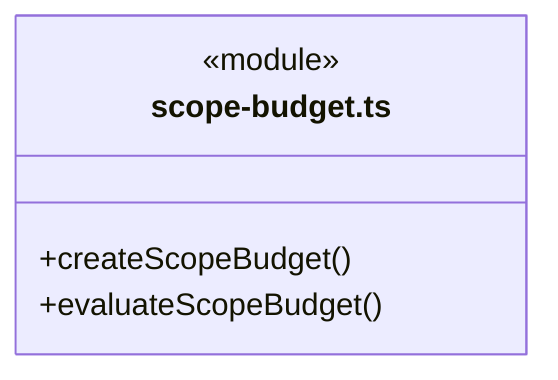

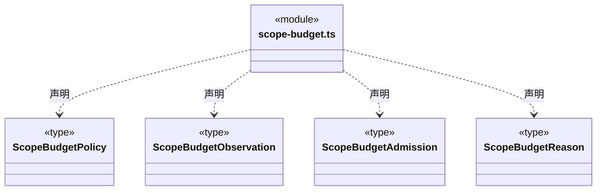

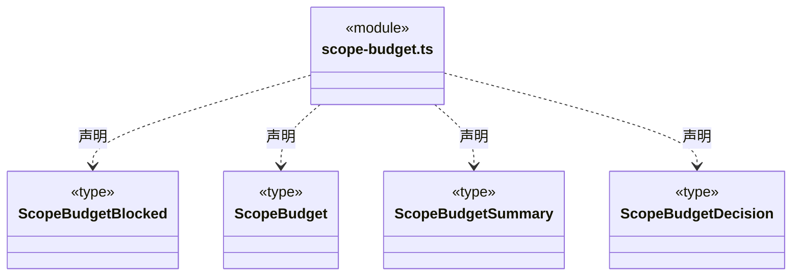

### scope-usage.ts

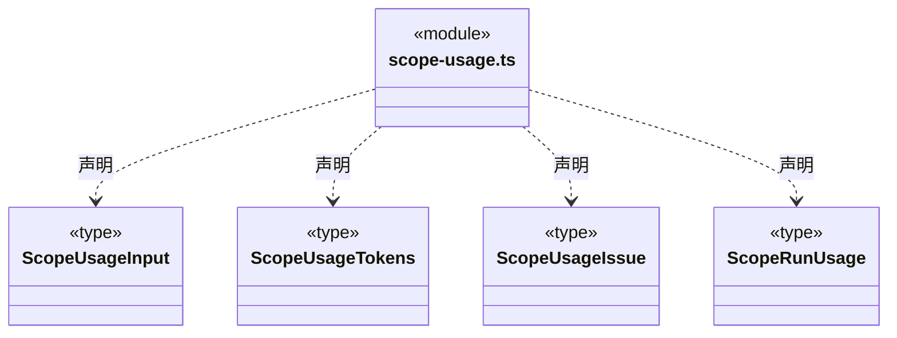

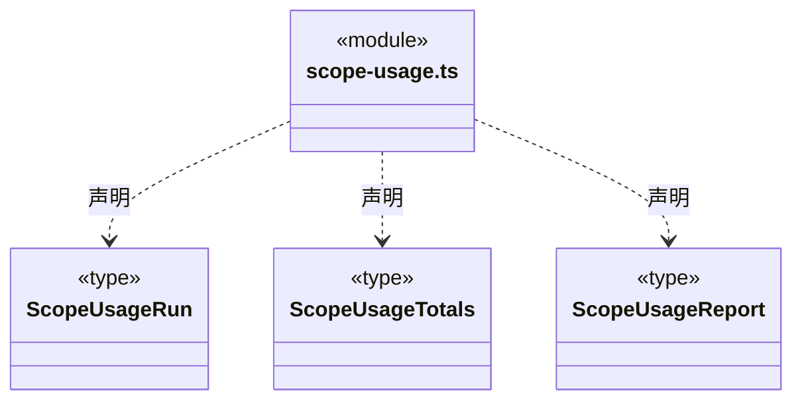

### 本目录调用边界

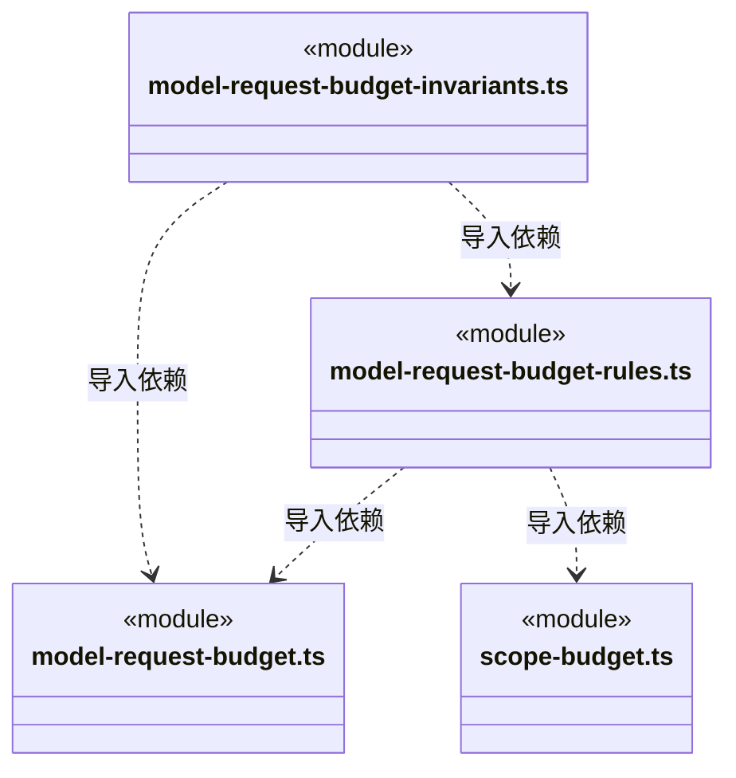

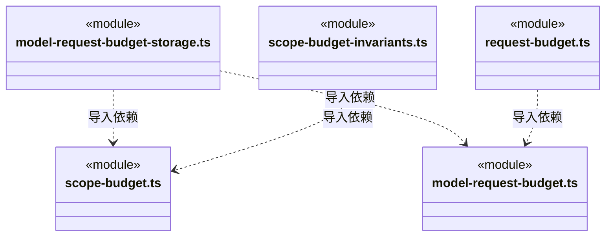

## 子目录导航

无子目录。

[返回上层](../ARCHITECTURE.md)。

每次修改本目录代码，同步维护文件头、关键契约说明及本图。未实现的治理、证据验收和自动编排能力不列入当前类图。

## 设计契约 v1 与落地范围

以下内容区分已接通能力与后续设计；以各节的实现状态为准，不将目标图当作现状图。维护源：[CONTRACT.md](CONTRACT.md)；生成类图时同步附加，勿直接修改本附录。

# 请求与作用域预算规则

本目录拥有模型请求预算的数据、状态约束、存储端口及作用域预算与用量协议。model-request-budget.ts、model-request-budget-rules.ts 和 model-request-budget-invariants.ts 定义请求账本及合法演进，model-request-budget-storage.ts 声明存储边界；scope-budget.ts、scope-budget-invariants.ts、scope-usage.ts 定义目标周期预算和公开用量。

request-budget.ts 提供 RequestBudgetPort、RequestBudgetTicket 与未知原因契约，依赖本域请求账本类型。reserve/issue 分别保存申请与发送意图，实际发送前同步 assertSend；报告、明确未发送与未知分别保留事实。规则不执行网络请求，也不拥有模型凭据或运行服务。

实际请求传输位于 [execution/engines/transport](../../execution/engines/transport/ARCHITECTURE.md)，预算编排在 [budget/runtime](../runtime/ARCHITECTURE.md)，持久化由 [dispatch/storage](../../dispatch/storage/CONTRACT.md) 承担。模型目录和配置服务分别见 [models](../../models/CONTRACT.md) 与 [models/service](../../models/service/CONTRACT.md)。迁移保留账本、结算与工具授权顺序。
