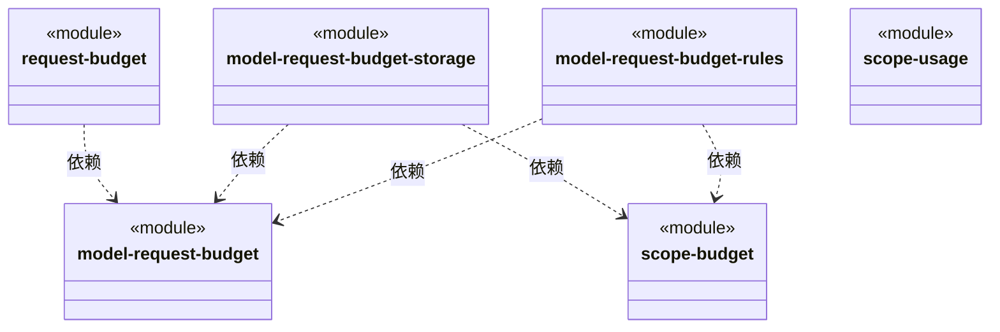

# src/logic/budget/rules 架构

## 设计意图

定义周期预算、请求账本和可信计量规则，让准入与持久重放使用同一组不变量。

周期规则检查冻结额度及启动证明，请求规则区分预留、发送意图与终态，并通过专用存储端口限制写入范围。无用量或遗留在途请求保持未知；引擎只能报告传输事实，不能自行设定身份、价格或释放额度。

## 主要组成

| 组成 | 定位 |
| --- | --- |
| [model-request-budget](model-request-budget.ts) | 定义逐模型请求预留、发送意图和结算的不可变事实，以及只读预算摘要。 |
| [model-request-budget-rules](model-request-budget-rules.ts) | 从不可变请求阶段计算预留、真实用量和后续请求的准入，供服务及 Store 独立核对。 |
| [scope-budget](scope-budget.ts) | 定义周期冻结额度、可信计量观察和启动证明；显式 request 模式另由请求账本控制每次发送。 |
| [scope-usage](scope-usage.ts) | 定义指定调度周期的只读运行计量报告，供调度服务、Bridge 和任务视图共用。 |
| [model-request-budget-storage](model-request-budget-storage.ts) | 声明请求账本专用读视图与提交单元，限制消费者写权限。 |
| [request-budget](request-budget.ts) | 约定真实传输与可靠预算服务间的预占、发送和结算端口。 |

<!-- architecture:generated:start -->

## 架构关系

[上层设计](../ARCHITECTURE.md)

<!-- architecture:generated:end -->
