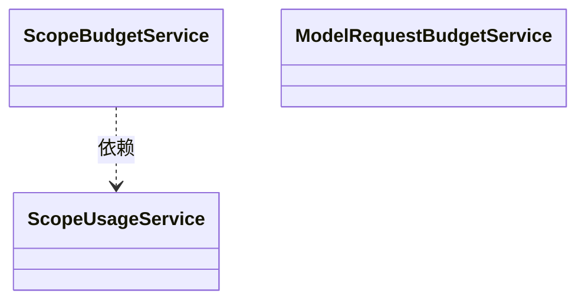

# src/logic/budget/runtime 架构

## 设计意图

预算应用服务：协调请求和目标预算预占/结算，通过明确存储端口保存结果；不直接访问共享派发 Store。

## 主要组成

| 组成 | 定位 |
| --- | --- |
| [ModelRequestBudgetService](model-request-budget-service.ts) | 通过专用预算端口保存每个真实主/成员请求的预留、发送意图和终态，不读取或改写其它调度领域。 |
| [ScopeBudgetService](scope-budget-service.ts) | 在调度事务内核实周期额度，并将许可证明或拒绝事实交给同一事务保存；逐请求模式读取独立请求账本。 |
| [ScopeUsageService](scope-usage-service.ts) | 按持久主运行清单、旧成员绑定与新递归父工具关系，读取 canonical 日志并生成只读消耗报告。 |

<!-- architecture:generated:start -->

## 架构关系

[上层设计](../ARCHITECTURE.md)

<!-- architecture:generated:end -->
