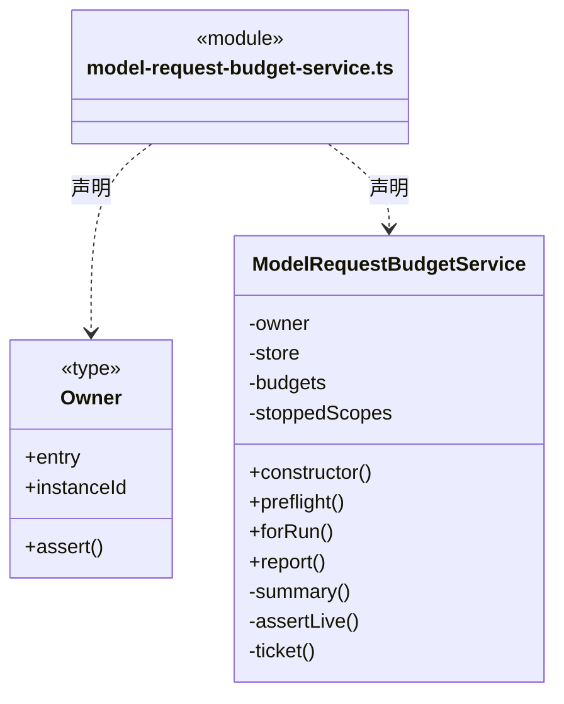
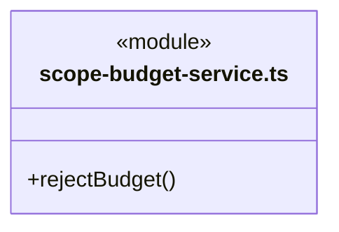
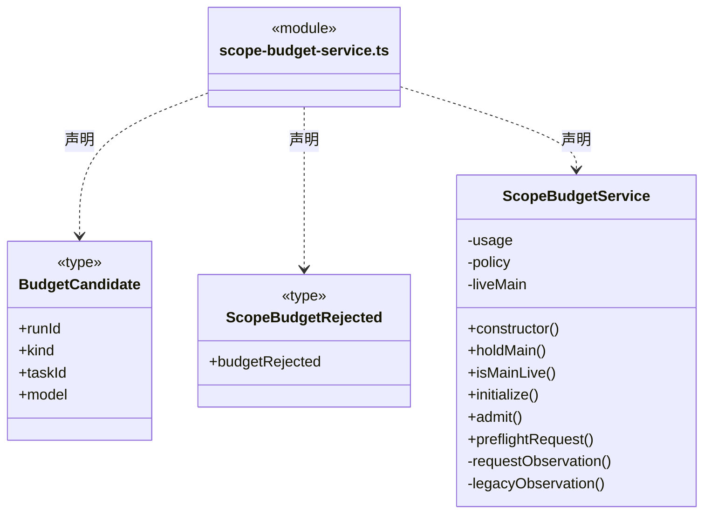
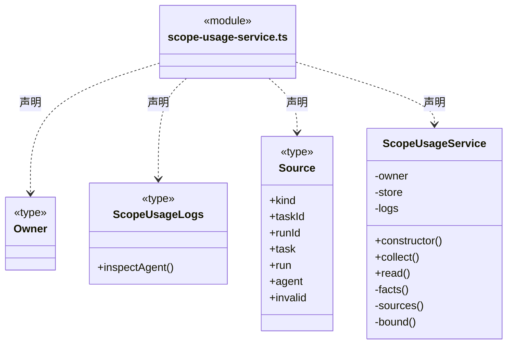
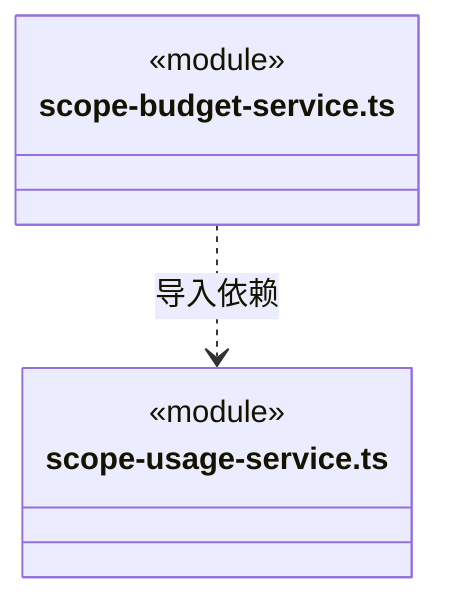

# src/logic/budget/runtime 架构

## 目录定位

预算应用服务：协调请求和目标预算预占/结算，通过明确存储端口保存结果；不直接访问共享派发 Store。

本文描述当前实现。通过分析目录边界后维护的 [源码架构脚本](../../../../scripts/source-architecture.mjs) 同步清单和声明；代码变更时仍须核对职责、关键成员与关系。

## 文件清单

| 文件 | 形式 | 当前职责 |
| --- | --- | --- |
| [ARCHITECTURE.md](ARCHITECTURE.md) | 说明文档 | 本目录的文件清单、真实声明、依赖与子封装导航。 |
| [CONTRACT.md](CONTRACT.md) | 说明文档 | 人工维护的职责、接口契约、状态所有权与扩展边界；在本文末尾同步附加。 |
| [model-request-budget-service.ts](model-request-budget-service.ts) | 源码模块 | 通过专用预算端口保存每个真实主/成员请求的预留、发送意图和终态，不读取或改写其它调度领域。 |
| [scope-budget-service.ts](scope-budget-service.ts) | 源码模块 | 在调度事务内核实周期额度，并将许可证明或拒绝事实交给同一事务保存；逐请求模式读取独立请求账本。 |
| [scope-usage-service.ts](scope-usage-service.ts) | 源码模块 | 按持久主运行清单、旧成员绑定与新递归父工具关系，读取 canonical 日志并生成只读消耗报告。 |

## 架构类图

成员标记：`+` 公开、`-` 私有、`#` 受保护、`$` 静态；构造函数单独列出。文档和资源仅在文件清单中导航，不作为代码节点。

### model-request-budget-service.ts

直接依赖：[../../../core/errors.ts](../../../core/errors.ts)、[../rules/model-request-budget-storage.ts](../rules/model-request-budget-storage.ts)、[../rules/model-request-budget.ts](../rules/model-request-budget.ts)、[../rules/model-request-budget-rules.ts](../rules/model-request-budget-rules.ts)、[../rules/request-budget.ts](../rules/request-budget.ts)、[../rules/model-request-configuration.ts](../rules/model-request-configuration.ts)。

### scope-budget-service.ts

直接依赖：[../../../core/errors.ts](../../../core/errors.ts)、[../../../core/platform/node/serialization.ts](../../../core/platform/node/serialization.ts)、[../../execution/rules/scope-usage.ts](../../execution/rules/scope-usage.ts)、[../rules/scope-budget.ts](../rules/scope-budget.ts)、[../../tasks/rules/dispatch-scope.ts](../../tasks/rules/dispatch-scope.ts)、[../../dispatch/rules/dispatch-storage.ts](../../dispatch/rules/dispatch-storage.ts)、[scope-usage-service.ts](scope-usage-service.ts)、[../rules/model-request-budget-rules.ts](../rules/model-request-budget-rules.ts)、[../rules/model-request-budget.ts](../rules/model-request-budget.ts)、[../rules/model-request-budget-storage.ts](../rules/model-request-budget-storage.ts)。

### scope-usage-service.ts

直接依赖：[../../agents/contracts.ts](../../agents/contracts.ts)、[../../../core/errors.ts](../../../core/errors.ts)、[../../../core/platform/node/serialization.ts](../../../core/platform/node/serialization.ts)、[../../knowledge/rules/ports.ts](../../knowledge/rules/ports.ts)、[../../execution/rules/types.ts](../../execution/rules/types.ts)、[../../execution/rules/scope-usage.ts](../../execution/rules/scope-usage.ts)、[../../dispatch/rules/dispatch-storage.ts](../../dispatch/rules/dispatch-storage.ts)、[../../tasks/rules/dispatch-execution.ts](../../tasks/rules/dispatch-execution.ts)、[../../tasks/rules/graph-types.ts](../../tasks/rules/graph-types.ts)、[../rules/scope-usage.ts](../rules/scope-usage.ts)、[../../tasks/runtime/scope-goal-service.ts](../../tasks/runtime/scope-goal-service.ts)。

### 本目录调用边界

## 子目录导航

无子目录。

[返回上层](../ARCHITECTURE.md)。

每次修改本目录代码，同步维护文件头、关键契约说明及本图。未实现的治理、证据验收和自动编排能力不列入当前类图。

## 设计契约 v1 与落地范围

以下内容区分已接通能力与后续设计；以各节的实现状态为准，不将目标图当作现状图。维护源：[CONTRACT.md](CONTRACT.md)；生成类图时同步附加，勿直接修改本附录。

# 模型请求预算运行时

ModelRequestBudgetService 按原根运行绑定预算作用域，为每个模型冻结独立价格。递归子调用的 agentRun 只保存请求来源；不创建额外预算作用域。

forRun 的 assertCaller 是子生命周期门禁，reserve、issue 和 assertSend 同时核实根运行与原子调用存活。实际用量、明确未发送和未知结果仍按原 ticket 结算，即使子运行已经停止也不能抹除实际消耗。未知请求保留预留额度并冻结后续发送。

规则与持久化分别由 ../rules 与 dispatch/storage 拥有；本服务不切换模型或代替 Agent 调度。

# 逐角色请求预算服务

ModelRequestBudgetService.forRun 的可选 role 默认 primary；装配方只能从冻结执行快照选择已登记角色，调用请求者不能传身份、容量或价格。每个角色取得独立 RequestBudgetPort，仍使用同一 RequestBudgetStore、周期余额和 stoppedScopes 屏障。模型请求在账本事务外发送，issue 完成并同步 assertSend 后才允许 IO。

任何角色的未知结果都会封住同周期所有端口；重开从持久账本恢复未决预留，不释放额度或自动重发。缺用量、结算失败不交付成功结果。此切片只提供预算接口，向量 HTTP 和记忆引擎在后续切片消费。

## 周期用量与递归调用

ScopeUsageService 从已登记主 run 出发，沿 canonical 日志中有前置授权的首次 cbim_agent_call 关联读取子 run；各层身份与原父引用须精确一致。普通递归 Agent 不要求虚构旧任务；带业务绑定的子运行还须匹配本 scope 的 agentBusinessRuns。旧任务归属路径保留。日志端口 inspectAgent 只读指定 task/run，统计不扫描目录、不触发执行或恢复。

最多核实 532 个来源，超限拒绝整份报告；重复、环、跨根引用及缺日志不重复累计或报告完整。没有真实终态事件的递归主/子运行计入在途，即使磁盘摘要暂为 interrupted。价格、Token 和结算完整性仍复用 execution 的原计量规则。两次读取核对持久来源；未结算日志的计量仍为部分值。

递归引用格式统一消费 agents/contracts 的 agentCallReferenceSchema；预算服务仍自行核对父授权、当前周期、唯一来源及在途状态，不把结构校验当作归属证明。
