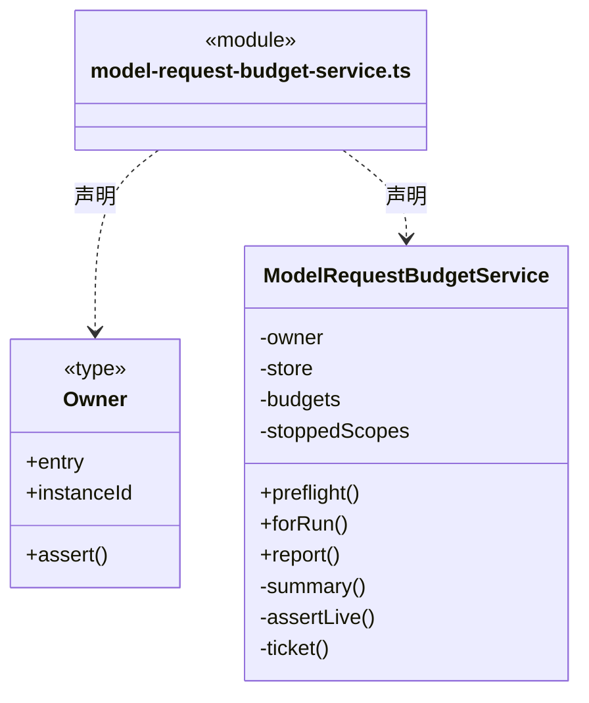
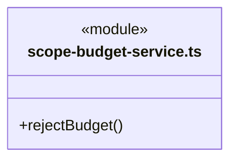
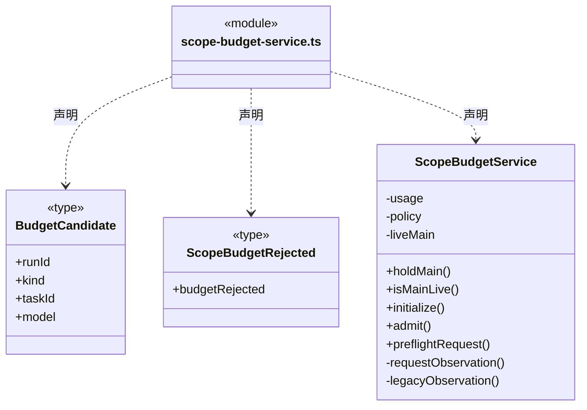
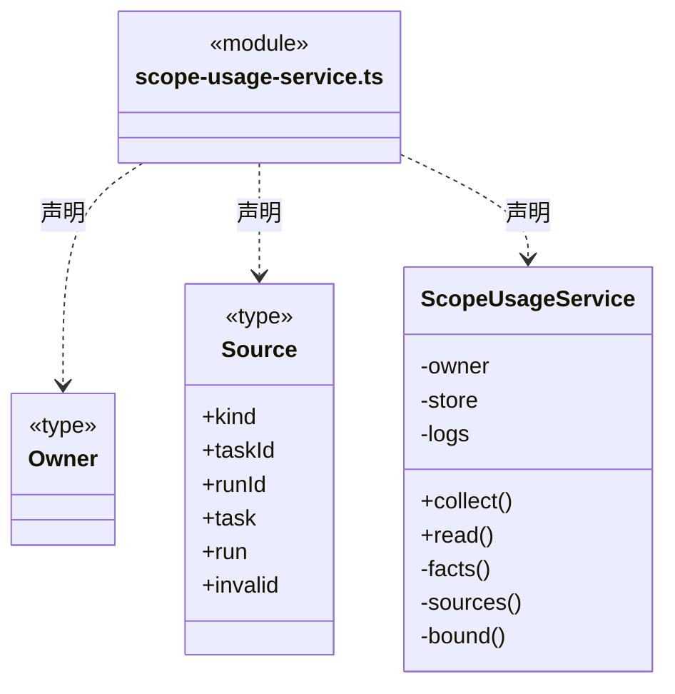
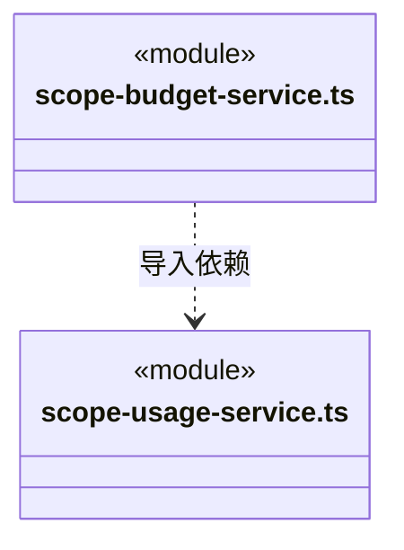

# src/logic/budget/runtime 架构

## 目录定位

预算应用服务：协调请求和目标预算预占/结算，通过明确存储端口保存结果；不直接访问共享派发 Store。

本文描述当前实现。通过分析目录边界后维护的 [源码架构脚本](../../../../scripts/source-architecture.mjs) 同步清单和声明；代码变更时仍须核对职责、关键成员与关系。

## 代码清单

| 文件 | 当前职责 |
| --- | --- |
| [model-request-budget-service.ts](model-request-budget-service.ts) | 通过专用预算端口保存每个真实主/成员请求的预留、发送意图和终态，不读取或改写其它调度领域。 |
| [scope-budget-service.ts](scope-budget-service.ts) | 在调度事务内核实周期额度，并将许可证明或拒绝事实交给同一事务保存；逐请求模式读取独立请求账本。 |
| [scope-usage-service.ts](scope-usage-service.ts) | 按指定目标周期的持久主运行清单与成员绑定，读取 canonical 日志并生成只读消耗报告。 |

## 架构类图

### model-request-budget-service.ts

直接依赖：[../../../core/errors.ts](../../../core/errors.ts)、[../rules/model-request-budget-storage.ts](../rules/model-request-budget-storage.ts)、[../rules/model-request-budget.ts](../rules/model-request-budget.ts)、[../rules/model-request-budget-rules.ts](../rules/model-request-budget-rules.ts)、[../rules/request-budget.ts](../rules/request-budget.ts)、[../rules/model-request-configuration.ts](../rules/model-request-configuration.ts)。

### scope-budget-service.ts

直接依赖：[../../../core/errors.ts](../../../core/errors.ts)、[../../../core/platform/node/serialization.ts](../../../core/platform/node/serialization.ts)、[../../execution/rules/scope-usage.ts](../../execution/rules/scope-usage.ts)、[../rules/scope-budget.ts](../rules/scope-budget.ts)、[../../tasks/rules/dispatch-scope.ts](../../tasks/rules/dispatch-scope.ts)、[../../dispatch/rules/dispatch-storage.ts](../../dispatch/rules/dispatch-storage.ts)、[scope-usage-service.ts](scope-usage-service.ts)、[../rules/model-request-budget-rules.ts](../rules/model-request-budget-rules.ts)、[../rules/model-request-budget.ts](../rules/model-request-budget.ts)、[../rules/model-request-budget-storage.ts](../rules/model-request-budget-storage.ts)。

### scope-usage-service.ts

直接依赖：[../../../core/errors.ts](../../../core/errors.ts)、[../../../core/platform/node/serialization.ts](../../../core/platform/node/serialization.ts)、[../../knowledge/rules/ports.ts](../../knowledge/rules/ports.ts)、[../../execution/rules/types.ts](../../execution/rules/types.ts)、[../../execution/rules/scope-usage.ts](../../execution/rules/scope-usage.ts)、[../../dispatch/rules/dispatch-storage.ts](../../dispatch/rules/dispatch-storage.ts)、[../../tasks/rules/dispatch-execution.ts](../../tasks/rules/dispatch-execution.ts)、[../../tasks/rules/graph-types.ts](../../tasks/rules/graph-types.ts)、[../rules/scope-usage.ts](../rules/scope-usage.ts)、[../../tasks/runtime/scope-goal-service.ts](../../tasks/runtime/scope-goal-service.ts)。

### 本目录调用边界

## 子目录导航

无子目录。

[返回上层](../ARCHITECTURE.md)。

每次修改本目录代码，同步维护文件头、关键契约说明及本图。未实现的治理、证据验收和自动编排能力不列入当前类图。

## 设计契约 v1 与落地范围

以下内容区分已接通能力与后续设计；以各节的实现状态为准，不将目标图当作现状图。维护源：[CONTRACT.md](CONTRACT.md)；生成类图时同步附加，勿直接修改本附录。

# 逐角色请求预算服务

ModelRequestBudgetService.forRun 的可选 role 默认 primary；装配方只能从冻结执行快照选择已登记角色，调用请求者不能传身份、容量或价格。每个角色取得独立 RequestBudgetPort，仍使用同一 RequestBudgetStore、周期余额和 stoppedScopes 屏障。模型请求在账本事务外发送，issue 完成并同步 assertSend 后才允许 IO。

任何角色的未知结果都会封住同周期所有端口；重开从持久账本恢复未决预留，不释放额度或自动重发。缺用量、结算失败不交付成功结果。此切片只提供预算接口，向量 HTTP 和记忆引擎在后续切片消费。
