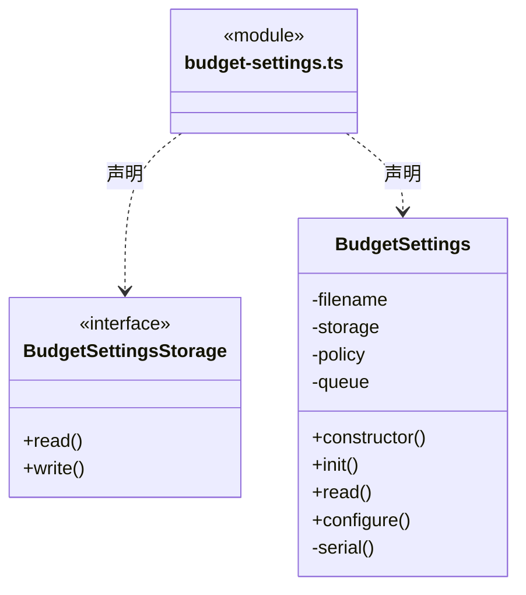

# src/logic/budget/settings 架构

## 目录定位

保存作用域预算默认值；运行周期在创建时冻结，设置变化不追改活动周期。

本文描述当前实现。通过分析目录边界后维护的 [源码架构脚本](../../../../scripts/source-architecture.mjs) 同步清单和声明；代码变更时仍须核对职责、关键成员与关系。

## 文件清单

| 文件 | 形式 | 当前职责 |
| --- | --- | --- |
| [ARCHITECTURE.md](ARCHITECTURE.md) | 说明文档 | 本目录的文件清单、真实声明、依赖与子封装导航。 |
| [budget-settings.ts](budget-settings.ts) | 源码模块 | 可靠保存新目标的额度及显式逐请求模式，供调度器创建周期时冻结，缺省模式保留原软限额语义。 |

## 架构类图

成员标记：`+` 公开、`-` 私有、`#` 受保护、`$` 静态；构造函数单独列出。文档和资源仅在文件清单中导航，不作为代码节点。

### budget-settings.ts

直接依赖：[../../../core/utility/index.ts](../../../core/utility/index.ts)、[../../../core/platform/node/files/index.ts](../../../core/platform/node/files/index.ts)、[../../../core/errors.ts](../../../core/errors.ts)、[../rules/scope-budget.ts](../rules/scope-budget.ts)。

## 子目录导航

无子目录。

[返回上层](../ARCHITECTURE.md)。

每次修改本目录代码，同步维护文件头、关键契约说明及本图。未实现的治理、证据验收和自动编排能力不列入当前类图。
