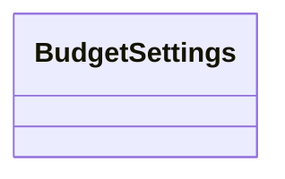

# src/logic/budget/settings 架构

## 设计意图

保存创建新目标时使用的额度和计量模式，隔离默认配置与活动周期的冻结策略。

`BudgetSettings` 负责版本化读取与可靠写入，由 Application 装配并向调度提供默认值。设置成功只影响后续创建，不能追改已有周期或把缺省软限额解释成逐请求硬约束。

## 主要组成

| 组成 | 定位 |
| --- | --- |
| [BudgetSettings](budget-settings.ts) | 可靠保存新目标的额度及显式逐请求模式，供调度器创建周期时冻结，缺省模式保留原软限额语义。 |

<!-- architecture:generated:start -->

## 架构关系

[上层设计](../ARCHITECTURE.md)

<!-- architecture:generated:end -->
