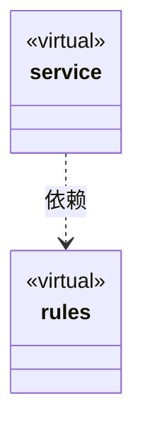

# src/logic/connectors 架构

## 设计意图

封装资源仓库连接的定义、登记、授权与读取。规则维护身份和协议，服务管理授权状态及真实连接；连接登记本身不授予业务执行权。

## 主要组成

本层由下列子模块组合，每个子模块作为独立的虚拟类封装参与本层协作。

<!-- architecture:generated:start -->

## 架构关系

标注为 `virtual` 的节点是直接子模块的虚拟类封装；内部设计沿下方入口阅读。

## 子模块

| 虚拟封装 | 整体职责 |
| --- | --- |
| [rules](rules/ARCHITECTURE.md) | 链接器定义、查询与唯一身份检查；反馈协议已迁入 Logic，现存连接协议不发网络请求或授予权限。 |
| [service](service/ARCHITECTURE.md) | 资源仓库连接授权、版本核实与读取取消；与静态包发布和仓库存储分开。 |

[上层设计](../ARCHITECTURE.md)

<!-- architecture:generated:end -->
