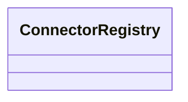

# src/logic/connectors/rules 架构

## 设计意图

链接器定义、查询与唯一身份检查；反馈协议已迁入 Logic，现存连接协议不发网络请求或授予权限。

## 主要组成

| 组成 | 定位 |
| --- | --- |
| [ConnectorRegistry](registry.ts) | 链接器领域封装，管理插件或资源仓库的静态身份、查询与重复校验。 |

<!-- architecture:generated:start -->

## 架构关系

[上层设计](../ARCHITECTURE.md)

<!-- architecture:generated:end -->
