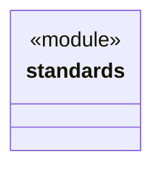

# src/logic/connectors/rules 架构

## 设计意图

维护连接器的静态定义、身份唯一性和查询规则，为资源与知识消费者提供可核对目录。

`ConnectorRegistry` 在已给定定义中登记和查询，`standards` 提供同版本规范与 Schema。该模块不连接网络、不保存凭据、不批准仓库读取；真实授权由 service 持有。

## 主要组成

| 组成 | 定位 |
| --- | --- |
| [standards](standards.ts) | 连接器声明规范与注册表 Schema；不携带凭据或发起网络连接。 |

<!-- architecture:generated:start -->

## 架构关系

[上层设计](../ARCHITECTURE.md)

<!-- architecture:generated:end -->
