# src/logic/connectors/rules 架构

本目录只维护这一份说明。设计与契约直接编辑本文；文件清单、类图和导航由 [架构脚本](../../../../scripts/source-architecture.mjs) 更新，生成区域之外的人工说明会保留。

## 封装意图

链接器定义、查询与唯一身份检查；反馈协议已迁入 Logic，现存连接协议不发网络请求或授予权限。

## 类与模块的设计意图

下表依据源码声明及文件头说明定位封装。字段表示该实例持有的状态或协作引用，不表示它拥有被引用服务的生命周期；实际资源责任和调用限制见下文契约及源码注释。

| 类／模块 | 实现形式与实例字段 | 封装依据 |
| --- | --- | --- |
| [definition.ts](definition.ts) | 函数／契约模块 | 旧插件映射与资源仓库身份是两种不同来源，严格分支避免把声明误当运行授权或把地址、密钥写进可复用知识。 |
| [ConnectorRegistry](registry.ts) | 实例类；持有 `entries` | 输入已通过结构 Schema；校验跨条目的身份约束，不执行任何外部工具。 |
| [repository-connection.ts](repository-connection.ts) | 函数／契约模块 | 把可复用知识声明和本机工作区授权分开，公开真实核验的有界摘要，不把链接器登记或资源内容解释为模型执行能力。 |
| [repository-tools.ts](repository-tools.ts) | 函数／契约模块 | 模型只能选择已装配链接器和资源，不提供仓库身份、共享代际或权限；有界输出保留完整正文指纹和分页版本，避免部分内容冒充全文。 |

## 接口设计契约

##### 已迁出的公开网页工具

网页工具协议已迁到 [Logic Web](../../web/ARCHITECTURE.md#contract)，由 `src/logic/web/index.ts` 公开；本目录不再保留 `web-tools.ts`。原输入限制、Unicode 正文上限、搜索结果与 untrusted 语义保持不变。浏览器 robots 策略及 Brave 配置的缺省、加密与持久化归 `src/logic/web/service`，模型工具不能修改这些设置。

##### 已迁出的 GitHub 反馈协议

反馈字段、正文、可信范围与连接状态已迁到 [Logic feedback](../../feedback/ARCHITECTURE.md#contract)，本目录不再保留 github-feedback.ts；现存链接器和资源协议仍由本目录维护。

##### 静态定义与提供方身份

`definition.ts` 定义严格的链接器联合协议。旧 `plugin:{ghost_id,namespace}` 原样保留，不补造 provider 或运行能力；资源仓库使用 `provider:"resource_repository_v1"` 与 `repository:{repositoryId}`，仓库 ID 是 UUID。两个分支均拒绝未知字段、混合身份以及 URL、token 等连接信息。链接器 ID 沿用 `.cbim/connectors/` 下单叶 `[A-Za-z0-9_-]+` 格式。

`ConnectorRegistry` 在已经通过结构校验的定义上查询与检查唯一性：链接器 ID 不区分大小写；插件以 ghost ID 与 namespace 二元组区分；仓库按 UUID 身份区分。提供方标签参与比较，不以 JSON 属性顺序或缺少 plugin 来判断相同目标。

`assets/connector/registry.schema.json` 为完整知识事务提供等价结构规则；知识校验继续检查 Agent、Module 对登记链接器的引用。定义可在其他工作区重新使用，但不会复制本机授权；保存或查询静态定义不发 HTTP、不启共享、不注册模型工具。真实连接与工作区授权由本机适配层单独管理。

##### 桌面资源仓库连接协议

`repository-connection.ts` 是桌面连接与原请求核对共同消费的纯输入/输出协议，不导入知识事务实现或主进程服务。输入绑定明确工作区和实例；历史回执查询保留原实例身份。列表区分旧插件、不再存在的定义、定义变化、无授权、无共享及就绪状态。缺失定义的历史授权可列出供显式撤销，不自动重建知识。

`preview` 返回固定的知识变更计划与共享连接身份；`commit` 只提交定义。`grant`/`revoke` 使用独立工作区授权版本 CAS 和命令 ID，回执绑定链接器、仓库、定义指纹与原命令；`receipt` 只查询原回执。协议不接受 URL、token、actor、资源正文或调用方声明的授权结果。仓库共享服务的 `connectionId` 表示本机服务提供的连接身份，不是账户身份或网络地址。

`commitReceipt` 以工作区和原 planId 查询知识提交凭据，返回时仍保留原实例身份；没有凭据保持未知，不从当前定义相同推断该计划已提交，也不重放提交。此只读查询可用于页面卸载或工作区重开后的原请求核对。

`unaccepted` 请求固定原工作区、原实例、操作类型与命令/计划 ID。只有后端串行核实原实例已退役、没有原授权命令或知识事务凭据时，才能返回明确未受理；当前实例查不到回执、存储损坏或不明事务状态不构成该结论。此接口只读，不取消、重放或重新授权。界面必须严格匹配原请求并获得 `unaccepted:true` 才能清除待确认记录。

`check` 回执明确记录真实 HTTP、只读、仓库版本、授权版本和核验时刻，最多包含 20 个资源目录摘要，并报告总数与截断标志。它不包含资源正文，也不承诺导入资源、下载文件、模型工具调用或业务验收。授权的持久化、共享关闭及重开失效、并发重新核对和网络取消由本机实现负责，不能仅凭本协议对象作权限判断。

##### 主运行中的真实只读仓库工具

`repository-tools.ts` 定义 `cbim_repository_list/get` 的模型输入、业务输出和可信 `RepositoryToolsPort`。主进程在本轮创建时捕获已就绪链接器的固定目标；公开目标只有工作区、链接器、仓库、共享连接身份和有界名称/简介，授权版本、定义指纹及网络凭据留在闭包。捕获不读取 HTTP；实际端口调用须在网络前后核实原目标、原授权与共享代际，不因变化换源或自动重新授权。

模型输入只选择 connectorId、资源、原仓库版本及分页范围，拒绝工作区、仓库身份、共享身份、地址、token 和权限。目录每页至多 50 条，后续页必须指定原 revision，返回精确 totalItems/nextOffset；单项名称至多 100 字符、简介至多 1000 字符，不能以原始超长字段撑大工具结果。正文按 Unicode codepoint 分块，每块至多 4096 个 codepoint，必须指定 expectedRevision 和 resourceId。contentHash 始终代表原完整 UTF-8 正文，complete 仅在本块从 0 开始且包含全部正文时为 true；最后一页不等于完整正文。严格输出拒绝错误范围、重复目录项、未知字段和矛盾分页，不补造无效资源事实。

该协议只让主运行读取已授权资料，不授予成员工具、安装资源、执行正文或使用资料作为文件交付证据。工具回执使用独立 repository scope；当前输出仍须通过共同工具结果边界，Schema 通过不代表业务验收或整个外部仓库已读取。

## 开闭边界

本目录的职责及允许协作由[封装意图](#封装意图)限定，输入输出、状态与失败语义以[接口设计契约](#接口设计契约)为准。扩展从已有公开入口及实际装配位置进入；没有明确可替换契约的部分按真实影响修改和验证，不预建未使用的基类或插件入口。

<!-- architecture:generated:start -->

## 文件清单

| 文件 | 形式 | 当前职责 |
| --- | --- | --- |
| [ARCHITECTURE.md](ARCHITECTURE.md) | 说明文档 | 本目录的文件清单、真实声明、依赖与子封装导航。 |
| [definition.ts](definition.ts) | 源码模块 | 链接器静态定义的纯协议，供知识校验、桌面连接管理与注册查询共用。 |
| [registry.ts](registry.ts) | 源码模块 | 链接器领域封装，管理插件或资源仓库的静态身份、查询与重复校验。 |
| [repository-connection.ts](repository-connection.ts) | 源码模块 | 桌面资源仓库链接器的输入、静态登记、独立只读授权与 HTTP 核验回执协议。 |
| [repository-tools.ts](repository-tools.ts) | 源码模块 | 主 Loop 资源仓库只读工具的严格分页、正文分块协议和可信捕获端口。 |

## 架构类图

成员标记：`+` 公开、`-` 私有、`#` 受保护、`$` 静态；构造函数单独列出。文档和资源仅在文件清单中导航，不作为代码节点。

### definition.ts

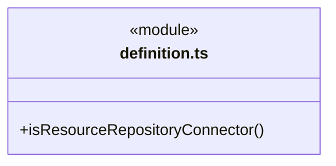

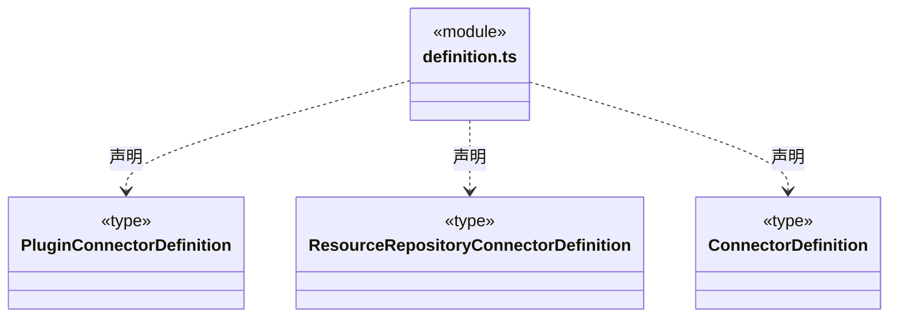

### registry.ts

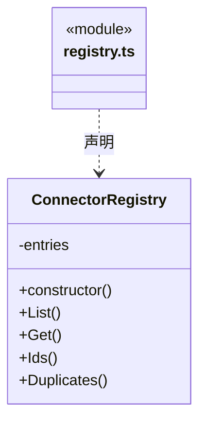

直接依赖：[definition.ts](definition.ts)。

### repository-connection.ts

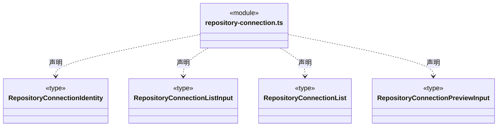

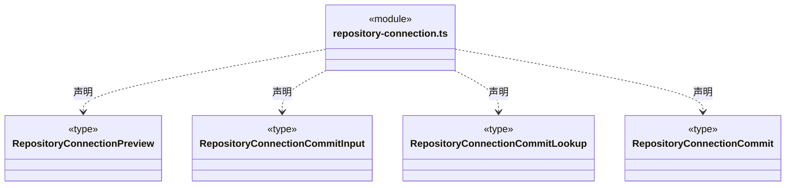

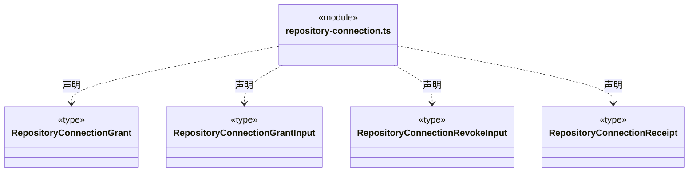

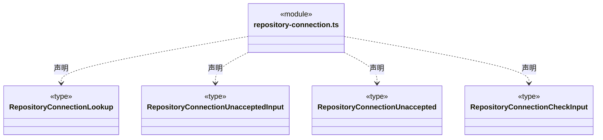

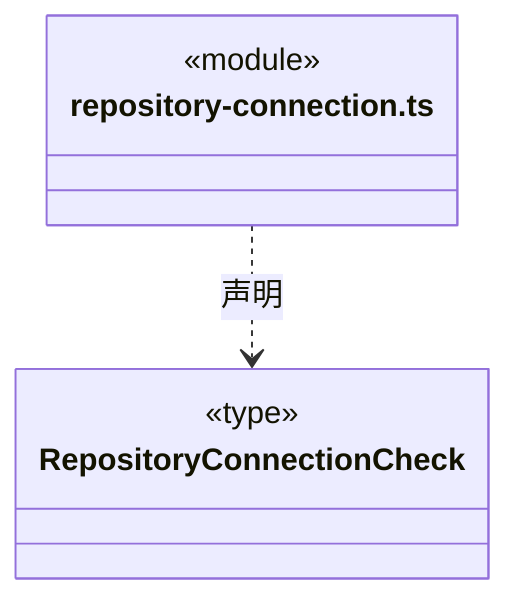

直接依赖：[definition.ts](definition.ts)。

### repository-tools.ts

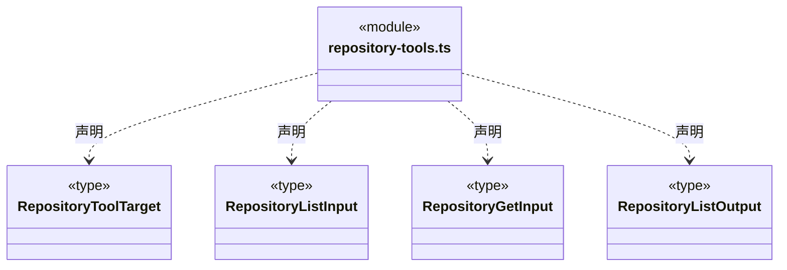

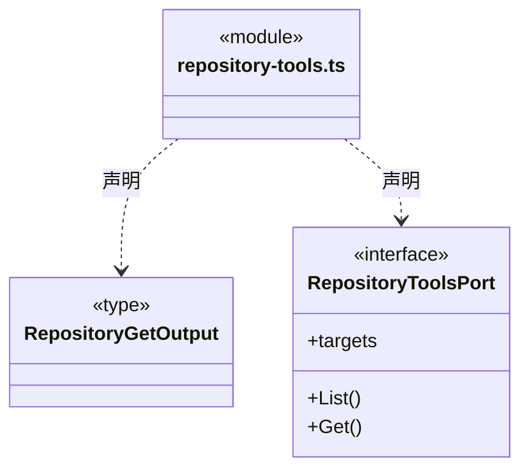

直接依赖：[definition.ts](definition.ts)、[../../tools/rules/scope-schema.ts](../../tools/rules/scope-schema.ts)。

### 本目录调用边界

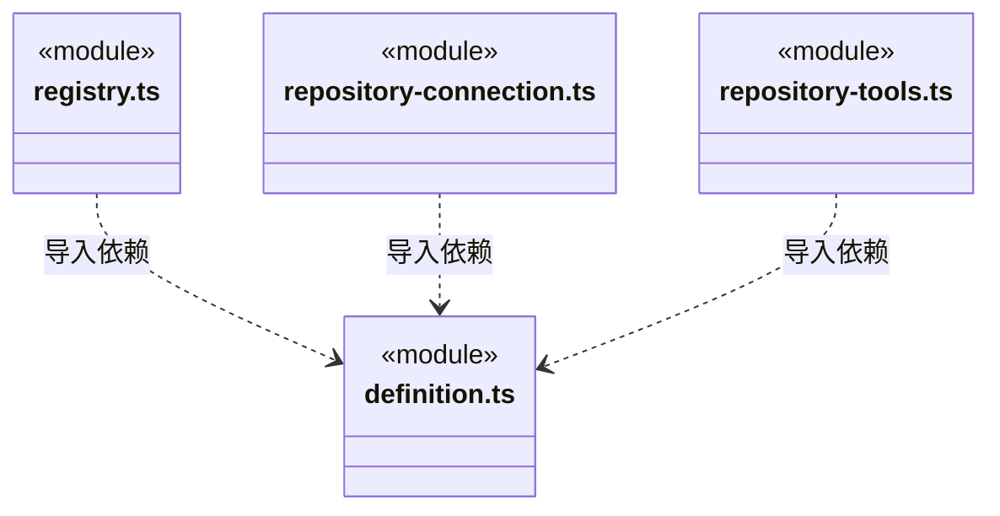

## 子目录导航

无子目录。

[返回上层](../ARCHITECTURE.md)。

每次修改本目录代码，同步维护文件头、关键契约说明及本图。未实现的治理、证据验收和自动编排能力不列入当前类图。

<!-- architecture:generated:end -->
