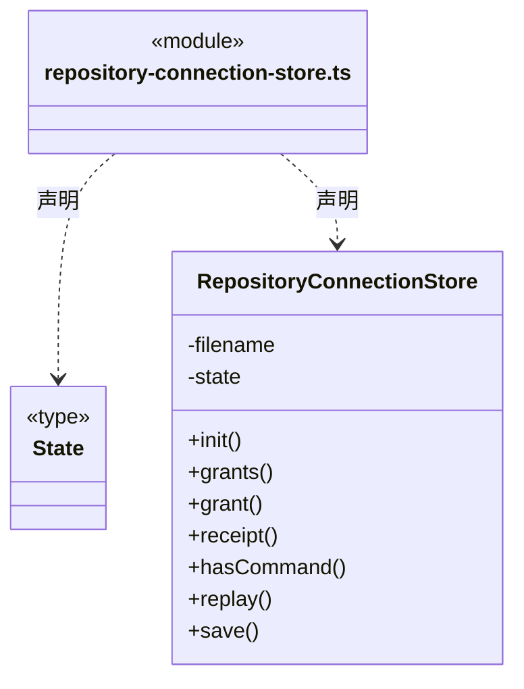
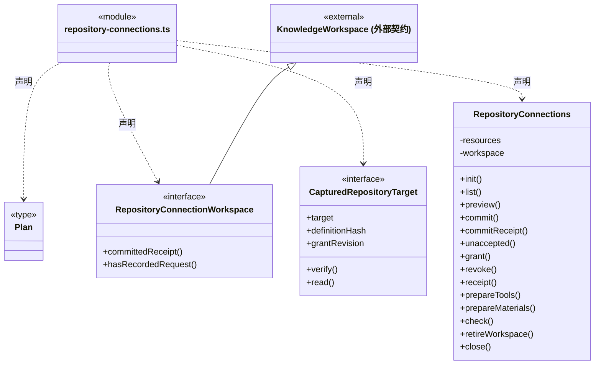
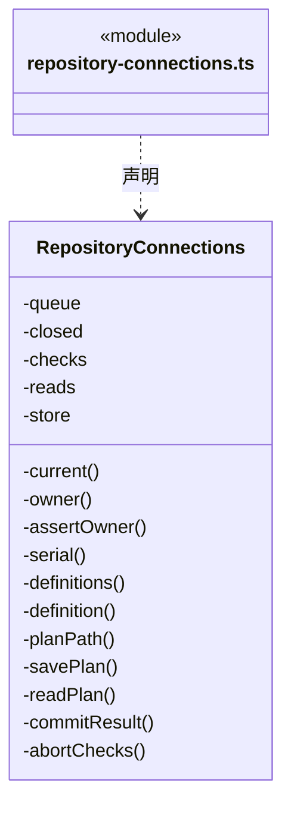
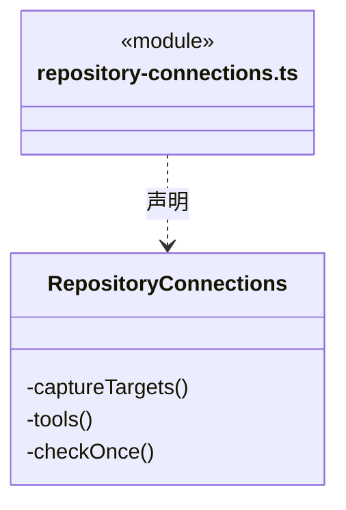
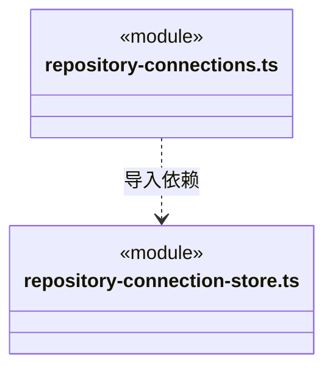

# src/logic/connectors/service 架构

## 目录定位

资源仓库连接授权、版本核实与读取取消；与静态包发布和仓库存储分开。

本文描述当前实现。通过分析目录边界后维护的 [源码架构脚本](../../../../scripts/source-architecture.mjs) 同步清单和声明；代码变更时仍须核对职责、关键成员与关系。

## 代码清单

| 文件 | 当前职责 |
| --- | --- |
| [repository-connection-store.ts](repository-connection-store.ts) | 在应用用户目录保存工作区资源仓库只读授权及原命令回执。 |
| [repository-connections.ts](repository-connections.ts) | 桌面资源仓库连接的知识预览/登记、独立本机授权和显式 HTTP 只读核验。 |

## 架构类图

### repository-connection-store.ts

直接依赖：[../../../core/platform/node/files/index.ts](../../../core/platform/node/files/index.ts)、[../../../core/platform/node/serialization.ts](../../../core/platform/node/serialization.ts)、[../../../core/errors.ts](../../../core/errors.ts)、[../rules/repository-connection.ts](../rules/repository-connection.ts)。

### repository-connections.ts

成员 1/3（同名节点为同一声明，跨图合并阅读）。

成员 2/3（同名节点为同一声明，跨图合并阅读）。

成员 3/3（同名节点为同一声明，跨图合并阅读）。

直接依赖：[../../../core/platform/node/files/index.ts](../../../core/platform/node/files/index.ts)、[../../../core/platform/node/serialization.ts](../../../core/platform/node/serialization.ts)、[../../../core/errors.ts](../../../core/errors.ts)、[../../knowledge/rules/ports.ts](../../knowledge/rules/ports.ts)、[../../knowledge/rules/types.ts](../../knowledge/rules/types.ts)、[../rules/definition.ts](../rules/definition.ts)、[../rules/repository-connection.ts](../rules/repository-connection.ts)、[repository-connection-store.ts](repository-connection-store.ts)、[../../resources/service/index.ts](../../resources/service/index.ts)、[../rules/repository-tools.ts](../rules/repository-tools.ts)。

### 本目录调用边界

## 子目录导航

无子目录。

[返回上层](../ARCHITECTURE.md)。

每次修改本目录代码，同步维护文件头、关键契约说明及本图。未实现的治理、证据验收和自动编排能力不列入当前类图。

## 设计契约 v1 与落地范围

以下内容区分已接通能力与后续设计；以各节的实现状态为准，不将目标图当作现状图。维护源：[CONTRACT.md](CONTRACT.md)；生成类图时同步附加，勿直接修改本附录。

# 工作区资源仓库授权连接

本目录持有显式连接登记、本机授权、原命令回执及运行资料读取端口。仓库与共享生命周期归 [resources/service](../../resources/service/CONTRACT.md)，静态包发布导入归 [resources/packages](../../resources/packages/CONTRACT.md)，GitHub 反馈归 [feedback/service](../../feedback/service/CONTRACT.md)，网页业务归 [web/service](../../web/service/CONTRACT.md)。连接服务组合各自公开能力，不持有其状态机。

## 显式资源仓库只读连接

`RepositoryConnections` 由桌面明确操作登记和授权，连接当前应用已显式开启共享的本机仓库。`preview / commit` 经原知识预览和事务登记 `resource_repository_v1` 定义，`grant / revoke` 另行修改用户目录中的本机授权；两种存储各自返回回执，不承诺跨存储原子提交。静态定义和导入资源不自动授予权限，旧 Cindy 映射仍为不可执行的静态声明，资源正文不会被自动安装、应用或执行。

授权绑定工作区、链接器、repositoryId、definitionHash 和连续授权 revision。写命令使用固定 commandId；同 ID 异参拒绝，旧 grant 重试只返回原回执，不复活后来已撤销的授权。`RepositoryConnectionStore` 将授权与命令回执同次原子保存，最多 1024 项授权、4096 条命令和 2 MiB；启动核实每条命令链连续且最终授权精确等于最新回执，缺失、孤立或矛盾记录拒绝加载，不能猜测恢复。

`ResourceRepositories.readConnection` 捕获当前共享代际和专用只读令牌，只暴露身份与读取闭包。实际 `RemoteRepository` 发起 HTTP GET，服务端拒绝该令牌的 POST/DELETE；页面不接触 URL、令牌或读写客户端。停止、重配或重新共享使旧代际永久失效；读取前后均核对工作区实例、定义、授权和共享身份。取消及 8 秒超时覆盖响应正文，不自动重试、开启共享、换源或回退本机文件。

正文 reader 生命周期由 `utility.readBoundedBytes` 统一管理，保留原 #70 修复的显式取消及锁/监听释放；原 `RemoteRepository.readBody` 已由此机制替代。请求层再次核实取消原因，半截正文不能被当作完整仓库解析；8 秒期限、大小边界和无自动重试语义不变。该防护覆盖 Node 22.19 中已观测到的“信号触发但正文仍挂起”情况，不通过更换 CI 版本或放宽断言掩盖。

`check` 显式读取后只返回最多 20 条目录摘要，无正文；列表和回执查询不发送网络。慢速核验不占授权写队列，撤销和工作区退役可取消在途请求，迟到结果不能通过版本屏障。授权重启后保留，共享服务与临时凭据不自动恢复；用户再次显式共享后使用新的连接代际。

登记计划缓存不是提交证明。`commitReceipt` 使用原 planId 和完整原请求只读核实知识 journal，支持查询旧实例原回执；`commit` 也不能仅凭缓存返回成功。已写正式知识但回执缓存失败报告 `REPOSITORY_CONNECTION_APPLIED`，沿原计划查询，不能用新请求猜测重做。

`unaccepted` 只在连接写队列排空、原实例已退役且原命令完全没有持久记录时返回明确未受理。知识事务的损坏、回滚或未终结记录都算存在；当前实例查询不到回执仍是未知。该只读证明不清历史、不提交原计划，供界面显式核实保存请求后尚未发送便退出的情况。

## 主运行捕获与有界资料读取

`prepareTools(identity)` 在主工厂创建本轮 Runtime 时读取正式定义和已持久授权，捕获原工作区实例、definitionHash、grantRevision 与共享 connectionId，不发送 HTTP。共享未开、没有就绪授权或静态注册表明确无效时不装工具，主会话仍可通过知识服务诊断；IO、关闭和实例错误不被吞成空能力。已有端口执行时的失败始终明确返回，不能降级、重新发现或切换来源。

捕获端口只公开安全目标摘要和 `list/get`，不公开私有指纹、权限版本、地址或令牌。实际网络前后均重新核对原定义、授权、实例与共享代际；撤销、工作区退役和退出取消在途读取，迟到结果不交付。后来的重新授权或共享只能由新主运行捕获，旧端口保持失效。

每次调用仍经过生产 Resource Repository v1 HTTP GET 和原 8 MiB 响应边界。模型目录最多返回 50 项摘要，续页固定 expectedRevision；正文最多 4096 个 Unicode codepoint，按明确 resourceId/revision/offset 读取。结果提供完整原文 SHA-256、总字符数、实际分块和 nextOffset，只有 offset=0 且包含全文才 complete=true。目录或正文版本变化拒绝原请求，不自动刷新版本重读。仓库资料不作为文件基线、成员交付或检查点证据。

桌面 `prepareMaterials(identity)` 与主运行共用同一授权捕获器，但提供独立的单次正文快照读取：用户指定原 connectionId、expectedRevision 和 resourceId，实际 HTTP 返回整份有界仓库后选出原资源。不能循环模型 get 分页拼出不同版本，也不开放 URL、token 或新授权。该端口额外供 Logic 资料服务保存真实 definitionHash/grantRevision，并在快照落盘后再次核实原捕获；信息只作为当时来源，不成为可复用权限。支持 connector/team/agent/skill/architecture/module/workflow 七种正文，全部是静态资料，不安装、不执行、不导入正式知识。已保存本机快照后撤权不删除历史资料，续跑不再次调用仓库。
