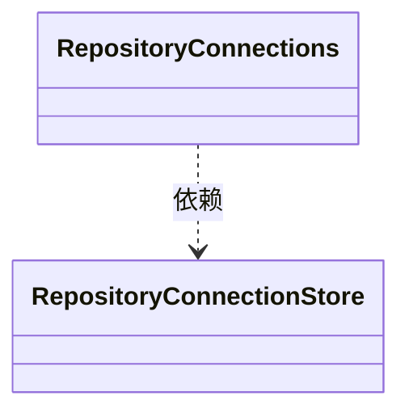

# src/logic/connectors/service 架构

## 设计意图

资源仓库连接授权、版本核实与读取取消；与静态包发布和仓库存储分开。

## 主要组成

| 组成 | 定位 |
| --- | --- |
| [RepositoryConnectionStore](repository-connection-store.ts) | 在应用用户目录保存工作区资源仓库只读授权及原命令回执。 |
| [RepositoryConnections](repository-connections.ts) | 桌面资源仓库连接的知识预览/登记、独立本机授权和显式 HTTP 只读核验。 |

<!-- architecture:generated:start -->

## 架构关系

[上层设计](../ARCHITECTURE.md)

<!-- architecture:generated:end -->
