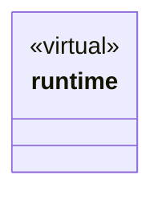

# src/logic/conversation 架构

## 设计意图

主 Agent 对话与消息队列业务；问题、审批和运行生命周期由 runtime 协作，不依赖界面。

## 主要组成

本层由下列子模块组合，每个子模块作为独立的虚拟类封装参与本层协作。

<!-- architecture:generated:start -->

## 架构关系

标注为 `virtual` 的节点是直接子模块的虚拟类封装；内部设计沿下方入口阅读。

## 子模块

| 虚拟封装 | 整体职责 |
| --- | --- |
| [runtime](runtime/ARCHITECTURE.md) | 管理工作区主会话的执行与交互等待。执行管理器协调运行，消息、审批和提问各有独立队列；成员任务派发通过协作服务完成。 |

[上层设计](../ARCHITECTURE.md)

<!-- architecture:generated:end -->
