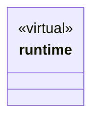

# src/logic/conversation 架构

## 设计意图

维护工作区主会话的交互与执行入口，把用户消息、审批和结构化提问连接到业务运行。

本层由 `runtime` 实现主会话调度和独立等待队列；成员协作通过 dispatch/execution 接入。对话历史、待执行消息与业务目标周期分别有身份，不能用界面切换或队列位置推断新的运行授权。

## 主要组成

本层没有直接产品实现，由下方子模块组成；每个直接子模块作为一个虚拟封装，只在本层呈现整体职责与协作。

<!-- architecture:generated:start -->

## 架构关系

标注为 `virtual` 的节点是直接子模块的虚拟类封装；内部设计沿下方入口阅读。

## 子模块

| 虚拟封装 | 整体职责 |
| --- | --- |
| [runtime](runtime/ARCHITECTURE.md) | 组织主会话执行、消息排队及交互等待，确保多次输入和系统接续保持真实来源与运行归属。 |

[上层设计](../ARCHITECTURE.md)

<!-- architecture:generated:end -->
