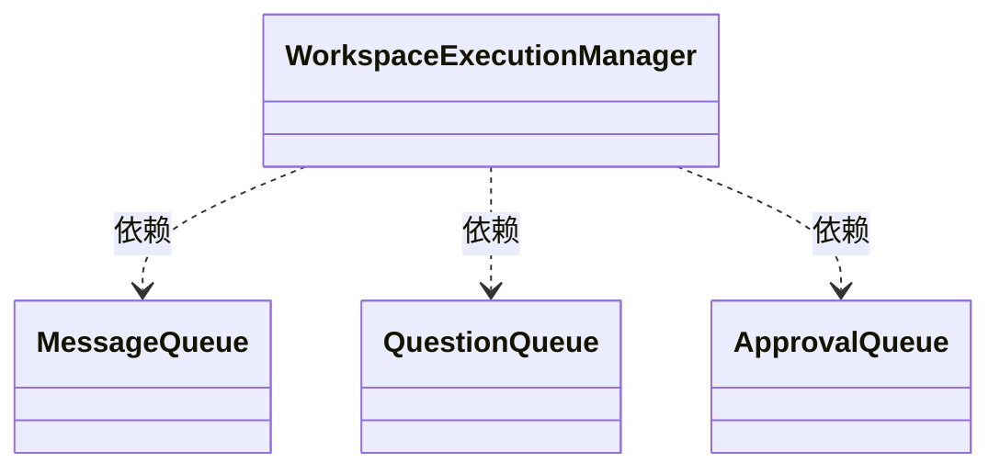

# src/logic/conversation/runtime 架构

## 设计意图

管理工作区主会话的执行与交互等待。执行管理器协调运行，消息、审批和提问各有独立队列；成员任务派发通过协作服务完成。

## 主要组成

| 组成 | 定位 |
| --- | --- |
| [ApprovalQueue](approvals.ts) | 任务内操作确认及本次运行全部放行的生命周期。 |
| [WorkspaceExecutionManager](execution-manager.ts) | 管理工作区主对话、可信结果与目标返工接续、多轮历史及队列；系统接续共用去重与停止屏障，业务成员经岗位派发领取。 |
| [MessageQueue](message-queue.ts) | 保存工作区各对话的待执行消息与发送时的模型/权限快照。 |
| [QuestionQueue](questions.ts) | 管理工作区内等待用户回答的结构化问题，供 Loop 工具与对话界面共享。 |

<!-- architecture:generated:start -->

## 架构关系

[上层设计](../ARCHITECTURE.md)

<!-- architecture:generated:end -->
