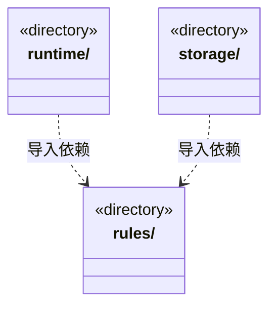

# src/logic/dispatch 架构

## 目录定位

派发存储端口及任务状态约束；服务与规则分开归属，实际依赖通过明确入口验证。

本文描述当前实现。通过分析目录边界后维护的 [源码架构脚本](../../../scripts/source-architecture.mjs) 同步清单和声明；代码变更时仍须核对职责、关键成员与关系。

## 代码清单

本层无直接代码文件。

## 架构类图

各图中的同名节点表示同一目录边界；跨组及完整直接依赖如下（无边不代表继承）：

- `runtime` → `rules`：导入。
- `storage` → `rules`：导入。

## 子目录导航

- [rules/](rules/ARCHITECTURE.md)：派发存储及命令端口：保持当前宽存储接口和原子性边界。只是明确接口目录，尚未拆分共享 DispatchStore；任务规则仍在 tasks，编排在 logic/dispatch/runtime。
- [runtime/](runtime/ARCHITECTURE.md)：派发编排：任务状态、领取、图依赖与应用命令通过 logic/dispatch/rules 的派发端口写入；共享 Store 尚未拆分。
- [storage/](storage/ARCHITECTURE.md)：当前派发图、命令、领取及任务状态的文件存储实现。保留共享事务与 DispatchStore，未按目录拆开一致性边界；这仍是依赖密集的共享实现。

[返回上层](../ARCHITECTURE.md)。

每次修改本目录代码，同步维护文件头、关键契约说明及本图。未实现的治理、证据验收和自动编排能力不列入当前类图。
