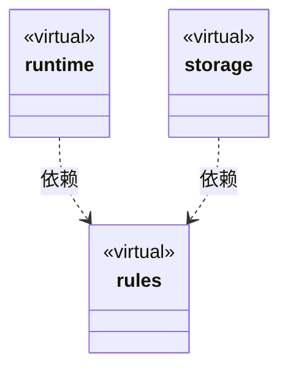

# src/logic/dispatch 架构

## 设计意图

封装工作区内的任务派发与协作回传。规则提供存储契约，运行层协调任务和执行绑定，存储层保持统一事务边界。

## 主要组成

本层由下列子模块组合，每个子模块作为独立的虚拟类封装参与本层协作。

<!-- architecture:generated:start -->

## 架构关系

标注为 `virtual` 的节点是直接子模块的虚拟类封装；内部设计沿下方入口阅读。

## 子模块

| 虚拟封装 | 整体职责 |
| --- | --- |
| [rules](rules/ARCHITECTURE.md) | 定义派发、岗位和任务状态共同使用的持久化端口。共享 DispatchStore 保持原子一致性，具体文件实现与业务编排分别位于 storage 和 runtime。 |
| [runtime](runtime/ARCHITECTURE.md) | 协调主会话派发、成员执行绑定和成果回传。各服务通过共享存储端口保存任务事实，自动协作与回传恢复分别封装，避免把运行流程放进存储实现。 |
| [storage](storage/ARCHITECTURE.md) | 以工作区日志保存任务图、执行实例与相关命令事实。FileDispatchStore 维护共同的事务边界，预算适配只缩小访问接口，不拆开原子提交。 |

[上层设计](../ARCHITECTURE.md)

<!-- architecture:generated:end -->
