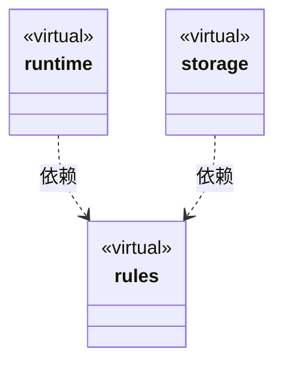

# src/logic/dispatch 架构

## 设计意图

协调工作区内的任务派发、执行绑定和成果回传，保持相关事实在共同事务边界内一致。

`rules` 声明持久化端口，`runtime` 组织主会话与成员协作，`storage` 保存事务日志并在提交与恢复时核验规则。共享存储维持跨任务、岗位和来源的原子关系，不能据此开放任意领域写权限。

## 主要组成

本层没有直接产品实现，由下方子模块组成；每个直接子模块作为一个虚拟封装，只在本层呈现整体职责与协作。

<!-- architecture:generated:start -->

## 架构关系

标注为 `virtual` 的节点是直接子模块的虚拟类封装；内部设计沿下方入口阅读。

## 子模块

| 虚拟封装 | 整体职责 |
| --- | --- |
| [rules](rules/ARCHITECTURE.md) | 定义派发相关事实的统一读写边界，使业务服务依赖明确事务协议而非磁盘实现。 |
| [runtime](runtime/ARCHITECTURE.md) | 把目标派发、成员绑定与可靠回传组织成协作过程，使流程策略独立于日志存储。 |
| [storage](storage/ARCHITECTURE.md) | 以一份工作区追加日志维护派发及相关审计事实，保留联合提交与恢复校验的原子边界。 |

[上层设计](../ARCHITECTURE.md)

<!-- architecture:generated:end -->
