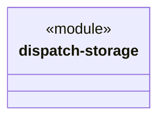

# src/logic/dispatch/rules 架构

## 设计意图

定义派发、岗位和任务状态共同使用的持久化端口。共享 DispatchStore 保持原子一致性，具体文件实现与业务编排分别位于 storage 和 runtime。

## 主要组成

| 组成 | 定位 |
| --- | --- |
| [dispatch-storage](dispatch-storage.ts) | 定义工作区长期岗位、模块责任、来源/文件操作审计以及执行实例、会话和任务派发的原子持久化端口。 |

<!-- architecture:generated:start -->

## 架构关系

[上层设计](../ARCHITECTURE.md)

<!-- architecture:generated:end -->
