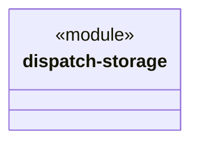

# src/logic/dispatch/rules 架构

## 设计意图

定义派发相关事实的统一读写边界，使业务服务依赖明确事务协议而非磁盘实现。

`dispatch-storage` 组合岗位、责任、任务图、执行登记、来源及操作审计的原子持久化契约。调用方提交变化，由存储实现核实同一前缀的不变量；预算等消费者使用收窄适配，不因共享事务而取得全部写能力。

## 主要组成

| 组成 | 定位 |
| --- | --- |
| [dispatch-storage](dispatch-storage.ts) | 定义工作区长期岗位、模块责任、来源/文件操作审计以及执行实例、会话和任务派发的原子持久化端口。 |

<!-- architecture:generated:start -->

## 架构关系

[上层设计](../ARCHITECTURE.md)

<!-- architecture:generated:end -->
