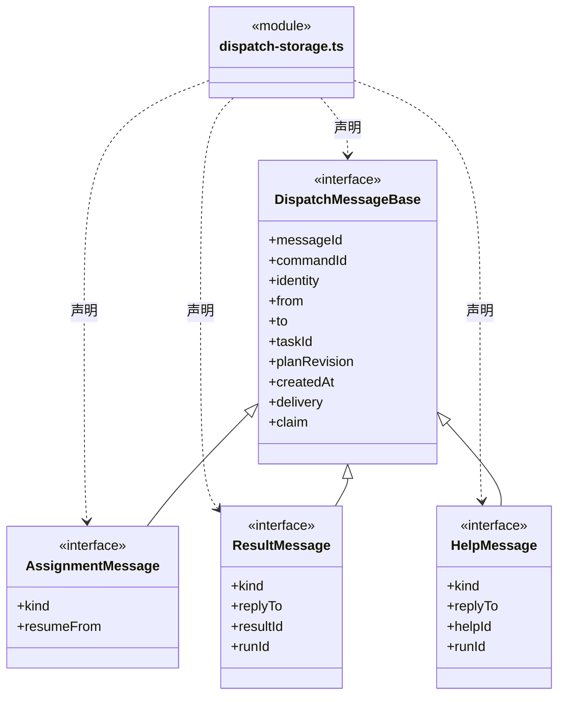
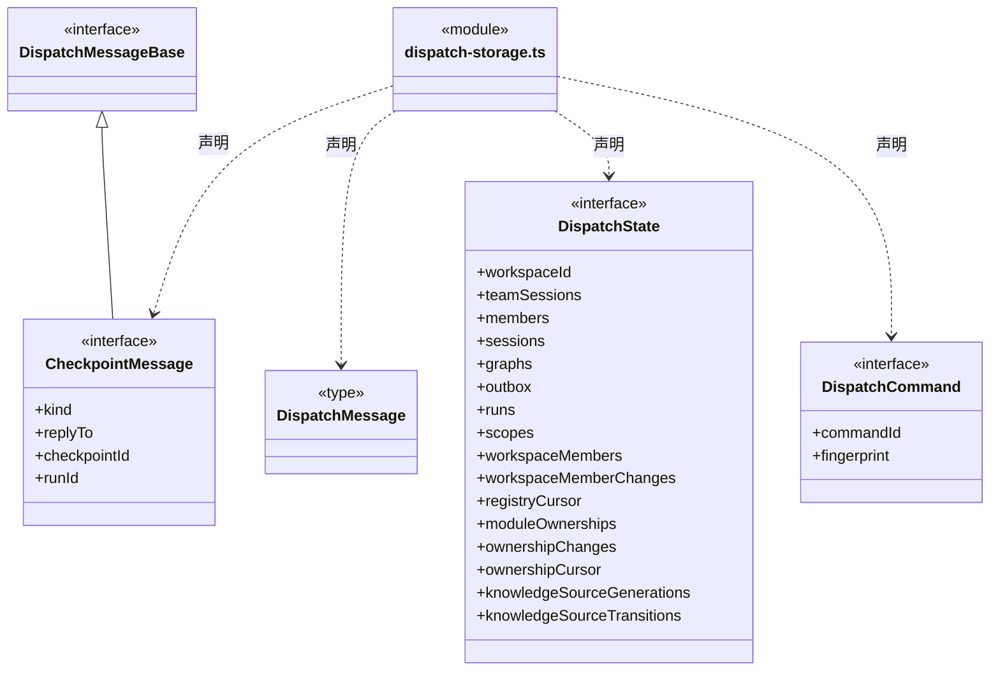
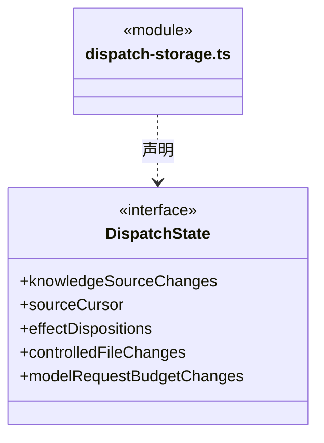
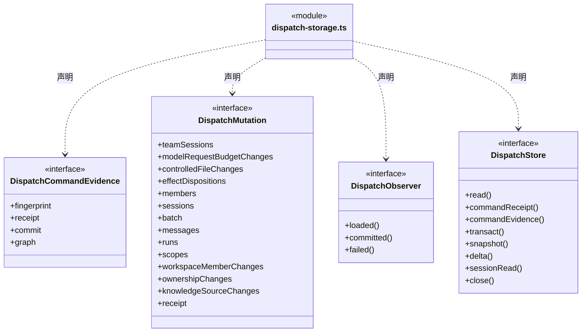

# src/logic/dispatch/rules 架构

## 目录定位

派发存储及命令端口：保持当前宽存储接口和原子性边界。只是明确接口目录，尚未拆分共享 DispatchStore；任务规则仍在 tasks，编排在 logic/dispatch/runtime。

本文描述当前实现。通过分析目录边界后维护的 [源码架构脚本](../../../../scripts/source-architecture.mjs) 同步清单和声明；代码变更时仍须核对职责、关键成员与关系。

## 代码清单

| 文件 | 当前职责 |
| --- | --- |
| [dispatch-storage.ts](dispatch-storage.ts) | 定义工作区长期岗位、模块责任、来源/文件操作审计以及执行实例、会话和任务派发的原子持久化端口。 |

## 架构类图

### dispatch-storage.ts

成员 1/2（同名节点为同一声明，跨图合并阅读）。

成员 2/2（同名节点为同一声明，跨图合并阅读）。

直接依赖：[../../team/rules/agent-types.ts](../../team/rules/agent-types.ts)、[../../team/rules/team-session.ts](../../team/rules/team-session.ts)、[../../tasks/rules/graph-types.ts](../../tasks/rules/graph-types.ts)、[../../tasks/rules/dispatch-execution.ts](../../tasks/rules/dispatch-execution.ts)、[../../tasks/rules/dispatch-scope.ts](../../tasks/rules/dispatch-scope.ts)、[../../tasks/rules/scope-view.ts](../../tasks/rules/scope-view.ts)、[../../tasks/rules/member-checkpoint.ts](../../tasks/rules/member-checkpoint.ts)、[../../team/rules/workspace-member.ts](../../team/rules/workspace-member.ts)、[../../workspace/rules/module-ownership.ts](../../workspace/rules/module-ownership.ts)、[../../workspace/rules/knowledge-source.ts](../../workspace/rules/knowledge-source.ts)、[../../tasks/rules/effect-observation.ts](../../tasks/rules/effect-observation.ts)、[../../file-operations/rules/controlled-file-event.ts](../../file-operations/rules/controlled-file-event.ts)、[../../budget/rules/model-request-budget.ts](../../budget/rules/model-request-budget.ts)。

## 子目录导航

无子目录。

[返回上层](../ARCHITECTURE.md)。

每次修改本目录代码，同步维护文件头、关键契约说明及本图。未实现的治理、证据验收和自动编排能力不列入当前类图。

## 设计契约 v1 与落地范围

以下内容区分已接通能力与后续设计；以各节的实现状态为准，不将目标图当作现状图。维护源：[CONTRACT.md](CONTRACT.md)；生成类图时同步附加，勿直接修改本附录。

# 团队逻辑对话登记

`DispatchState.teamSessions` 和 `DispatchMutation.teamSessions` 保存办公室内的长期对话身份。与主根、成员登记和任务派发共用原子提交；独立控制面已有的严格 mutation 白名单不放宽。旧状态缺省保持缺省，关闭周期不删除登记；消息正文、原生路径和执行授权不进入此表。
