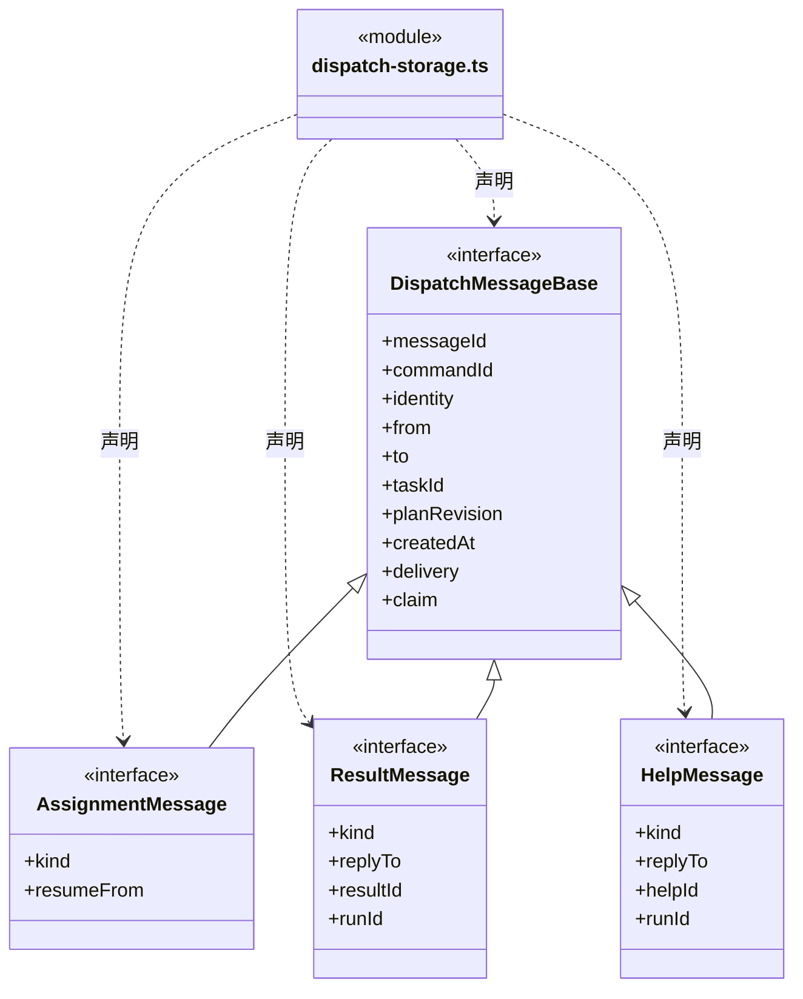
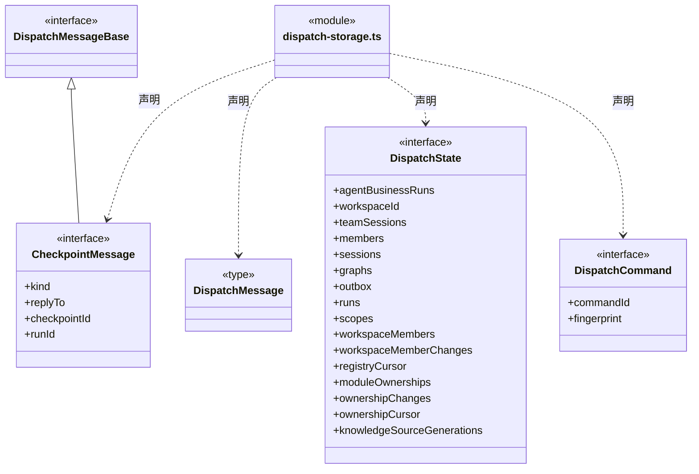
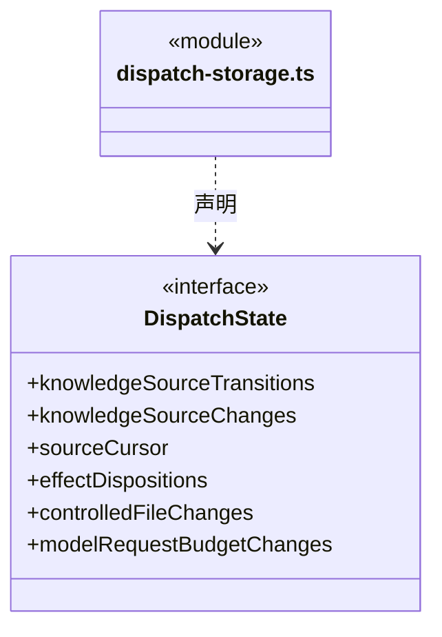
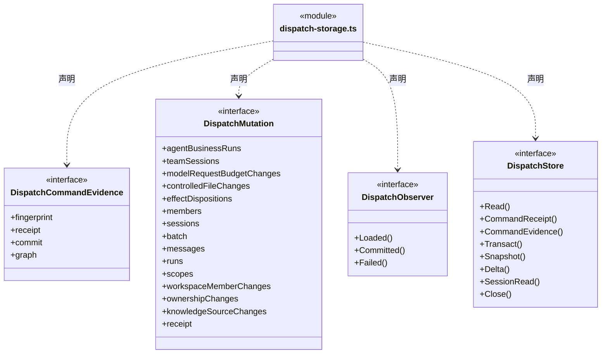

# src/logic/dispatch/rules 架构

本目录只维护这一份说明。设计与契约直接编辑本文；文件清单、类图和导航由 [架构脚本](../../../../scripts/source-architecture.mjs) 更新，生成区域之外的人工说明会保留。

## 封装意图

派发存储及命令端口：保持当前宽存储接口和原子性边界。只是明确接口目录，尚未拆分共享 DispatchStore；任务规则仍在 tasks，编排在 logic/dispatch/runtime。

## 类与模块的设计意图

下表依据源码声明及文件头说明定位封装。字段表示该实例持有的状态或协作引用，不表示它拥有被引用服务的生命周期；实际资源责任和调用限制见下文契约及源码注释。

| 类／模块 | 实现形式与实例字段 | 封装依据 |
| --- | --- | --- |
| [dispatch-storage.ts](dispatch-storage.ts) | 函数／契约模块 | 调度层只表达领域变化，main 负责落盘；任务、领取意图、消息和成员占用一起提交，界面在同一屏障读取图与独立周期投影，观察端口只接收已提交事实。 |

## 接口设计契约

### 团队逻辑对话登记

`DispatchState.teamSessions` 和 `DispatchMutation.teamSessions` 保存办公室内的长期对话身份。与主根、成员登记和任务派发共用原子提交；独立控制面已有的严格 mutation 白名单不放宽。旧状态缺省保持缺省，关闭周期不删除登记；消息正文、原生路径和执行授权不进入此表。

## 开闭边界

本目录的职责及允许协作由[封装意图](#封装意图)限定，输入输出、状态与失败语义以[接口设计契约](#接口设计契约)为准。扩展从已有公开入口及实际装配位置进入；没有明确可替换契约的部分按真实影响修改和验证，不预建未使用的基类或插件入口。

<!-- architecture:generated:start -->

## 文件清单

| 文件 | 形式 | 当前职责 |
| --- | --- | --- |
| [ARCHITECTURE.md](ARCHITECTURE.md) | 说明文档 | 本目录的文件清单、真实声明、依赖与子封装导航。 |
| [dispatch-storage.ts](dispatch-storage.ts) | 源码模块 | 定义工作区长期岗位、模块责任、来源/文件操作审计以及执行实例、会话和任务派发的原子持久化端口。 |

## 架构类图

成员标记：`+` 公开、`-` 私有、`#` 受保护、`$` 静态；`function` 为函数值成员，`get`／`set` 为访问器。调用／构造／索引签名按匿名签名列出，不虚构方法名；`global.` 表示全局声明补充，非运行时嵌套类。构造函数单独列出，运行时私有字段保留 `#`。文档和资源仅在文件清单中导航，不作为代码节点。

### dispatch-storage.ts

[查看源码](dispatch-storage.ts)。

成员 1/2（同名节点为同一声明，跨图合并阅读）。

成员 2/2（同名节点为同一声明，跨图合并阅读）。

直接依赖：[../../budget/rules/model-request-budget.ts](../../budget/rules/model-request-budget.ts)、[../../execution/rules/business-run.ts](../../execution/rules/business-run.ts)、[../../file-operations/rules/controlled-file-event.ts](../../file-operations/rules/controlled-file-event.ts)、[../../tasks/rules/dispatch-execution.ts](../../tasks/rules/dispatch-execution.ts)、[../../tasks/rules/dispatch-scope.ts](../../tasks/rules/dispatch-scope.ts)、[../../tasks/rules/effect-observation.ts](../../tasks/rules/effect-observation.ts)、[../../tasks/rules/graph-types.ts](../../tasks/rules/graph-types.ts)、[../../tasks/rules/member-checkpoint.ts](../../tasks/rules/member-checkpoint.ts)、[../../tasks/rules/scope-view.ts](../../tasks/rules/scope-view.ts)、[../../team/rules/agent-types.ts](../../team/rules/agent-types.ts)、[../../team/rules/team-session.ts](../../team/rules/team-session.ts)、[../../team/rules/workspace-member.ts](../../team/rules/workspace-member.ts)、[../../workspace/rules/knowledge-source.ts](../../workspace/rules/knowledge-source.ts)、[../../workspace/rules/module-ownership.ts](../../workspace/rules/module-ownership.ts)。

## 子目录导航

无子目录。

[返回上层](../ARCHITECTURE.md)。

每次修改本目录代码，同步维护文件头、关键契约说明及本图。未实现的治理、证据验收和自动编排能力不列入当前类图。

<!-- architecture:generated:end -->
