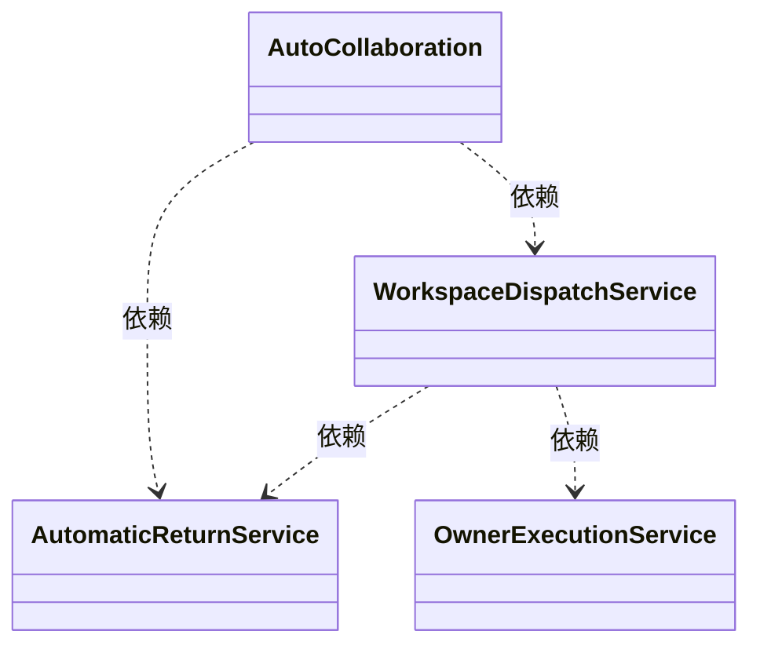

# src/logic/dispatch/runtime 架构

## 设计意图

把目标派发、成员绑定与可靠回传组织成协作过程，使流程策略独立于日志存储。

`WorkspaceDispatchService` 维护派发及会话登记，`OwnerExecutionService` 核实负责人绑定，`AutoCollaboration` 驱动目标周期，`AutomaticReturnService` 保存待接收批次并处理恢复。它们共用注入的事务端口，未知结果和预算耗尽使流程停止，不能借自动接续无限重试。

## 主要组成

| 组成 | 定位 |
| --- | --- |
| [AutoCollaboration](auto-collaboration.ts) | 管理用户任务周期，串接主调度、成员回传、重启后可靠成果接收及最多三轮验收返工；同角色等待不阻断其它角色，未知事实或额度耗尽停止，可靠关闭后释放执行实例。 |
| [AutomaticReturnService](automatic-return-service.ts) | 持久保存主轮待回传批次，重启时核实可自动接收的已完成成员结果。 |
| [WorkspaceDispatchService](dispatch-service.ts) | 工作区的成员注册、主对话实例绑定、主会话派发及任务图查询；主/子逻辑对话随登记可靠保存且跨周期保留，重启仅保留通过完整核实的待回传周期，其余中断封存。 |
| [OwnerExecutionService](owner-execution-service.ts) | 在既有知识、模型和派发存储之间核实岗位执行绑定，为计划、派发、领取和依赖维护提供同一入口。 |

<!-- architecture:generated:start -->

## 架构关系

[上层设计](../ARCHITECTURE.md)

<!-- architecture:generated:end -->
